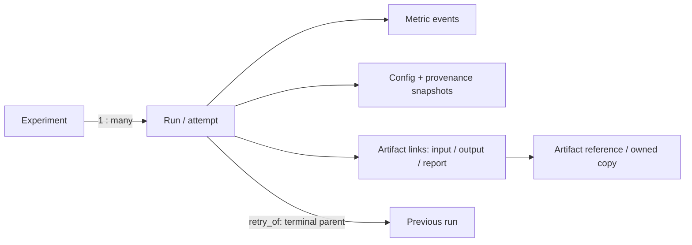

# M2-D-A — Experiment Manager Architecture Design

Tarih: 2026-10-19. **Karar: DESIGN GO — local-first, SQLite tabanlı, manuel entegrasyon.**
Bu belge önerilen sözleşmedir. `hyso.experiments` ve aşağıdaki API'ler henüz
uygulanmadı. Production/test/storage kodu yazılmadı; full pytest, CUDA gate,
benchmark veya Experiment Manager smoke çalıştırılmadı.

## 1. Branch / HEAD / working tree

Branch `feature/hyso-models-next`; başlangıç/son HEAD
`da3054ffd6481f5c921103ad0e6fe73a97c3181b`,
`docs: record final benchmark engine quality gate`. M2-C-C raporu commit edilmiş.
Başlangıçta yalnız `tests/test_gradient_accumulation.py` kullanıcı farkı vardı.
Dosyaya yazılmadı/stage edilmedi/geri alınmadı; başlangıç/son SHA-256:
`17b1e7ac85a3af92c28def4389fadb942d4777ab353baca29a2834547e78c10d`.
Index boş; branch/commit/push/checkout/reset/rebase/merge/version değişikliği yok.

İncelenen dayanaklar: [sabit roadmap v1.0](../roadmap/hyso-architecture-roadmap-v1.md),
[35-feature backlog](../roadmap/hyso-performance-backlog-v1.1.md),
[Generic Trainer tasarımı](m2-a-generic-trainer-design.md),
[Trainer final gate](m2-b5-final-generic-trainer-quality-gate.md),
[Benchmark tasarımı](m2-c-a-benchmark-engine-design.md),
[Benchmark final gate](m2-c-c-final-benchmark-quality-gate.md).
M2-C-C'nin1732 PASS/1 mevcut SKIP,160 farklı native CUDA, installed53 tekrar,
minimum/runtime ve19-module packaging sonuçları **geçmiş kanıttır**; bu tasarımda
yeniden çalıştırılmış gibi sunulmaz. Yeni doğrulama yalnız belge/kaynak/Git
inspection ve başlangıç/son dosya hash denetimidir.

## 2. Mevcut HYSo mimarisi

Gerçek dosya ve API inspection bulguları:

| Kaynak | Mevcut davranış; tasarıma etkisi |
|---|---|
| hyso/training/trainer.py: Trainer | Caller model/optimizer/loss sahibidir; fit train_loader, val_loader, epochs, save_last_to, resume_from alır. Tek fit lifecycle; retry fresh Trainer ister. Experiment Manager fit/optimizer/scheduler sahibi olmaz. |
| Trainer.history / fit dönüşü | train_loss, train_acc, val_loss, val_acc listeleri; accuracy **yüzde**, val yoksa None. EMA açıksa validation evaluation_model üzerindedir. LR trace/epoch duration history'de yoktur; bunlar uydurulamaz. |
| Trainer._emit | train_begin, epoch_end, train_end; synchronous callback(event, deepcopy(plain_logs)). Logs epoch, applied_updates, optimizer_attempts, ema_updates, learning_rate listesi, early_stop taşır. Private metoda yeni bağımlılık kurulmaz. |
| hyso/training/resume.py: prepare_save/save_last/restore_checkpoint | Bounded ModularCNN/TensorDataset profile, original epoch budget ve callbacks=() ister. Epoch_end observer checkpoint save'den **önce** çalışır. Manager kayıt işlemi coherent checkpoint üretildiğinin kanıtı değildir. |
| hyso/checkpoint.py | FORMAT_VERSION=1; save_training_checkpoint/load_training_checkpoint mevcut. Loader weights_only=True ve metadata/state validation kullanır. Manager checkpoint serialize/deserialize etmez, bu formatı değiştirmez. |
| hyso/benchmark/runner.py: BenchmarkRunner.run | Resident eager CPU/CUDA inference, registered-state/RNG guard, event/stream scope ve opt-in ayrı memory probe. Disk I/O eklenmez. |
| hyso/benchmark/result.py | Frozen BenchmarkResult.to_dict/to_json/to_csv/to_samples_csv ve compare_results. Schema1, safe explicit exports; to_json varsayılan no-clobber. Public from_json/load_json API'si **yoktur**. |
| hyso/benchmark/__init__.py | Yalnız BenchmarkRunner, BenchmarkResult, compare_results exports. Manager bunları yeniden implement etmez. |
| tests/test_packaging.py / setup.cfg | Gerçek19 production modülü; isolated wheel/sdist/source-byte/legacy/Trainer/replay/benchmark smoke. HYSo0.2.0, Python>=3.10, Torch>=2.2.2, torchvision>=0.17.2; setuptools hyso.* keşfi. |

Mevcut test altyapısı CPU-first tests/pytest.ini, CUDA visibility gizleme,
single-thread/seed fixtures, JUnit identity, failure injection ve ayrı native
CUDA process'leridir. Yeni tracking testleri bunların yerine geçmez.
Private resume/benchmark serializer helper'larını import ederek yeni tracking
formatını eski checkpoint profile'a bağlamak tercih edilmez.

## 3. Experiment Manager sorumluluğu ve sınırları

Manager **kimlik, immutable açıklama, gözlem ve dosya ilişkisi** saklar: hangi
araştırma altında hangi run, config/model/data/runtime, metric ekseni/birimi,
checkpoint/benchmark dosyası, başlangıç/bitiş ve failure domain'i.
Query ile iki run'ın açıklamaları/ölçümleri incelenebilir; otomatik winner yoktur.

Trainer, evaluator veya benchmark engine değildir; model/factory/loader/
optimizer oluşturmaz, callable çalıştırmaz, seed ayarlamaz, gradient temizlemez,
training/resume başlatmaz. `evaluation` kind caller'ın evaluation sonucunu
saklamak içindir; yeni accuracy engine vaadi değildir. Remote execution,
cloud/MLflow/W&B, authentication, registry/plugin, GUI/sweep/profiler ve
otomatik regression/Pareto bu ilk kapsamın dışındadır.

Bağımlılık yönü: tracking core → Python standard library. Trainer ve Benchmark
Manager'a bağımlı olmaz. İleri integration yalnız caller/public sonuçlar üzerinden;
manager storage kodu CUDA probe/synchronize/Tensor.item/model clone çağırmaz.
HYSo root'un mevcut legacy imports'u değişmez; yeni katman ekstra GPU keşfi yapmaz.

## 4. Experiment / Run / Metric / Artifact kavramları

| Nesne | Kimlik/sahiplik | Yaşam ve ilişki |
|---|---|---|
| Experiment | Store içi opaque UUID, display name; manager metadata sahibi | Bir araştırma koleksiyonu; çok run. Aynı isim tekrar edebilir, isim path/unique key değildir. |
| ExperimentRun | Ayrı UUID; tek kind=training/evaluation/benchmark, experiment_id FK | Bir caller çalışma attempt'inin tracking kaydı; model/process'in sahibi değildir. Retry yeni Run'dır. |
| MetricRecord | Run+series+axis coordinate ve event UUID | Immutable finite numeric gözlem. Birim/eksen/source açık; düzeltme eski değeri ezmez. |
| ArtifactReference | UUID, expected byte size/SHA, ingest state ve ownership | Gerçek file referansı veya manager-owned immutable copy. Link role=input/output/report; producer id bilinmiyorsa null. |
| Provenance | Run başlangıç snapshot'ı ve doğrulama statüleri | Kod/model/data/runtime/config açıklaması; provenance kaydı determinism kanıtı değildir. |



Bir artifact birden fazla run tarafından input olarak kullanılabilir; aynı
record'un producer'ı son consumer'a çevrilmez. Link role ile `producer_run_id`
ayrıdır. External file'ın üreticisi bilinmiyorsa current run diye uydurulmaz.
BenchmarkResult.identity.run_id, Manager run UUID'sinden ayrıdır; annotation
ve artifact link'i ile ilişkilendirilir. Manager id checkpoint içine yazılmaz.

İlk sürümde iki runtime sınıfı yeterli: ExperimentManager ve döndürdüğü
ExperimentRun handle. Experiment/Metric/Artifact/summary verileri defensive
plain dict olarak döner; ayrı public dataclass ailesi gerekmez. Dönen dict'i
değiştirmek DB'yi değiştirmez. Handle snapshot'ı runtime model referansı tutmaz.

## 5. Public API tasarımı

**Gelecek API örneği; bugün import edilmez/çalışmaz:**

```python
from hyso.experiments import ExperimentManager

manager = ExperimentManager(root_dir="./hyso-runs")
experiment = manager.create_experiment(name="CNN Attention Comparison")
run = manager.create_run(
    experiment_id=experiment["id"], kind="training",
    config={"model": "ModularCNN", "attention": "eca",
            "optimizer": "AdamW", "seed": 42},
    provenance={"dataset": {"status": "not_collected", "value": None}},
)
run.start()
run.log_metric(name="train/loss", value=0.42,
               epoch=1, unit="mean_loss", source="caller")
run.log_metric(name="validation/accuracy", value=0.91,
               epoch=1, unit="fraction", source="caller")
run.finish(reason="completed")
snapshot = run.to_dict()
manager.close()
```

İlk public exports: **ExperimentManager, ExperimentError**. ExperimentRun bir
factory dönüş handle'ıdır; ayrı constructor/import gerektirmez. Proposed API:

| API | Sözleşme |
|---|---|
| manager.create_experiment(name, request_id=None) | Immutable id/name/created record; defensive dict. |
| manager.create_run(experiment_id, kind, config, provenance=None, redact_paths=(), retry_of_run_id=None, resume_artifact_id=None, request_id=None) | Validated/sanitized snapshot; ExperimentRun handle. |
| manager.get_experiment(id), manager.get_run(id), manager.list_runs(experiment_id, kind=None, status=None, after_seq=None, limit=100) | get_run handle, diğerleri defensive records; indexed bounded read. |
| run.start(request_id=None), finish(reason, request_id=None), fail(code, failure_domain="workload", workload_outcome="failed", request_id=None), interrupt(reason, request_id=None) | State-machine transaction; fresh state/owner check; terminal değişmez. |
| run.log_metric(name, value, unit, source, epoch=None, step=None, step_kind=None, event_id=None) | Keyword-only metadata; committed MetricRecord veya idempotent mevcut record. |
| run.log_metrics(records) | En çok256 kayıt; tek all-or-none transaction. |
| run.read_metrics(name=None, after_seq=None, limit=1000), run.to_dict() | Bounded snapshot; summary latest/count bilgisinden türetilir, best/winner değildir. |
| run.add_artifact(path, kind, ownership="reference", role="output", producer_run_id=None, metadata=None, request_id=None) | B2'de explicit file ingest; ArtifactReference dict. |
| manager.link_artifact(run_id, artifact_id, role="input"), manager.verify_artifact(artifact_id) | B2: existing metadata link / explicit streaming checksum observation. |
| manager.recover_interrupted(run_id, expected_revision, reason), manager.reconcile_storage() | B2: explicit fencing / bounded pending-artifact inspection; training başlatmaz. |
| manager.close() | Connection/session kaynaklarını kapatır; running kayıtları completed yapmaz. |

Senkron API seçilir; implicit start/finish/context-manager yoktur. Failure
semantiğini gizleyen `with run:` ilk sürümde eklenmez. ExperimentError code,
operation, entity/request/event id, retryable ve commit_state
(not_committed/committed/unknown) taşır. Validation/conflict/storage hataları
ayırt edilir; secret içeren arbitrary exception metni DB'ye otomatik yazılmaz.

## 6. Data model ve schema versioning

SQLite storage schema `PRAGMA user_version=1`; store_meta store UUID ve canonical
encoding version1 taşır. API record envelope `format="hyso.experiment"`,
schema_version=1. Bu tracking versiyonları checkpoint FORMAT_VERSION=1 ve
BenchmarkResult schema_version=1'den **bağımsızdır**; onlara migration uygulanmaz.

Aşağıdaki tablo **şema taslağıdır, storage implementasyonu değildir**:

| Tablo | Temel kolonlar / integrity |
|---|---|
| store_meta | singleton, store_id, canonical_json_version, created_at_utc. |
| experiments | seq INTEGER PK AUTOINCREMENT; id TEXT UNIQUE, name, created_at_utc, request_id UNIQUE, request_hash. |
| runs | seq INTEGER PK AUTOINCREMENT; id UNIQUE, experiment_id FK, kind/status CHECK; immutable config_json/hash, provenance_json/hash; created/started/ended UTC; revision INTEGER; writer_session_id nullable; reason_json, request_id UNIQUE/request_hash. |
| run_events | seq PK; operation_id UNIQUE, run_id FK, revision, from_status/to_status, recorded_at_utc, sanitized reason_json; UNIQUE(run_id,revision) for transition events. |
| metric_series | PK(run_id,name), unit, axis_kind, source; bir kez belirlenir. |
| metric_events | seq PK; event_id UNIQUE, run_id/name FK to series, axis_index INTEGER, optional epoch_context, value REAL, optional caller_observed_at_utc, recorded_at_utc; UNIQUE(run_id,name,axis_index). |
| artifacts | id PK UUID, ownership/kind, producer_run_id nullable FK, original_locator nullable/redacted, managed_relative_path nullable, ingest_state, expected_size/SHA, created/ready timestamps, request_id UNIQUE/request_hash. |
| run_artifacts | PK(run_id,artifact_id,role), FK'ler; relation metadata ve assertion source. |
| artifact_checks | seq PK, artifact_id FK, checked_at_utc, observed status/size/hash veya reason; append-only verification observations. |
| run_attempts (B2) | run_id PK/FK, lineage_id FK, attempt_no, retry_of_run_id UNIQUE nullable FK, resume_artifact_id nullable FK; UNIQUE(lineage_id,attempt_no). |

Tüm ilişkiler aynı store içindedir; foreign_keys=ON, delete RESTRICT. Yeni retry
parent aynı experiment/kind'da failed/interrupted olmalı; cycle önlenir.
Initial attempt_no=1, lineage_id=ilk run id; retry child=parent+1. UNIQUE parent
tek retry zinciri sağlar. Bağımsız araştırma dalları yeni run + artifact input
ilişkisi kullanır. B1'de artifacts/run_artifacts/artifact_checks/run_attempts
tabloları yoktur; retry/resume-artifact parametreleri non-null ise reddedilir.
B2 bunları kontrollü storage schema2 migration'ıyla ekler, mevcut run'lar için
lineage_id=id/attempt_no=1 kayıtlarını oluşturur. Core tabloları yeniden kurmaya
ve unsupported ALTER TABLE UNIQUE eklemeye gerek yoktur; eski core kayıtları
ve exported tracking record schema1 semantiği korunur.

Plain config/provenance: exact dict/list/string/bool/int/finite float/null;
tuple/set/bytes/callable/object/Tensor/module ve default=str/pickle fallback yok.
JSON encoding UTF-8, sorted keys, compact separators, ensure_ascii=False,
allow_nan=False; float/int tipleri korunur. Bu **RFC8785 iddiası değildir**.
Hash sanitized canonical bytes SHA-256'dır; redacted input'un original hash'i
saklanmaz. Config immutable; lifecycle timestamps/reasons config'e eklenmez.

Limits: config+provenance snapshot başına1MiB, depth16, string64KiB;
batch256 metric, query page1000, run başına varsayılan1 milyon metric,
owned artifact varsayılan1GiB. Artifact/event budget gerekiyorsa açık constructor
policy ile artırılır; store policy kaydedilir, sessizce sınır kaldırılmaz.
Bütün artifact/link/reason metadata blob'ları da aynı plain/depth/byte sınırına
tabidir; failure code ve unit/source label'ları bounded/control-character-free'dir.
SQL JSON1/STRICT/RETURNING gibi optional yeni SQLite özelliklerine dayanmaz.

Unknown/newer storage schema fail-closed; normal açılış migration yapmaz.
B2 migration explicit offline `ExperimentManager.migrate_store(root_dir)` ile,
writer'lar kapalı ve SQLite backup API ile consistent backup sonrası çalışır.
DDL + version transaction'ı rollback edilebilir; partial migration testedir.
Backup external artifact dosyalarını otomatik yedeklemez. Core B1 schema1 ve
B2 schema2 ayrımı packaging milestone'unda açıkça raporlanır.

## 7. Run lifecycle/state machine

| Başlangıç | İşlem | Sonuç / invariant |
|---|---|---|
| created | start | running; started_at ve writer_session_id bir kere atanır. |
| created | fail / interrupt | failed / interrupted; preflight/abandoned reason; started_at=null kalabilir. |
| running | log_metric(s), artifact ingest/link | running; transaction revision artar; owner check. |
| running | finish | completed; gerekli output ingest'leri ready, bilinen pending/failed output yok; ended_at atanır. |
| running | fail | failed; domain=workload/tracking/artifact ve sanitized code. |
| running | interrupt / explicit recovery | interrupted; owner revoke, ended_at/reason; workload sonucu unknown olabilir. |
| terminal | start/finish/new metric/config mutation | Reddedilir; önceki committed operation'ın exact replay'i read-only dönebilir. |

Completed, caller'ın belirttiği çalışma ve kayıt akışının başarılı kapanışıdır;
accuracy hedefi, epoch budget'ın bitmesi veya dosyaların sonsuza dek erişilebilir
kalması değildir. EarlyStopping normal başarıdır, reason=early_stopped.
Terminal checkpoint/no-op dönüşünde produced epochs/updates0 olarak belirtilir;
history prefix'i yeni üretilmiş veri gibi kaydedilmez.

Read/reopen eski running kaydını değiştirmez: persisted status running,
writer_liveness=unknown/recovery_required advisory olarak görünür. PID var/yok
ve wall-clock timeout tek başına canlılık kanıtı veya automatic completion olmaz.
recover_interrupted explicit expected_revision CAS ile owner'ı fence eder;
eski handle'ın sonraki write'ı stale-owner hatası verir. Devam eden training
process'ini durdurduğu iddia edilmez; caller önce eski writer'ı koordine eder.

Retry **yeni run UUID**, terminal parent ve ayrı config/provenance snapshot'ıdır.
Tracking kaydını yeniden açmak Trainer resume değildir. Resume artifact input
ilişkisi yalnız hangi byte'ların kullanılmasının istendiğini söyler; loader'ın
plan/state uyumunu doğrulaması Trainer'ın işidir. cancelled state ilk sürümde
gerekmez; explicit interruption reason=user_cancelled yeterlidir, process kill
veya eğitim kontrol API'si eklenmez.

## 8. Storage backend seçimi

| Seçenek | Güçlü yön | İlk sürümde maliyet/sınır |
|---|---|---|
| JSON metadata + JSONL metrics | Stdlib, taşınabilir plain export, kolay streaming append | Metadata/event atomic ortak commit yok; concurrent append/file lock, torn final line, index/recovery/duplicate suppression özel protokol ister. |
| SQLite + artifact directory | Stdlib, transaction/unique/FK, indexed query, rollback journal | Tek writer serialize olur; lock timeout ve DB/FS ortak transaction olmaması yönetilmeli; local filesystem varsayımı gerekir. |
| Yalnız file/directory per event | Basit file görünürlüğü, küçük örnekte kolay | Çok file, directory scans, metric ordering/query ve cross-record integrity pahalı; reliable concurrency yine ayrı protokol. |

**Seçim: SQLite, rollback journal DELETE, synchronous=FULL, foreign_keys=ON,
bounded busy_timeout=5000ms; local dedicated root.** WAL ilk sürümde seçilmez;
checkpoint/WAL lifecycle ve network-filesystem beklentisi eklenmez. Her mutation
kısa BEGIN IMMEDIATE transaction'dır; hash/copy/training DB lock'u içinde değil.
SQLite atomicity/durability yine OS/filesystem/hardware davranışına bağlıdır.
Network share/OneDrive senkronize live DB üzerinde concurrent writer desteklenmez;
önerilen root senkronize olmayan local disk'tir. Kod repository'sinin OneDrive'da
olması canlı experiment DB'sini oraya koyma gereği doğurmaz.

JSON/JSONL primary storage seçilmedi: iki ayrı persistence authority ve bozuk
son JSONL satırını sessizce atma politikası yoktur. Gelecek JSONL export artifact
olabilir; DB'ye auto-import/replay/repair edilmez. İleride JSONL primary backend
istenirse ayrı schema, append-lock/torn-record recovery tasarımı gerekir.

Önerilen layout:

```text
hyso-runs/
  experiments.sqlite3
  .staging/<generated-artifact-id>.part
  artifacts/<generated-artifact-id>/payload
```

Display names, config ve caller path'leri managed destination üretmez. List/query
seq cursor ile bounded ve deterministic'dir; live pagination concurrent insert
için long-lived snapshot garantisi değildir. Summary derived query'dir;
ikinci mutable summary JSON/index dosyası tutulmaz.

## 9. Filesystem/atomicity/crash safety

DB ilk açılışında boş/recognized dedicated root ve schema doğrulanır; random
dosya veya corrupt DB otomatik silinip yeniden yaratılmaz. Init DDL ve
user_version tek transaction; iki creator SQLite lock/unique ile serialize olur.
Unsupported/newer schema ve integrity hataları açık storage error verir.

| Hata / interruption | Politikası |
|---|---|
| Program normal close, açık running | Otomatik completed yok; committed metrics korunur, caller terminal status'u açık seçer. |
| Commit öncesi crash/kill | SQLite rollback journal ve transaction boundary; all-or-none iddiası supported local FS içindir. |
| Commit sonrası ACK kaybı | commit_state=unknown; request/event id ile read-back/idempotent retry; kör duplicate append yok. |
| Power loss / device failure | FULL/fsync best effort; OS/drive flush'ı ve directory durability evrensel garanti değildir. Gerçek power-cut testi yapılmadan “power-loss safe” denmez. |
| Disk full / PermissionError / lock timeout | Bounded error, transaction rollback/read-back; geçmiş kayıtlar silinmez, success uydurulmaz. |
| Corrupt metadata/metrics/DB | Fail-closed, offending record/id/path güvenli diagnostik; otomatik truncate/repair yok. Backup/inspection ayrı operator işi. |
| Artifact ingest yarıda kaldı | pending/staged/failed record ve staging/orphan envanteri; ready olmadan consumer'a usable denmez. |
| File kayıp/değişmiş | verify_artifact yeni missing/mismatch/unreadable observation yazar; expected hash/history değiştirilmez. |

Windows'ta açık dosya/AV/indexer os.replace/link'i reddedebilir; açık file
handle kapanmadan publish yok. Son path'e no-clobber publication, source ile
aynı trusted managed filesystem'de staging; unsupported hard-link/replace
capability açık hata verir, copy-overwrite fallback yapılmaz. Retry explicit ve
bounded; old caller file'ın üzerine yazmak için permission artırılmaz.

SQLite transaction artifact filesystem'iyle ortak atomic değildir. B2 copy
ingest: (1) unique id/pending reservation+link commit, (2) source'u stage'e
stream-copy/hash, flush/fsync/close, (3) expected hash/size ile staged commit,
(4) unique final path'e no-clobber publish, (5) ready commit. Her DB commit
reservation/owner fence'i kontrol eder. Hash bilinmeden kalmış staging orphan
karantinada kalır; staged+final matching ise explicit reconciliation ready
yapabilir. Mismatch adopted olmaz. Recovery eski running'i completed yapmaz.

Recovery sırasında gecikmiş eski writer'ın filesystem orphan bırakması tamamen
önlenmiş sayılmaz; DB-ready commit fenced'dir ve UUID path caller dosyası değildir.
Terminal run'ın state/config/metric'leri immutable; önceden reserved artifact
ingest'inin recovery/availability observations'u ayrı audit kaydıdır. Bu durum
terminal run'a yeni output icat etmek için kullanılmaz.

Bilinen failed ingest ilk sürümde aynı artifact slot'unda yeniden başlatılmaz;
caller run'ı failure_domain=artifact ile kapatır. İleride başka bir run başarılı
dosyayı açıkça ilişkilendirebilir; failed record/history korunur. Pending/staged
belirsizliği reconcile edilebilir, ancak bilinen failure otomatik success'e
çevrilmez. Bu sınır yeni-workload retry ile aynı şey değildir.

## 10. Artifact ownership ve güvenlik

**reference**: var olan regular file'a doğrulanmış locator/hash/size kaydı;
file caller'a aittir. **copy**: yeni UUID managed path'e byte-identical owned
copy; source'a yazılmaz. Hash almak explicit streaming I/O'dur; model load yok.
Kaynak closed/quiescent olmalı; fstat önce/sonra kontrolü değişimi yakalamaya
yardımcıdır, hostile concurrent modification'a karşı tam snapshot garantisi değil.

Reference ingest hash sonrası bir metadata/link transaction'ıyla ready olabilir;
sonradan değişmesi expected hash'i değiştirmez. Owned copy final immutable'dır,
dedup/content-addressed GC ilk sürümde yoktur. Reader metadata'yı almak için
GB'lık file'ı otomatik rehash etmez; last_checked_at ve current_availability=unknown
ayrılır. Explicit verify_artifact fresh observation verir. Producer claim,
checkpoint'in belirli epoch/modeli içerdiğinin cryptographic attestation'ı değildir.

Kimlikler manager-generated lowercase UUID hex; display name dosya adı değil.
Caller managed target/relative path seçemez. Path traversal/NUL/absolute target
override reddedilir. Source reference explicit şekilde root dışında olabilir;
bu yalnız referans yetkisidir, delete/overwrite yetkisi değildir. Stored original
locator varsayılan redacted/null olabilir; operational locator gerekirse explicit
consent ile sensitive local DB alanında tutulur, query/export'ta gizlenir.

Symlink, junction/Windows reparse point ve component escape denetlenir;
resolved containment yalnız string prefix ile yapılmaz. Trusted dedicated root
ve non-hostile same-user filesystem varsayılır. Python3.10 cross-platform API ile
tam race-free no-follow sandbox iddiası yoktur; adversarial root/symlink race
destek dışıdır. Untrusted checkpoint yalnız bytes'tır: pickle/torch.load,
code evaluation, automatic model construction veya external command execution yok.

V1'de hard delete/prune API'si yoktur. Gelecek experiment deletion en fazla
tracking metadata/owned copy policy'siyle ayrıca tasarlanır; **external reference
asla silinmez**. İlk reconciliation envanter/karantina üretir, otomatik recursive
delete/GC yapmaz. Backup'ın referanslı external dosyaları koruduğu varsayılmaz.

## 11. Configuration/provenance/reproducibility

Run create sırasında config/provenance defensive canonical snapshot ve hash
alınır; sonradan edit yoktur. Hatalı config için yeni run gerekir. Snapshot:
model name/class/config, dataset descriptor/fingerprint, optimizer/group hyperparams,
scheduler/budget, precision, seed, batch, epochs, accum_steps ve requested/resolved
device gibi **caller'ın plain olarak bildirdiği** alanları içerir.
Module/optimizer/loader nesnesinden keyfi __dict__/repr/pickle scraping yapılmaz.

Her optional provenance ölçütü `value/status/reason/source` ile açıklanır:
provided / observed / not_collected / redacted / unknown. Python/HYSo/Torch
package version stdlib metadata ile alınabilir; Torch runtime/device sorgusu
yapılmaz. Git revision, dirty tree, model/data/source SHA biliniyorsa caller
sağlar; branch/revision veya dataset hash uydurulmaz. Dataset path hash'i veri
content hash'i değildir. Model checkpoint SHA dosya kimliğidir, BenchmarkResult
weights_sha256 ile aynı hash yöntemi olduğu varsayılmaz.

UTC create/start/end timestamps process wall clock gözlemidir; ordering için
DB seq/revision kullanılır. Monotonic tracking elapsed yalnız aynı process/session
aralığında anlamlıdır; restart'ta devam ettirilmez, GPU/epoch duration sayılmaz.
Config/seed/hash eşliği exact resume veya farklı runtime'da aynı accuracy/ms
garantisi değildir. Redaction gerekli ayarları gizlediyse reproducibility
completeness=partial açıkça gösterilir; reproducible=True otomatik verilmez.

Sensitive handling: önce plain type/size/depth validation, sonra explicit JSON
Pointer redact_paths ile sanitization. Secret/token/password/api_key/auth gibi
anahtarlar redaction uygulanmadıysa varsayılan reddedilir. Redacted alan
null+status/reason ile işaretlenir; raw config/hash/exception secret'ı diske
yazılmaz. Serbest metin/path içine gizlenmiş bütün sırların bulunacağı iddia
edilmez; caller allowlist/minimization sorumludur. Full env, argv, hostname,
username, dataset path ve traceback otomatik toplanmaz. Root permissions/ACL
caller'a aittir; local storage encryption/auth/sandbox anlamına gelmez.

## 12. Generic Trainer entegrasyonu

**İlk sürüm: manual integration.** Caller run'ı start eder; mevcut Trainer'ı
kendisi kurar ve callbacks=() ile fit eder. Normal dönüşten sonra history'den
bounded metric batch'leri loglar, bitmiş checkpoint'i reference/copy olarak
ilişkilendirir, sonra finish eder. `save_last_to` ve `resume_from` yalnız
Trainer.fit'e gider; Manager bunları otomatik çağırmaz veya v1'e alan eklemez.

| Mevcut history | Tracking mapping |
|---|---|
| train_loss | train/loss, unit=mean_loss, source=trainer_history |
| train_acc | train/accuracy, unit=percent; **100'e bölme/0–1 varsayımı yok** |
| val_loss / val_acc | validation/loss / validation/accuracy; mean_loss / percent; None ise numeric event yok |
| learning rate / duration | History'de yok; yalnız caller gerçekten ölçüp verdiğinde ayrı source/axis/unit ile loglanır. |

Epoch'lar history index+1; public returned history full prefix taşıyabilir.
Resume attempt'te önceki epoch'lar yeni attempt tarafından üretilmiş sayılmaz:
caller'ın doğrulanmış completed_before_fit sınırından sonraki index'ler loglanır.
Bu sınır bilinmiyorsa restored prefix'i yeni-produced history diye import etme;
history artifact/source annotation olarak sakla. Resume loader/plan validation
ve original epoch budget Trainer'a aittir; private resume helper kullanılmaz.

Failure orchestration açık olmalı: training exception → best-effort sanitized
run.fail, original exception tekrar raise; KeyboardInterrupt → interrupt.
Tracking failure ikincil hatası original training exception'ını maskelemez.
Training başarılı ama metric/artifact logging başarısızsa “training failed”
uydurulmaz; persisted fail reason'da failure_domain=tracking/artifact,
workload_outcome=succeeded kullanılabilir. Disk kapalıysa terminal commit bile
yapılamayabilir: eski running kalır, sonra explicit recovery gerekir.
Completed-epoch metric'leri hata öncesi commit edildiyse saklanır; başarısız
fit sonrası mevcut history yalnız observed history'dir, last checkpoint kanıtı değil.

Observer seçeneği mevcut synchronous callback(event, logs) üzerinden teknik
olarak mümkündür fakat ilk integration kapısına alınmaz. Callback exception
propagate eder; epoch_end callback'i coherent save'den önce olduğundan logging
hatası checkpoint yazılmasını engelleyebilir. Checkpoint profile callbacks=()
sınırı gevşetilmez; her step'te disk I/O eklenmez. İleride observer adaptörü
istenirse ayrı non-resume profile/replay ve error-policy test kapısı gerekir.

## 13. Benchmark Engine entegrasyonu

Caller benchmark run'ını start eder; BenchmarkRunner.run çağrısı aynı kalır.
Result döndükten **sonra** public result.to_json ile caller'ın yeni/kapalı export
path'ine yazar; run.add_artifact(kind="benchmark_json", ownership="reference"
veya "copy") ile ilişkilendirir. Optional summary/sample CSV aynı public API
ile explicit üretilebilir; Manager exporter veya timing yazmaz.

Artifact link metadata: benchmark_schema_version=1, gerçek
BenchmarkResult.identity.run_id, varsa source model/checkpoint artifact id,
weights fingerprint method/name ve provenance source=caller. Bunlar Manager
run UUID'sini değiştirmez. Result JSON canonical full record'dur; bütün raw R×N
samples metric_events'e çoğaltılmaz. İstenirse pooled mean gibi az sayıda summary
metric, açık timing scope/source/unit ile ayrıca loglanabilir; latency-derived
rate sustained FPS diye etiketlenmez.

Manager live modeli/BenchmarkResult instance'ını DB'ye koymaz. İlk artifact
registry bytes/hash kaydeder; JSON içinde id/schema association'ı caller claim'i
olarak işaretlenir, arbitrary artifact'e engine-valid damgası verilmez. Public
JSON loader varmış gibi `BenchmarkResult.from_json` çağrısı önerilmez. Mevcut
constructor BenchmarkResult(data) plain-data validation yapabilir, fakat trusted
dosya okuma/parser/provenance tasarımı yapılmadan otomatik reconstruction katmanı
eklenmez. Karşılaştırma ilk aşamada caller'ın elindeki live Result'larla yapılır.

compare_results(a,b) mevcut compatible/incompatible/insufficient_metadata
anlamını korur. Caller plain report'u finite JSON artifact olarak saklayıp
iki input benchmark artifact id'sine bağlayabilir; Manager compare_runs/winner
API'si eklemez. Memory disabled/measured, baseline/cache ve unverified process
isolation eligibility'si yeniden yorumlanmaz. Run metadata/artifact I/O timing
event aralığına veya memory probe'a girmez; peak reset politikası değişmez.

## 14. Metric logging semantics

| Konu | Kesin ilk sürüm politikası |
|---|---|
| Name | En çok128 ASCII karakter; harfle başlayan alnum/underscore/dot/hyphen component'leri slash ile ayrılır; boş component, control char ve dot-only segment yok. Filesystem path değildir. |
| Unit/source | Zorunlu bounded plain string. Aynı run/name series boyunca immutable; loss/percent/fraction/ms/s/LR karıştırılmaz. Source=caller/trainer_history gibi açık origin; arbitrary callback değildir. |
| Value | Native finite float veya float64'te exact temsil edilebilir native int; bool/NumPy scalar/Tensor/NaN/Inf reddedilir. Mutlak integer değeri>2^53 reddi sessiz precision loss'u önler; conversion caller işidir. |
| Primary axis | epoch=N (1-based) **veya** step=N + explicit step_kind=applied_update/optimizer_attempt/microbatch/observation (nonnegative signed64). Step ile epoch birlikteyse epoch yalnız context'tir, primary step'tir. |
| Observation-only | step_kind=observation + caller index; implicit unkeyed duplicate event yok. Event DB seq'si bilimsel training step'i değildir. |
| Series identity | (run_id,name); unit/axis_kind/source ilk kayıtta belirlenir. LR group'ları ayrı name, ör. learning_rate/group_0. |
| Duplicate | Aynı natural coordinate ve aynı semantic payload → mevcut record/id döner; farklı value/unit/source/context → conflict, overwrite yok. Explicit event_id de unique/idempotent olmalı. |
| Out-of-order | Yeni coordinate series max axis'inden büyük olmalı; küçük yeni index reddedilir. Önceden committed coordinate'in exact retry'si max'ten küçük olsa da idempotent read'dir. Farklı series bağımsız interleave olabilir. |
| Time | Caller observed_at opsiyonel, server recorded_at ayrı; UTC wall time axis index yerine geçmez. Manager elapsed tracking scope'tur. |
| Batch | ≤256, validate-before-write, bir transaction. Bir invalid/conflicting kayıt varsa bütün batch rollback; partial batch success yok. |
| Failure/terminal | Committed events kalır; failed run için erase yok. Terminal'e yeni event eklenmez; exact committed operation replay'i yeni write değildir. |

Idempotency semantic payload'ı name/value/unit/source/axis/context ve varsa caller
observed_at içerir; server timestamp/seq/generated event id karşılaştırma dışıdır.
Aynı event id farklı run/payload için conflict'tir. Aynı numeric coordinate'de
birden fazla gözlem isteniyorsa ayrı observation axis veya açık farklı series
gerekir; timestamp oynatarak eski değeri düzeltme yoktur. Null validation metric
numeric0'a çevrilmez; val yokluğu config/history artifact'ta açıklanır.

## 15. Performance overhead politikası

Config/provenance başlangıçta bir kez; public Manager API içinde model/Tensor
clone veya runtime RNG/seed/GPU sync yoktur. İlk manual profile metric'leri fit
sonrası epoch batch'leriyle kaydeder; gerçek zamanlı streaming vaadi verilmez.
Step logging explicit caller tercihidir ve maliyeti caller'a görünür; her step
FULL commit default entegrasyon değildir.

Transaction bounded batch/query; event budget dolunca açık limit error, silent
drop/truncate yok. Artifact hash/copy streaming ve lock dışı; gereksiz whole-file
RAM buffer yok. Büyük raw benchmark samples artifact'ta tutulur. SQLite boyutu
ve disk full izlemi caller'a aittir; automatic vacuum/prune eğitim sırasında
çalışmaz. Explicit archive/retention ayrı sonraki tasarım olabilir.

Async writer/thread/process/queue ilk sürümde **yoktur**. Dolayısıyla gizli flush
ve accepted-but-unsaved event kuyruğu yok; başarılı return committed record
demektir, OS/hardware durability sınırı ayrıca geçerlidir. I/O overhead'in
ihmal edilebilir olduğu ölçülmeden iddia edilmez. Tracking time ile workload
ve benchmark kernel/event time farklıdır; sabit ms eşiği test edilmez.

## 16. Concurrency ve retry

Independent manager session'ları/process'leri aynı experiment altında farklı
run yaratabilir; short SQLite writer transaction serialize olur, UUID ve unique
request_id collision'ı engeller. UUID generation OS entropy kullanır; Python/
NumPy/Torch global RNG seed/state'e dokunmaz. Caller label/name unique değildir.

Bir running run'ın tek **writer_session_id** sahibi vardır; farklı manager
session'ı mevcut running kaydı okuyabilir ama metric/status mutate edemez.
İlk API handle'ları process/thread-bound ve non-reentrant'tır; inherited/forked
handle kullanılmaz. Concurrent işler bağımsız manager session'ları kullanır.
DB state/owner/revision guard, yalnız in-memory lock'a güvenmez.
Recovery expected_revision ile eski session'ı fence eder; implicit TTL/heartbeat
ve PID-only takeover yoktur. SQLite busy timeout bounded'dır, sonsuz retry yok.

Mutating create/start/finish/artifact işlemlerinde optional request_id UUID;
aynı request ve aynı semantic payload idempotent, farklı payload conflict.
Generated id commit öncesi belirlenir; unknown-commit error onu taşır, caller
read-back veya aynı id ile retry eder. Derived timestamps request hash'e girmez;
ilk committed snapshot authoritative kalır. Validation error partial row bırakmaz.

Training retry parent terminal kalacak şekilde yeni child Run; tek retry zinciri
UNIQUE(retry_of_run_id) ile atomik kurulur. Retry attempt no/op state'i eski
metrics'i değiştirmez. Yeni Trainer/model/optimizer hazırlama ve checkpoint
resume caller işidir; original plan/runtime gereksinimleri Trainer tarafından
korunur. Manager record recovery, training rollback veya deterministic resume
işlemi değildir.

## 17. Test matrisi

Aşağıdakiler **gelecek implementasyon acceptance testleridir, bugün PASS
denmez**. Her test exact persisted records/row count/hash/state ve error code
assert eder; fault injection test davranışını gevşetmez.

| Grup | Somut senaryo | Zorunlu assertion |
|---|---|---|
| Core | Experiment/run create, aynı display name, injected UUID collision | Farklı UUID; unique/FK korunur; collision bounded retry veya açık conflict. |
| Lifecycle | Bütün izinli/geçersiz transitions, repeated request_id | Config/terminal immutable; bir transition event; no double success. |
| Query | Snapshot mutation, pagination, multiple kinds | Defensive copies, stable seq order, page limits; evaluation çalıştırılmaz. |
| Metrics | Epoch ve farklı step_kind; group LR; percent/fraction/loss | Series unit/axis/source immutable; index/context kayıpsız. |
| Metrics | Duplicate same/different payload, out-of-order, bool/Tensor/NaN/Inf | Idempotent row veya conflict; invalid value hiçbir row yaratmaz. |
| Metrics | Batch içindeki son event invalid; crash sonrası replay | All-or-none; committed prefix eski batch'lerden korunur; duplicate yok. |
| Config | Canonical order/depth/size, caller dict mutation, redaction | Hash deterministic; raw secret DB/journal/log/error record'a yazılmaz; unsupported object repr çağrılmaz. |
| SQLite | Held write transaction + ikinci process barrier | Bounded busy error; iki run creation kaybı/duplicate yok; no new skip/xfail. |
| SQLite | Commit öncesi/sonrası process kill, commit/flush/disk-full injection | Yeniden open transaction state tutarlı; unknown ACK read-back; running asla auto-completed değil. |
| Recovery | Foreign writer write, stale revision, fencing + late writer | Rejected; eski metrics/terminal korunur; training cancel edildiği iddia edilmez. |
| Storage | Corrupt/truncated DB, unknown schema, migration failure | Fail-closed/no overwrite; backup/version/history korunur. |
| Artifacts | Reference/copy, missing/changed file, fstat race | Expected hash immutable; correct observed status; source untouched. |
| Artifacts | Her ingest phase'te exception/kill, orphan staged/final | Pending usable değil; correct hash ile explicit reconcile; mismatch quarantine; completed run icat edilmez. |
| Path | Traversal, symlink/reparse/junction, existing destination, Windows PermissionError | Managed containment; no-clobber; external data delete/overwrite yok. Platform-specific test ayrı native kanıt. |
| Trainer manual | Gerçek küçük CPU FP32/FP64 history + checkpoint v1 | Accuracy percent, val None yok sayı; callbacks=(); manager optimizer/scheduler/EMA çağırmaz. |
| Trainer failure | Workload exception + log-failure birlikte; partial history | Original exception korunur; failure domain doğru; checkpoint coherence uydurulmaz. |
| Resume | Yeni attempt, consumed checkpoint, original history prefix, terminal/no-op | Yeni epoch'lar doğru attribution; parent immutable; same total budget; callbacks=() sınırı. |
| Benchmark | Gerçek CPU/CUDA Result→public JSON→artifact | Full samples/schema/reset warning korunur; Manager GPU sync/event/allocator çağırmaz. |
| Comparison | Üç status + ayrı memory; optional source | Public compare_results aynen kullanılır; no loader/winner/significance icadı. |
| State/RNG | Model/grad/buffer/modes + Python/NumPy/Torch CPU/GPU before/after tracking | Exact referans/değer/RNG eşliği; no Tensor clone/seed/forward. |
| Compatibility | Python3.10, current/minimum Torch CPU, Windows ve uygun Linux FS | Installed import provenance, stdlib SQLite capability, metadata/public exports/checkpoint1/Result1 freeze. |
| Packaging | Son wheel+sdist gerçek envanter/source bytes/exclusions | Yalnız eklenmiş gerçek modules; docs/tests/DB/artifacts/weights/cache paketlenmez. |

Concurrency testleri process barrier/ack kullanır; timing yarışını fixed sleep
ile gizlemez. Fault injection sqlite BEGIN/COMMIT ve file write/fsync/link/replace
sınırlarında yapılır; fresh process reopen ile persisted state doğrulanır.
Process kill testi fiziksel power-cut/disk firmware testi diye sunulmaz.
Native CUDA gerçek GPU yoksa PASS/CPU fallback yapılmaz; CPU protocol double
ile donanım kanıtı ayrılır. Baseline identity/skip statüleri yeni JUnit'te korunur.

## 18. Torch 2.2.2 / packaging uyumluluğu

Core stdlib sqlite3/json/uuid/hashlib/pathlib/time kullanır; Torch2.2.2'ye yeni
API bağımlılığı yoktur. Python3.10'da unsupported yeni SQLite/Python convenience
özellikleri kullanılmaz; gerçek bundled SQLite version/capability gelecekte
installed smoke'da kaydedilir. Bu tasarım görevinde SQLite DB açılmadı/çalışan
Experiment Manager veya yeni minimum test sonucu üretilmedi.

Gelecekte minimum existing clean Python3.10/Torch2.2.2+cpu ortamına yalnız son
local HYSo wheel isolated --no-index/--no-deps target'a kurulmalı; create/log/
recover/artifact ve mevcut Trainer/Benchmark public integration smoke repo
dışından provenance ile doğrulanmalı. Clean35 distribution/source hash'leri
önce/sonra denetlenir. Minimum CPU sonucu CUDA kanıtı değildir.

Önerilen üretim düzeni: B1 `hyso/experiments/__init__.py` + `manager.py`;
B2 gerekçeli private `artifacts.py` ekleyebilir. Bunlar **önerilen**, bugün
olmayan dosyalardır. Mevcut19 module B1'de21, B2'de gerekirse22 olur; gerçek
filesystem inventory esas alınır, tests/test_packaging.py MODULES o zaman
additive güncellenir. B3 manuel integration yeni module gerektirmeyebilir.
Root/model exports, HYSo0.2.0 metadata, dependency listesi, checkpoint1 ve
BenchmarkResult1 korunur. sqlite3 stdlib'dir, harici dependency kurulmaz.

## 19. B1/B2/B3 implementasyon planı

| Aşama | Minimal çıktı | Çıkış kapısı |
|---|---|---|
| M2-D-B1 Core Experiment Tracking | İki proposed module; schema1 Experiment/Run, immutable config/provenance, lifecycle/owner/request IDs, bounded metric transactions ve read/query. Artifact/retry recovery API'leri henüz aktive edilmez; unsupported açık hata. | CPU core/metric/validation/transaction/creation-concurrency; exact identity/statü baseline; minimum Python3.10 installed core smoke; packaging inventory. |
| M2-D-B2 Artifacts & Reliability | Explicit schema2 migration, reference/owned-copy, SHA/ownership/links, staged ingest/reconciliation, writer fencing, new-attempt retry ve resume input ilişkisi. | Real failure injection/process-kill/reopen, disk/permission/Windows path ve no-delete tests; old store migration; checksum/terminal/history integrity. |
| M2-D-B3 Trainer & Benchmark Integration | Manual examples/public result mapping, history percent/None/resumed-prefix semantics, explicit checkpoint and benchmark/comparison artifacts. Production Trainer/Runner'a callback/dependency eklenmez. | Gerçek CPU/minimum training+checkpoint/replay ve benchmark export; native GPU state/RNG/no-sync integration; installed wheel/sdist provenance. |
| M2-D-C Final Experiment Quality Gate | Yeni full CPU, mevcut bütün relevant native CUDA, storage/recovery/migration, minimum installed ve final packaging/freeze. | Yeni JUnit/unique scenario sayımı; legacy/checkpoint/benchmark freeze; FINAL GO/PARTIAL/NO-GO. |

M2-D-B1 başarıyla geçmeden B2 storage kompleksliği; B2 reliability geçmeden
integration convenience veya background writer eklenmez. B1 proposed public
contract'ın yalnız core altkümesini uygular, henüz desteklenmeyen method
çalışıyormuş gibi sunulmaz. Bu aşamalar 35 performans özelliği için yeni
implementation fazları değildir; Experiment Manager tamamlanmadan o backlog'a
başlanmaz. Deney yönetimi bu sonuçları ileride generic artifact/metric/source
annotation ile ilişkilendirebilir, metric hesaplamalarını sahiplenmez.

## 20. Bilinen riskler

Local FS/SQLite locking ve OS/drive durability sınırı, SQLite+artifact iki
resource commit açığı, hash sırasında source mutation, symlink/reparse TOCTOU,
disk budget ve secrets'ın free text içinde saklanması başlıca risklerdir.
Trusted dedicated root, immutable managed publish, short transaction, explicit
unknown state, no overwrite/delete ve future failure tests ile sınırlandırılır;
hostile multi-user sandbox veya tam power-loss guarantee iddia edilmez.

Manual logging real-time değildir ve failed fit'te son epoch gözlemleri
eksilebilir; eksik metric0 diye tamamlanmaz. Resume history attribution ve
epoch_end-before-checkpoint sırası yanlış korelasyon üretebilir; callbacks=()
korunur, imported/restored history yeni-produced veri gibi işaretlenmez.
Caller-supplied config/data/producer/isolation açıklamaları verified execution
kanıtı değildir. Tracking corruption'tan training/model rollback türetilmez.

35-feature backlog P01–P35 tam/tekil olarak incelendi: **1 implemented,
4 partial,30 planned**; bu belge durumları değiştirmez. P09 allocator scope'u,
P01/P08/P11/P29 partial sınırları ve sabit v1.0 korunur. Bu tasarım accuracy,
quality regression, profiling/sweep/edge/energy implementasyonu değildir.

## 21. DESIGN GO / NEEDS REVISION

**DESIGN GO — bounded local tracking architecture.** Identity/config/metric
ownership, SQLite transaction/key/query seçimi, explicit lifecycle/recovery,
new-run retry, artifact iki-resource safety ve caller-managed Trainer/Benchmark
entegrasyonu açık ve test edilebilir. Unknown/durability/reproducibility sınırları
success veya training-resume garantisiyle karıştırılmıyor. Remaining reliability
işleri B1/B2/B3 acceptance gates'idir; bugün uygulanmış veya test edilmiş sayılmaz.

Bu görevde yalnız bu yeni tasarım raporu oluşturuldu. Başlangıçtaki128 tracked
dosyanın byte hash'leri korundu; production/test/metadata/roadmap/backlog aynı,
kullanıcı farkı aynı SHA'dadır. Full pytest/CUDA/package build/Experiment Manager
runtime testi yapılmadı. Commit/push/version/dependency/install/download/release
yoktur. `git diff --check` ve Git/index/hash kontrolleri tasarım doğrulamasıdır.

## 22. Sonraki görev önerisi

**M2-D-B1 — Core Experiment Tracking** ile başlanabilir: proposed namespace,
SQLite schema1 init/version checks, immutable sanitized config/provenance,
Experiment/Run lifecycle ve session guards, bounded/idempotent metric records,
deterministic read/query ve failure-injection CPU tests. Önce bu küçük çekirdek
ve minimum installed packaging kapısı tamamlanmalı; artifact copy/recovery B2,
manuel public integration B3 ve bütün-suite kalite kapısı D-C olarak kalmalıdır.
Bu tasarım onayı Experiment Manager'ın bugün çalıştığı, yeni runtime GO veya
yayın onayı anlamına gelmez.
