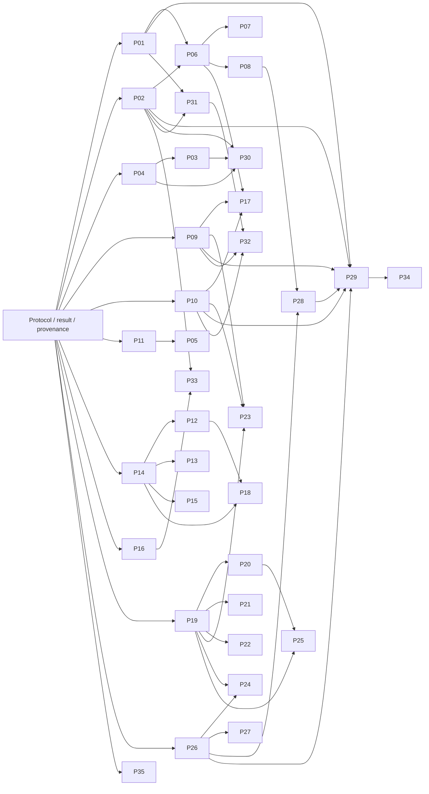

# HYSo — M2-P-A: Advanced Performance Engine Architecture (P01–P35)

2026-10-20, Europe/Istanbul. **DESIGN GO**: aşağıdaki sınırlı sözleşmeler ve
doğrulama kapılarıyla implementation planı uygulanabilir. Bu karar implementation,
native test, performans üstünlüğü veya release onayı değildir. Bu görev yalnız bu
belgeyi oluşturur; production, test, dependency ve backlog değişikliği içermez.

## 1. Kaynak ve çalışma ağacı

- Branch: `feature/hyso-models-next`.
- HEAD: `41c854b4ed79dd2fa0519608a8770790b2684cf8`,
  `docs: record final experiment manager quality gate`.
- M2-D-C2 raporunun son commit'i bu HEAD'dir; rapor tracked ve commit edilmiştir.
- Başlangıç index boş; tek mevcut fark `tests/test_gradient_accumulation.py`
  (0 ekleme, 2 silme). Kullanıcı farkı korunur. SHA256:
  `17b1e7ac85a3af92c28def4389fadb942d4777ab353baca29a2834547e78c10d`.
- Repo içinde `rg --files -g AGENTS.md` sonucu yoktur. Commit/push, branch
  değişimi, checkout/reset/rebase/merge/revert yapılmadı.

Önce [backlog v1.1](../roadmap/hyso-performance-backlog-v1.1.md),
[sabit roadmap v1.0](../roadmap/hyso-architecture-roadmap-v1.md),
[C-C final gate](m2-c-c-final-benchmark-quality-gate.md),
[D-C2 final gate](m2-d-c2-final-experiment-quality-gate-revalidation.md) ve
[C1 allocator investigation](m2-d-c1-cuda-allocator-investigation.md) incelendi.
Ardından yalnız gerekli Runner/Result/Trainer/Manager kaynakları, resume/checkpoint
sınırları, packaging fixture ve metadata okundu. Roadmap v1.0 tarihsel/sabit
durumları güncel M2 audit'leri yerine kullanılmadı; hiçbir roadmap güncellenmedi.

**Geçmiş baseline:** Generic Trainer, Benchmark ve Experiment Manager FINAL GO;
D-C2 full CPU 1995 PASS/1 mevcut SKIP, 162 farklı native CUDA senaryosu PASS,
Torch 2.2.2 CPU installed smoke ve 21 modüllü wheel/sdist PASS. C1'in dört
regresyonu bu baseline içindedir. Bunlar bu tasarım görevinde yeniden
çalıştırılmadı. C-C'nin 160 distinct/162 execution sonucu ile D-C2'nin
162 distinct/164 execution sonucu farklı gate'lerdir; sayılar birleştirilmez.

## 2. Mevcut mimari ve değişmez sınırlar

| Kaynak | Yeniden kullanılacak gerçek kapsam | Koruma sınırı |
|---|---|---|
| `hyso/benchmark/runner.py` | Resident eager model/input; CPU FP32/FP64 host timing; CUDA FP32/AMP FP16 event timing; state/RNG guard; descriptor/hash; logical bytes; ayrı allocator probe | Caller modelini taşımaz; hooks/compiled/quantized/parallel profilleri reddeder; hidden stream/device işi ve concurrent caller desteklenmez |
| `hyso/benchmark/result.py` | Frozen/slots `BenchmarkResult`, validation, linear quantiles P50/P90/P95, derived serial rate, JSON/summary/sample CSV, `compare_results` | Schema1 ve mevcut kolonlar değişmez; comparison yalnız koşul eşliğidir |
| `hyso/training/trainer.py` | Classification/binary loss/accuracy; sample weighted accumulation; `_batch`, `_loss_and_correct`, `_update`, `fit`; scaler/attempt/applied/EMA counters | Public imzalar, history, scheduler/EMA/ES sırası ve checkpoint davranışı korunur |
| `hyso/experiments/manager.py` | Generic metric series, finite values, mevcut axes, immutable config/provenance snapshots, lifecycle; schema2 artifact/retry/recovery | Tracking ölçüm yapmaz; handle tek thread/process'e aittir; yeni store schema1, migration explicit |
| `hyso/training/resume.py`, `hyso/checkpoint.py` | Coherent epoch boundary, strict replay, checkpoint format1 | Save/resume callbacks=() ve destekli loader/model planı sınırı aynen kalır |

P09 implemented; P01/P08/P11/P29 partial; **diğer 30 planned**. Bunlar bu
belgenin bütün tablolarında başlangıç statüsüdür, tasarım yazılmasıyla değişmez.
Kullanıcıdaki kısa başlıklar backlog ile çelişmez; kesin kapsam farkları şunlardır:
P01'de P90 da vardır, P99 yoktur; P02 mevcut derived rate değildir; P09 fiziksel
VRAM değildir; P11 logical byte ile sınırlıdır; P16 GPU busy yüzdesi compute-unit
utilization değildir; P18 sayaç gerektirir; P28 yüzde puan ve göreli yüzdeyi ayırır;
P29 mevcut karşılaştırma quality winner/Pareto/significance değildir; P35 node
execution kanıtıdır. Aşağıdaki tasarım backlog'un bu dar sözleşmelerini esas alır.

## 3. Tercih: küçük analysis katmanlarıyla hibrit mimari

| Seçenek | Kazanç | Maliyet / karar |
|---|---|---|
| A — Runner'ı bütün özelliklerle genişlet | Mevcut guard/timer tek yerde | Kamera, training, ORT ve telemetry resident single-forward sözleşmesine uymaz; schema ve ownership riski yüksek. Seçilmedi |
| B — Bağımsız yeni engine | Yeni protokoller bağımsız | Aynı latency/state/export mantığı kopyalanır, iki doğruluk kaynağı oluşur. Seçilmedi |
| C — Mevcut çekirdek + ayrı analysis/profiler/sweep | Kanıtlı latency ve P09 aynen kullanılır; yeni scope açık | Yeni protokollere küçük typed sonuçlar gerekir. **Seçildi** |

Önerilen `hyso.performance` namespace'i ihtiyaç geldikçe açılır; şimdiden bütün
modüller veya plugin/registry/framework kurulmaz. `inference` mevcut sonuçların
analytics'ini ve yeni sustained/pipeline protokollerini, `sweeps` nokta yönetimini,
`profiling` profiler oturumunu, `training` kapalı varsayılan recorder'ı,
`quality` task değerlendirmesini, `deployment` kamera/ORT oturumunu taşır.
OS RSS ve telemetry yalnız kullanan modülün küçük adapter'ıdır. Ayrı bir
executor/scheduler/veritabanı/REST katmanı yoktur.

Akış: immutable plan → capability kontrolü → gerekli izolasyon/worker → warmup →
ölçüm → completion/drain → model/tensor referanslarını bırakma → plain-data
result → explicit export → Experiment artifact association ve bounded metrics.
Recorder başka ölçüm scope'una kendiliğinden girmez. Parent worker'a canlı CUDA
tensor/model göndermez; yerel factory/artifact recipe ve plain config kullanır.
Windows için spawn uyumlu, import edilebilir factory gerekir; lambda/pickle
edilemeyen closure açık hata verir. Runtime/context parent'tan miras sayılmaz.

### Public API ve result strategy

Aşağıdakiler **önerilen gelecek API**'lerdir, bugün export edilmez:

- `analyze_latency(benchmark_result, *, quantiles, tail_policy)` → `LatencyAnalysis`.
- `measure_throughput(model, input_source, *, protocol)` → `ThroughputResult`.
- `measure_pipeline(pipeline, source, *, protocol)` → `PipelineResult`.
- `run_sweep(model_factory, input_factory, *, axis, points, protocol)` → `SweepResult`.
- `profile_model(model_factory, input_factory, *, protocol)` → `ProfileResult`.
- `training_analysis(trainer, *, protocol)` context'i; içeride mevcut `trainer.fit`
  aynen çağrılır, context kapandıktan sonra `TrainingPerformanceResult` alınır.
- Task/deployment işlerinde explicit `evaluate_quality`, `analyze_tradeoffs`,
  `measure_camera`, `measure_stability`, `measure_energy`, `verify_provider_execution`
  fonksiyonları kendi typed result'ını döndürür. Genel string dispatcher gerekmez.

Her türün bağımsız `format="hyso.performance.<kind>"`, `schema_version=1` alanı
olur. **Bu schema1 BenchmarkResult schema1 değildir.** Yeni payload envelope:

```json
{
  "format": "hyso.performance.latency_analysis",
  "schema_version": 1,
  "result_id": "uuid",
  "feature_ids": ["P01"],
  "protocol": {"id": "resident_tail", "version": 1, "scope": "serial_current_stream_forward"},
  "identity": {"experiment_run_id": null, "source_result_id": "benchmark-run-uuid"},
  "provenance": {"source_revision": "sha", "model_hash": "sha", "input_protocol_hash": "sha"},
  "measurements": {"p99_ms": {"value": null, "unit": "ms", "status": "insufficient_samples", "reason": "tail_policy"}},
  "artifacts": [],
  "diagnostics": {"limitations": [], "warnings": []}
}
```

Her typed result bu zarfı dar bir payload sözleşmesiyle tamamlar; keyfi metrik
torbası public API değildir. Frozen/plain, defensive copy, finite native scalar,
explicit null/status/reason, unknown-version rejection, raw-sample association
zorunludur. Ölçüm `measured`, hesaplama `derived`, tahmin `estimated` olarak
ayrılır; ayrıca `disabled`, `unsupported`, `not_applicable`, `insufficient_samples`,
`failed` durumları bulunur. `failed` nokta taşıyan sweep kısmi sonuç verebilir;
tek ölçümde fatal state mutation başarılı sonuç üretemez.

Yeni türler explicit `to_dict/to_json` ve kendi belgelenmiş CSV kolonlarını
kullanır. Atomic/no-clobber/overwrite, UTF-8, allow_nan=False, quoting/formula
safety mevcut export politikasını izler; Result internallerini public API gibi
import etmez. Gerekiyorsa saf export yardımcıları daha sonra behavior-preserving
ayrılır; ilk milestone'da şart değildir. Eski JSON/48 kolon summary/10 kolon
samples CSV byte/semantik kontratı ve schema1 reader aynen kalır.
`compare_results` yeni tür kabul etmeye zorlanmaz. Yeni comparison payload'ında
eligibility ve analysis decision ayrı alanlardır; eski sonuç referansları korunur.

## 4. Ölçüm dili ve isolation protokolleri

### Scope ve birimler

| Kavram | Kesin anlam / birim | Birbirine dönüştürülmeyecek kavram |
|---|---|---|
| Single inference latency | Resident **batch** forward süresi, ms/batch; batch=1 ayrıca belirtilir | ms/image demek için batch'e bölme latency dağılımını kanıtlamaz |
| Serial service rate | B×N / sum(forward_seconds), images/s, mevcut derived alan | Sustained throughput/FPS değildir |
| Sustained throughput | Ölçülen completion window'unda gerçekten biten örnek / host seconds | GPU event toplamının tersi değildir |
| End-to-end | Aynı ID'nin source/acquisition boundary→postprocess/isteğe bağlı display completion host gecikmesi | Forward latency veya stage toplamı değildir |
| Pre / forward / post | Ayrı host veya event clock stage süreleri, ms/stage | Overlap varsa toplanıp E2E denmez |
| Cold start | Fresh worker import/load/context-init/ilk completion süreleri, ms veya s | Warmup sonrası latency değildir; OS page cache otomatik cold değildir |
| Allocator / physical VRAM | Process-device allocated/reserved byte; driver/device memory ayrı scope | P09 total VRAM/model-only footprint değildir |
| RSS | Process resident physical pages, byte; sampled peak veya OS high-water ayrı | tracemalloc/Python heap, commit/working-set-private ile aynı değildir |
| Footprint | Gerçek serialized artifact byte; unique-object logical parameter/buffer byte ayrı | Logical toplam fiziksel storage/disk değildir |
| FLOP / MAC | Convention ve coverage ile operation count | Süre, trafik ve kullanım yüzdesi değildir |
| Utilization | Tanımlı sensor domain/time interval busy %, CPU core-normalization | GPU busy % Tensor Core occupancy değildir |
| Energy | Sensor power integral J; W güç; J/completed inference | TDP×latency measured energy değildir |

### Ortak kayıt ve protokol profilleri

Her sonuç planında warmup W, repeat R, requested/actual sample count, discarded
sample sayısı ve nedeni, timeout/window, clock ve sync, process/thread/stream
kimliği, CPU thread sayısı/affinity, factory/caller ownership, I/O-transfer sınırı,
allocator/cache/reset durumu, overhead instrumentation, precision/master/input/
output dtype, autocast/quantization, hardware/runtime/driver/OS/library sürümleri
vardır. Bilinmeyen thermal/clock/power alanı null+reason'dır; kilitlenmiş clock
veya sakin cihaz varsayılmaz. Mevcut provenance'e ek bilgi yeni zarfta tutulur.

| Profil | W/R/sample / sync | Isolation, ownership ve kapsam |
|---|---|---|
| L — resident latency | Mevcut varsayılan W=10, N=50, R=3 aynen; tail koşusu explicit daha büyük N ister | Caller model/input guard; CPU perf_counter_ns; CUDA captured current-stream event. Input generation/transfer/state check/statistics/probe dışarıda |
| S — sustained / pipeline | Her repeat ayrı W; explicit positive duration veya tamamlanacak work count; actual completions ve R kaydı | Queue depth/concurrency bounded; setup/disk/DB dışarıda; host monotonic başlangıç ve tail completion; transfer inclusion explicit |
| F — fresh process | Her cold trial yeni spawn, W=0 ilk forward; warm reference ayrı worker phase; bağımsız R | Model/artifact worker-owned, initialization/cache durumu kayıtlı; timeout/process crash ayrı outcome |
| P — profiler / counters | Explicit wait/warmup/active schedule, active call sayısı/R; trace flush dışarıda | L'den ayrı run; profiler/hook overhead flag; worker model; host launch/device event/counter domain ayrı |
| T — training | Epoch/microbatch/attempt/window sayısı; warmup eğitim adımları state'ten silinmez, yalnız analiz dışı etiketlenir | Gerçek update; event buffer bounded, chunk/epoch drain; her step'e yeni sync yok; training data transfer ayrı stage |
| Q — quality | Timing warmup uygulanmaz; N labeled example, split ve seed/trial sayısı | Eval model/EMA seçimi açık; isolated RNG/transform; prediction completion, deterministic ID eşlemesi |
| D — deployment / telemetry | Önceden belirlenmiş warmup/duration/sample interval/R, gap ve timeout kayıtlı | Worker/camera/sensor owner; host/device/sensor clock mapping; overhead ayrı, fiziksel cihaz koşulları explicit |

Bütün matris satırları belirtilen profili ve bu metadata'yı miras alır. Özel
warmup/sample/sync istisnası satırda belirtilir. Her protokolde gerçek timestamp,
count ve ham kanıt tutulur. Measurement overhead ölçülüp raporlanır; latency'den
otomatik sabit maliyet çıkarılmaz. Paired bare/instrumented koşuları ayrı scope
ve tekrarlı koşularla overhead hassasiyetini gösterir. Sıra randomizasyonu ayrı
RNG ile yapılır; caller RNG değiştirilmez.

CUDA L sözleşmesi değişmez: event'ler sample dışında initialize edilir;
her repeat warmup sonrası device drain; start.record(captured stream) → forward →
end.record(aynı stream) → end.synchronize → elapsed_time. Scope
`serial_current_stream_forward`, sync
`repeat_device_drain_and_end_event_sync`. Zero/NaN/Inf clamp edilmez.
Host launch gap event timeline'a girebilir; elapsed pure kernel sum değildir.
Hidden stream/device çalışma destek dışıdır. Yeni P/S protokolleri bunu sessizce
değiştirmez, ayrı result üretir.

## 5. P01–P35 teknik feature matrisi

Kısaltmalar: B=BenchmarkRunner/Result, T=Trainer, E=ExperimentManager;
`—` başka P özelliğine hard bağımlılık yok demektir (ortak zarf/protokol yine
zorunlu). Donanım/dependency sütununda “Torch” mevcut minimum ortamı ifade eder;
başka paket yazmayan satır yeni dependency gerektirmez. Sonuç alanları yeni typed
payload'a aittir; mevcut schema1'e eklenmez. Test/AC sütunu planlanan somut kanıttır,
bu görevde test çalıştırıldığı anlamına gelmez.

| ID / backlog adı | Durum | Reuse | Tam ölçüm / birim ve profil | HW/runtime / ek dependency | Hard P bağımlılığı | Public payload | Hata / unsupported | Doğruluk testi → acceptance criteria |
|---|---|---|---|---|---|---|---|---|
| P01 Inference Latency — P50/P95/P99 | partial | B samples/statistics/export | L raw R×N batch latency; linear P99 ms. Tail policy toplam n≥1000 ve (1−q)n≥10; yetersizde P99 null | CPU/CUDA, Torch | — | LatencyAnalysis: source_result_id, n, p50/p95/p99_ms, quantile_method, tail_count, repeat dispersion | Eksik raw samples, incompatible scope; insufficient_samples | Bilinen [1..1000] için P99=990.01; n=999/null, repeat flatten reference; native stream L korunumu → yeterli sample ve method/provenance ile P99, schema1 değişmeden |
| P02 Real Throughput / FPS | planned | B provenance/precision policy, L reference | S sürekli bounded queue; CPU serial loop veya CUDA stream enqueue; per-forward sync eklemeden host completion-window images/s | CPU/CUDA, Torch | — | ThroughputResult: completed_batches/images, elapsed_s, queue_depth, concurrency, tail_s, rates | Timeout, incomplete tail, duplicate count, hidden streams | Bilinen batch/tail cardinality ve bağımsız completion ledger; native terminal event drain → rate=gerçek completed/gerçek window, derived rate farklı field/scope |
| P03 End-to-End Latency | planned | B model descriptors; P04 stages | S acquisition/read-start→post-complete aynı frame ID; host ms/frame, quantiles | CPU/CUDA, caller source/stage functions | P04 | PipelineResult: per-ID start/end, e2e_ms, queue_wait, included_stages | Clock-domain mismatch, missing/duplicate ID, unresolved completion | Kontrollü stage/barrier ve timestamp sırası; gerçek async tail → E2E aynı örneğe ait, overlap açıklanmış, latency forward diye etiketlenmemiş |
| P04 Preprocessing / Postprocessing Time | planned | Mevcut Torch/torchvision transforms, B clock policy | S/P pre decode/resize/normalize ve post decode/NMS vb. declared işlem listesi; host/event ms/stage ayrı | CPU/CUDA; caller postprocessor, yeni paket yok | — | StageTimingResult: stage/device/clock/count, inclusive_wall_ms, device_ms, overlap | Belirsiz device boundary, unsupported output protocol | Known transform outputs/count/order, CPU timer ve native completion trace; nested/overlap reference → her stage clock+boundary doğru, toplam E2E diye sunulmaz |
| P05 Cold Start & Model Loading | planned | Yerel checkpoint/artifact provenance, E associations | F parent spawn-to-ready, import, deserialize, model-init, CUDA-init, first-forward completion ayrı ms/s; file byte | CPU/CUDA, stdlib subprocess/multiprocessing; yerel artifact | P11 | ColdStartResult: trial phases, cache policy/unknown, process_id, first/warm | Factory spawn failure, load/format error, timeout; page-cache cold garanti yok | Her trial farklı worker yaşam döngüsü, phase order ledger; geçersiz artifact; native context first use → fresh-process gerçek, warm reference ve import-vs-context ayrımı |
| P06 Batch Size Sweep | planned | B run/result, P01/P02, P09 optional | L/S her gerçek batch noktasında bağımsız W/N/R; batch→ms/rate/allocator-byte | CPU/CUDA, Torch; model/input factory | P01, P02 | SweepResult axis=batch, point_id/result_ref/outcome/order | Invalid batch, OOM, failed point; interpolation yok | Nonuniform batch input count, point hashes/W/R; failure continuation; native FP32/AMP → gerçek valid result veya explicit failure her nokta, cross-batch latency compatibility ayrı |
| P07 Resolution Sweep | planned | P06 point orchestration, B | L/S sabit batch; H×W başına gerçek forward, preprocessing/aspect-ratio; kalite varsa ayrı Q | CPU/CUDA, Torch | P06 | SweepResult axis=resolution, H/W/aspect, input hash, result_refs | Geçersiz shape, output semantics değişimi, OOM | Rectangular shapes ve rejected shape; per-point warmup/sample count → shape gerçek ölçülür, quality yokken quality alanı unsupported |
| P08 Precision Benchmark | partial | B CPU fp32/fp64, CUDA fp32/amp_fp16 | L/S precision policy sweep; BF16 capability; INT8 backend recipe; conversion/load cost F'de ayrı | CPU/CUDA Torch; INT8 backend explicit, ORT yalnız seçilirse optional | P06 | PrecisionResult: backend/master/input/output/autocast/quantization/calibration hashes, conversion_s, refs | BF16 device/runtime unsupported, missing calibration, op fallback, silent cast yasak | Existing dtype/master/input guards; native BF16 gerçek forward; INT8 graph/output/backend proof; conversion timer → yalnız doğrulanan precision, P28 kalite ayrı |
| P09 GPU Peak Memory | implemented | B `_cuda_memory_probe` ve validation aynen | L sonrası ayrı tek forward; baseline/previous/peak/current/released allocated/reserved ve incremental byte | NVIDIA CUDA/Torch allocator, mevcut kanıt RTX3060 | — | Mevcut BenchmarkResult.cuda_memory aynen; analysis yalnız ref | Disabled null/no-reset; CPU not_applicable; concurrent allocator/isolation unknown | Mevcut native baseline/reset/output-release, nonnegative exact int, disabled reset0 ve C1 dört weakref regresyonu → mevcut scope korunur; yeni implementation işi yok |
| P10 CPU Peak RAM | planned | E artifact/metadata; B ownership policy | D/F OS process RSS baseline/current ve sampled_peak byte; ayrı OS lifetime high-water; interval/gaps | Windows stdlib ctypes process-memory adapter; Linux /proc adapter; psutil gerekirse optional | — | MemoryResult: rss_samples, sampled_peak, os_hwm, interval, backend/scope | Permission, OS API unavailable; sampled peak kısa transient kaçırabilir; tracemalloc fallback yok | Büyük native CPU tensor allocate/touch/free, process reference; high-water monotonic, gap test → RSS backend gerçek OS değeri; sampled ve exact HWM adları ayrı |
| P11 Model Footprint | partial | B `_counts`, descriptor; E artifact hash/size | Logical unique object params/buffers byte aynen; gerçekten serialize edilmiş artifact stat byte, format/options/hash | CPU; stdlib pathlib/hashlib, Torch serialization | — | FootprintResult: logical fields/ref, serialized_bytes/format/hash; physical_storage null | Missing/changed artifact, sparse/quantized unsupported recipe; alias ambiguity explicit | Tied/cross-category/view reference; temp gerçek dosya stat+SHA ve round-trip → logical≠disk; artifact lifecycle/hash doğrulanmış |
| P12 FLOPs / MACs | planned | B input/model hashes, P14 observed ops | P count exact Conv/Linear formula: MAC=B×out_spatial×Cout×(Cin/groups)×kernel; FLOP=2MAC, bias/elementwise ayrı convention | CPU/CUDA Torch profiler op trace; yeni paket şart değil | P14 | OperationCountResult: macs/flops, per_op, convention, coverage/unknown_ops | Dynamic branch, fused/unsupported ops; uncounted ops zero sayılmaz | Analitik grouped Conv/Linear+bias; unsupported-op graph → coverage kanıtlı, partial lower-bound total explicit; full FLOP claim yalnız complete coverage |
| P13 Layer-wise Profiler | planned | P14 traces, B descriptors | P module path + call index ile inclusive/exclusive host/device ms, shape, allocation event; shared calls ayrı | Torch profiler; module annotation/hooks yalnız worker scope'unda | P14 | ProfileResult.modules: call tree, self/total, correlation/coverage, trace ref | Shared/nested ambiguity, missing module annotation; Runner hook rejection bypass edilmez | Tekrarlanan shared module/nesting model count; exception hook cleanup ve native trace → double count yok; inclusive sum latency diye sunulmaz |
| P14 Operator / Kernel Profiler | planned | B factories/provenance | P CPU op self/total, CUDA kernel durations/count/correlation; host launch ayrı ms | Torch profiler CPU; CUDA activity availability; Nsight/CUPTI tools yalnız optional ayrı adapter | — | ProfileResult: operators/kernels, activity availability, trace checksum/schedule | CUDA activity missing/permission/version incompatibility, truncated trace | Küçük Conv/Linear gerçek CPU trace; native op→kernel correlation ve missing-activity case → profiler run baseline'dan ayrı, raw trace artifact ve coverage var |
| P15 CPU–GPU Transfer Analysis | planned | P14 trace, Torch copy/event | P H2D/D2H byte ve completed-copy ms; byte/s; pageable/pinned/nonblocking; overlap timeline | NVIDIA CUDA Torch; pinned host memory | P14 | TransferResult: direction/bytes/pinning, host_enqueue_ms/device_copy_ms, completed_bandwidth, overlap | Pin failure, unknown transfer size, missing copy event | Gerçek tensor copy round-trip equality; element_size×numel, terminal event; overlapped stream trace → enqueue bandwidth değildir; overlap çift sayılmaz |
| P16 GPU / CPU Utilization | planned | P10 OS adapter boundary, E timeline artifact | D per-process/system CPU time delta / wall; normalize core count açık; GPU busy sensor % timeline | Windows/Linux OS CPU counters; NVIDIA NVML optional nvidia-ml-py; hardware counters ayrıca optional | — | UtilizationResult: sensor/domain/interval, CPU normalization, GPU busy, missing/gaps | Sensor absent/permission/counter reset; Tensor Core counter unsupported null | Native idle/workload queries ve OS/NVML raw timestamps; deterministic counter delta tests → measured busy domain doğru, timer-derived utilization yok |
| P17 Maximum Feasible Batch Size | planned | P06 sweep points, P09/P10 diagnostics | F bounded exponential/bracket search + local refinement; max observed feasible batch ve upper fail/budget | CPU/CUDA Torch, worker memory budget/timeout | P06, P09, P10 | CapacityResult: tested points, feasible_max, upper_failure, search_bound, monotonicity_status | OOM/fatal context worker terminate; CPU host OOM prevention budget; nonmonotonic graph | Gerçek successful forward ve next failed batch veya search-cap; worker crash/OOM recovery → cap hit lower_bound, nonmonotonicta observed max; küresel max iddiası yok |
| P18 Arithmetic Intensity & Roofline Analysis | planned | P12 counts, P14 kernel scope, P15 calibration where relevant | P matched kernel region DRAM/cache traffic byte ve FLOP; FLOP/byte, FLOP/s, GB/s; same hierarchy measured ceilings | Doğrulanmış optional hardware-counter profiler + gerçek device calibration; çoğu CPU/Windows profili koşullu | P12, P14 | RooflineResult: hierarchy/traffic source/FLOP convention/ceilings, empirical_or_estimated, bounds | Counter yok/metric unsupported/replay mismatch → measured roofline unsupported; parameter bytes traffic değil | Kalibre memory/compute workloads, actual counter export/time correlation; known analytic count → same scope+hierarchy+precision; estimate measured diagnosis'a çevrilmez |
| P19 Epoch / Training Step Time | planned | T fit/_batch/_update, counters | T epoch train/validation/lifecycle wall s; microbatch forward+backward ms; accumulation-window/attempt ms ayrı | CPU/CUDA Torch, private opt-in recorder | — | TrainingPerformanceResult: segment/epoch/microbatch/attempt/applied IDs, host/device scopes | Incomplete epoch, recorder fail/overflow buffer, terminal fit no new samples | 5 samples uneven tail+accumulation known ledger; event/order reference; native replay exact state → birim açık, training work inference olarak etiketlenmez |
| P20 Forward / Backward / Optimizer Breakdown | planned | T `_loss_and_correct`, scaled backward, `_update` | T/P forward, loss/check, backward, unscale/normalize/clip, attempted scaler.step, scaler.update, EMA/scheduler/zero_grad ayrı ms | CPU/CUDA Torch; event recording/optional profiler | P19 | TrainingPerformanceResult.stages: attempt/applied/skip flags, host/device ms, overhead | Missing event/correlation, mixed-stream work; stage sums overlap warning | Native true backward/update ve forced overflow/recovery; stage-order trace; skip optimizer duration not zero invented → actual optimizer ran bayrağı ve async scope doğru |
| P21 DataLoader Bottleneck Analysis | planned | T loop, existing loaders, P19 compute | T next(iterator) host wait, transfer ve compute ayrı ms/batch; optional worker decode/transform trace | CPU/CUDA, stdlib/Torch DataLoader; worker instrumentation explicit | P19 | LoaderResult: main_wait, transfer, compute, worker_events/coverage, pin/prefetch/workers | Worker clocks unaligned, unavailable internals; wait worker CPU diye sunulmaz | num_workers=0 deterministic loader; gerçek multiworker spawn/prefetch trace ve order/RNG check → loop semantics aynı, next wait ve service time ayrılmış |
| P22 Training Throughput | planned | T samples/counters, P19 windows | T complete window samples/s, microbatches/s, attempts/s, applied updates/s; tail dahil | CPU/CUDA Torch | P19 | TrainingPerformanceResult.rates: window_s/completed_samples/count deltas | Incomplete pending work/denominator0; overflow samples applied update sayılmaz | Unequal batch tail + accumulation + skipped attempt reference; native terminal drain → actual counts/window; update ve attempt ayrı |
| P23 Training Memory Analysis | planned | P09 allocator policy, P10 RSS, T actual state | T ayrı replay/probe training window allocator/RSS peak; logical params/grad/optimizer bytes, saved activation observations ayrı | CPU/CUDA Torch, OS RSS adapter | P09, P10, P19 | TrainingMemoryResult: logical components, peak scope, state boundary, snapshot/trace refs | Unsupported optimizer state/activation coverage; measured peak için exclusive reset izni yoksa disabled | Gerçek SGD/Adam state allocation öncesi/sonrası; accumulation grad lifetime; native full update peak → component sum RSS/VRAM değil; P09 single-forward değişmez |
| P24 Time to Target Accuracy | planned | P19 segments, P26 quality, T history/evaluation_model | T/Q ilk validation crossing elapsed active-training s, epoch/applied-update; eval inclusive clock ayrıca; right-censored trials | Labeled data, CPU/CUDA Torch; repeated seed runs | P19, P26 | TimeToTargetResult: metric/unit/direction/threshold, first_observed, interval bounds, censoring, trials | Hedefe ulaşmama fail değil censored; eval cadence unequal, resume prefix missing | Kontrollü metric sequence crossing/noncrossing, irregular cadence, resume segments → [önceki eval,ilk passing eval] intervali ve censored süre, best-restore ile yanlış attribution yok |
| P25 Gradient / AMP Diagnostics | planned | T finite checks, native scaler, post-step hook/counters | T unscaled/sample-normalized grad norm/finite preclip, scale before/after, attempted/applied/skipped count | CPU diagnostics; native CUDA AMP for overflow, Torch | P19, P20 | GradientDiagnosticsResult: norm convention, finite, scale, overflow reason/unknown, attempt ownership | Scale drop tek başına executed-step kanıtı değil; sparse coverage/AMP unavailable | Bilinen gradient norm+accumulation tail, native forced inf→skip→recovery; hook cleanup → scaler semantics/RNG/update/EMA/scheduler aynı, extra full grad copy yok |
| P26 Accuracy / Precision / Recall / F1 | planned | T task/label validation örnekleri; sklearn mevcut dependency, Torch | Q task-specific labeled eval; ratio [0,1], confusion count; classification/detection/counting ayrı | CPU/CUDA, caller dataset/labels; mevcut Torch/sklearn, ek paket şart değil | — | QualityResult: task, metric_id/unit/direction/averaging, n, dataset/protocol hashes, task payload | Invalid label/pred, zero division policy, missing class; detection/counter adapter absent unsupported | Bilinen confusion matrix; detection one-to-one IoU matching/tie/duplicate/empty fixture; counting exact/MAE fixture → task-specific contract, ratio ve percent ayrı |
| P27 Robustness Benchmark | planned | P26 evaluator, torchvision transforms | Q aynı sample IDs clean/perturbed metric ve drop; seed/severity corruption curves | CPU/CUDA labeled local set, mevcut Torch/torchvision | P26 | RobustnessResult: paired IDs/hash, corruption/version/severity, metrics/deltas/CI | Non-label-preserving transform, incompatible split/seed, missing pairs | Deterministic identity perturbation drop0; seeded severity/reference labels; reproducible order → paired protocol, uncertainty ve sample n, dayanıklılık genellemesi sınırlandırılmış |
| P28 Quantization / Precision Accuracy Drop | planned | P08 converted variants, P26 same evaluation | Q precision baseline/variant paired quality; signed pp=100(new−base), relative%=100(new−base)/base | CPU/CUDA/backend; local calibration held-out split; ORT optional yalnız recipe seçerse | P08, P26 | PrecisionQualityResult: signed_delta_pp/relative_pct, degradation_pp, variant/calibration/eval hashes | base0 relative null; different preprocess/threshold invalid pair; calibration/eval leakage | Known .8→.75: −5pp, −6.25% (tolerance); base0; same IDs; gerçek INT8/FP16 inference → dönüşüm kanıtı+aynı eval, ratio dışı metric'te pp yok |
| P29 Accuracy–Speed–Memory Trade-off & Regression | partial | B compare_results/export; P01/P09/P10/P26/P28 | Q+L/S ayrı sonuçlardan eligible quality/speed/memory axes, deltas, uncertainty/Pareto; paired baseline/candidate trials | CPU/CUDA, aynı evaluation/protocol; yeni paket yok | P01, P02, P09, P10, P26, P28 | TradeoffResult: axis eligibility, protocol diffs, trial n/CI, Pareto ties/unknown, regression decision/inconclusive | Mismatch/unknown isolation, insufficient trials, multiple comparisons; old comparison winner değil | Synthetic dominance/tie/missing-axis; seeded paired trial bootstrap reference; actual repeated baseline/candidate → yalnız eligible axes, declared variable whitelist, önceden belirlenmiş practical policy; sabit ms/FPS yok |
| P30 Real Camera FPS & Dropped Frames | planned | P03/P04 pipeline, P02 completion count | D gerçek capture/read→pre→transfer→forward→post→optional display; host FPS, age/latency, acquired/processed/dropped/pending | Fiziksel camera; OpenCV veya vendor SDK optional, timestamp adapter | P02, P03, P04 | CameraResult: frame IDs/timestamps, source FPS, completed FPS, queue depth/drop/late/reason, display scope | Camera unavailable/disconnect, sensor clock unknown, unreadable source drop counter | Gerçek kamera slow-consumer/backpressure test; ID conservation, ordering ve terminal flush → source drop ve local drop ayrı; sentetik test tek başına camera validation değil |
| P31 Long-Running Stability | planned | P01/P02 results, E artifacts | D fixed planned duration/cadence workload; windows latency/rate/errors/recovery, actual uninterrupted duration | CPU/CUDA Torch; real target runtime; optional thermal telemetry | P01, P02 | StabilityResult: window series, exposure_s, failure/recovery/gaps, completion | Timeout/crash/thermal unknown; restarts yeni segment, sessiz reset yok | Planlanan uzun native run ve injected controlled failure; full ledger reconciliation → requested duration tamam/explicit truncated, kısa smoke uzun-run kanıtı değil |
| P32 Memory Leak / Memory Growth Analysis | planned | P09/P10/P31, C1 ownership discipline | D warmup sonrası live allocated/RSS trends byte/s; reserved/cache ayrı; repeated windows/snapshots | CPU OS RSS; CUDA allocator; optional snapshot adapter | P09, P10, P31 | MemoryGrowthResult: slope/CI/window n, plateau, live refs evidence, diagnosis status | Insufficient duration, cache plateau/allocator fragmentation; slope tek başına leak değil | Stable fixed workload vs deliberate retained-output worker; snapshot/weakref corroboration; native plateau run → growth ölçümü ve leak diagnosis ayrı, canlı owner kanıtı olmadan confirmed leak yok |
| P33 Power & Energy per Inference | planned | P02 completed window, P16 telemetry handling | D timestamped power integral trapezoid J/window ve J/completed inference; gross domain ve idle-subtracted estimate ayrı | Gerçek NVML power sensor, Linux RAPL energy counter veya harici meter; optional adapter | P02, P16 | EnergyResult: sensor/domain/W samples/J/count/uncertainty/gaps, baseline method | Sensor absent/unsupported Laptop counter, coarse sampling, reset/wrap; no TDP estimate as measured | Analitik sampled waveform integral ve reset/gap test; actual sensor trace/time alignment+workload count → measured yalnız sensor kanıtıyla, idle subtraction model attribution estimate |
| P34 Multi-Device Comparison | planned | P29 eligibility, per-device B results | Aynı protocol gerçek farklı devices üzerinde latency/rate/quality/memory; enerji varsa ayrı axis | En az iki fiziksel device; CPU-vs-GPU valid pair veya ayrı GPU/edge cihaz; runtime adapters | P29 | DeviceComparisonResult: per-device run refs/hw/runtime/precision, eligible axes/differences | Missing physical device, backend/precision mismatch explicit conditional; extrapolation yok | İki native provenance/trace ve same input/eval; missing-device negative → devices gerçek, unknown axis null; aynı GPU farklı logical index multi-device kanıtı değil |
| P35 Execution Provider Fallback Detection | planned | P14 trace association conventions, E artifacts | P/D ORT session graph nodes→actual executed provider; expected/allowed placement ve unexpected fallback count | Optional onnxruntime CPU/GPU build+gerçek supported providers; yerel valid ONNX graph, export işi ayrı | — | ProviderExecutionResult: provider config/available list, optimized graph map, execution events, coverage/unmapped nodes, fallback evidence | Unsupported EP/trace field, fusion/unmapped nodes; list-only insufficient_evidence | Gerçek ORT CPU run, available accelerated EP run ve controlled unsupported-node/explicit placement case; node events correlate → provider listten farklı execution proof; unexecuted branch inconclusive |

## 6. Kritik measurement protokollerinin tamamlanması

### P02 sustained throughput

İlk destek concurrency=1 sürekli in-flight batch akışıdır; eşzamanlılık gerçek
throughput için zorunlu değildir, süreklilik ve completion window zorunludur.
CPU loop tam synchronous completion sayar. CUDA aynı declared stream'de bounded
event/output ring kullanır; her forward sonrası synchronize etmez. Ölçüm öncesi
warmup drain edilir, boş queue'da host t0 alınır. Sabit batch-count veya host
deadline admission kapanana kadar iş kabul edilir; terminal event ile bütün
admitted işler tamamlanınca t1 alınır. Tail flush **paydada** bulunur. Tamamlanan
örnek sayısı gerçek batch cardinality toplamıdır; admission count completion
yerine geçmez. Çıktı doğrulaması/retention politikası sabit, çıktı birikimi
bounded'dır. Count/elapsed equality ve pending=0 başarılı pencere invariant'ıdır.
Deadline'da tamamlanmayan işler censored/failed window yapar, gizlice çıkarılmaz.
Multi-stream/multi-worker ancak ayrı concurrency protokolü ve native kanıtıyla
eklenir; aynı canlı caller modeline concurrency varsayılmaz.

### P30 kamera

Capture adapter monoton frame ID, read-start/read-complete host timestamp ve
varsa sensor exposure timestamp verir. Sensor→host clock mapping offset/drift/
uncertainty doğrulanmamışsa sensor-to-output latency unsupported; host
read-start-to-output ayrı adla geçerlidir. Queue bounded, policy açıkça
block/drop_oldest/drop_newest ve kapasiteyle kaydedilir; late frame tamamlanmış
olabilir, drop ile iki kez sayılmaz. Tek ID bir terminal outcome alır.
Her pencere `pending_start + acquired = processed + local_dropped + pending_end`;
başlangıçta pending=0 ise backlog eşitliği elde edilir. Sensor/driver'da edinilmeden
düşen frame'ler source counter varsa ayrı `source_dropped`, yoksa unknown'dır.
Capture FPS, inference completion FPS ve display FPS ayrı pay/count/timestamp
taşır. Display dahilse callback completion sınırı ve renderer rate limit kaydı
gerekir. Disconnect, reconnect ve queue flush yeni segment olarak görünür.

### P33 enerji ve P35 fallback

Enerji window'u P02 host completion window'uyla hizalanır; sensor intervali,
timestamp belirsizliği, interpolation, missing gaps ve integral kapsamı tutulur.
Counter enerji veriyorsa delta/wrap/reset protokolü uygulanır; Watt samples için
trapezoid integral kullanılır. GPU device gücü CPU/ekran/host toplamı değildir;
RAPL package enerjisi GPU enerji alanına yazılmaz. Idle subtraction ölçülmüş
gross enerjiden türetilen attribution estimate'dir; negatif türetme clamp edilmez,
uygunsuz baseline olarak işaretlenir. Sensör olmadan measured değer null'dır.

ORT provider config/availability ile gerçek execution ayrı evidence alanlarıdır.
Requested provider'ın olmaması config sorunudur; node fallback kanıtı değildir.
Optimized/fused graph mapping hash'i ve profiling execution provider events
saklanır. CPU'ya izin verilen shape/control node'ları explicit allowlist'te olur;
beklenmeyen CPU node yalnız execution kanıtıyla fallback sayılır. Fusion veya
conditional branch yüzünden coverage eksikse “no fallback” yerine inconclusive
denir. Tek CPU EP koşusu accelerated→CPU fallback kanıtı yerine geçmez.

## 7. Trainer entegrasyonu (P19–P25)

Mevcut `_emit` train_begin/epoch_end/train_end observer log'u verir; microbatch,
loss/backward veya next(iterator) sınırlarını vermez. Save/resume callbacks=()
gerektirir (`resume.py:prepare_save`). Observer callback takıp checkpoint
validasyonunu gevşetmek seçilmedi. Yeni public Trainer imzası/history alanı eklemek
yerine `training_analysis` context'i gelecekte private ephemeral recorder bağlar;
fit/_update içindeki az sayıda private boundary bu recorder varsa plain event/
timestamp üretir. Monkeypatch veya optimizer.step'i ikinci kez çağırma yoktur.
Disabled durumda event allocation/timer/sync/extra traversal/I/O yok; aynı
branch dışındaki işlem sırası ve mevcut counter sahipliği aynıdır.

Boundary planı: epoch begin → iterator next wait → `_batch` validation/transfer →
forward → loss/correctness checks → sample-weighted scaled backward → microbatch
commit → accumulation-window update attempt → unscale → sample normalization →
finite/clip → scaler.step → scaler.update → applied/EMA/OneCycle → zero_grad →
train end/drain → validation → epoch scheduler → ES → history → callbacks →
checkpoint → finalize. Forward timer loss/correctness `.item()` maliyetini
forward'a gizlemez. Mevcut `.item()`/finite checks'in zaten yapabildiği host sync
maliyeti kayda geçer; recorder bunlara ek her-step sync üretmez.

- `microbatch_id`, `optimizer_attempt_id`, `applied_update_id`, window_samples ve
  actual batch size ayrı. Son kısa accumulation window toplam gerçek sample'a
  bölünür; accum_steps'e bölünmez. Applied ID skipped attempt'te ilerlemez.
- CUDA stage event'leri sampled microbatch/window'larda bounded buffer'da;
  readout epoch/chunk completion'da. Chunk drain varsa altered scope ve overhead
  metadata'da; bare baseline'a karşılaştırılamaz. CPU host duration ve GPU event
  duration aynı sütunda karıştırılmaz. Hook recording failure context cleanup
  ve explicit analysis failure üretir; devam eden training sonucu için transaction
  rollback iddiası verilmez. Strict policy sonraki güvenli boundary'de durdurur.
- `_update` gerçek optimizer post-step hook'u ve scaler davranışıyla applied
  ownership'i zaten belirler. Recorder aynı kararı dinler; scale before/after,
  finite ve attempt/applied/skip'i gözler. Native overflow/recovery kanıtı şarttır.
- EMA yalnız applied update'te, OneCycle aynı ownership'te; epoch scheduler ve
  EarlyStopping mevcut validation sırasındadır. Analysis bu nesneleri sürmez.
  Evaluation base/EMA model seçimi ve best-weight restoration sınırı kaydedilir.
- DataLoader next süresi ana sürecin beklemesidir; worker decode/augmentation
  service time ancak ayrı worker trace ile ölçülür. Iterator wrapping sampling
  order, generator, worker lifecycle/prefetch davranışını değiştirmemelidir.
  Strict resume hâlen destekli num_workers=0 TensorDataset planıyla sınırlıdır;
  multiworker profiling strict replay desteği vaat etmez.
- Training ölçümü state-mutating gerçek workload'dur; inference gibi başlangıç
  weight'lerine restore edilmez. Disabled/observed paired run'lar aynı seed'den
  başlayıp model/optimizer/scaler/EMA/scheduler/history/RNG/state exact eşliği
  göstermelidir; wall times eşitlik assertion'ına girmez.
- Resume her yeni process/run için yeni `segment_id` üretir. v1 checkpoint'e
  recorder/timestamp eklenmez. Eski epoch/history yalnız provenance'dir;
  tekrar metric/timing üretilmez. Aktif elapsed süreler ancak ilişkili segment
  artifact'ları verified ise toplanır; kapalı süre active-training süresine girmez.
  Eksik prefix varsa cumulative time-to-target null/insufficient_metadata.
  Restore/retry mevcut checkpoint/replay sözleşmesini aynen kullanır.
- Context sonunda event/hook/model/tensor referansları finally ile bırakılır.
  Büyük gradient/activation CPU kopyası normal timing yolunda yapılmaz; diagnostics
  sampling ve ayrı profiler/probe scope'uyla sınırlandırılır.

## 8. Kalite, uncertainty ve comparison

Classification: multiclass predictions [N,C] finite logits + targets int64 [N]
ve class mapping; argmax/tie policy explicit. Binary logits [N] veya [N,1], hard
0/1 targets; threshold logits0/probability0.5 varsayılanı kaydedilir. Multilabel
başlangıçta unsupported. Confusion matrix row=true/column=prediction; per-class
precision/recall/F1, macro/micro/weighted, missing class ve zero-division policy
(null+reason veya explicit0) sonuçta vardır. Accuracy ratio olarak saklanır;
Trainer train_acc/val_acc percent ise explicit /100 dönüşümü ve source unit kaydı
yapılır. Accuracy hiçbir zaman precision/recall yerine kullanılmaz.

Detection ayrı task adapter'ıdır: per-image boxes XYXY absolute pixel, class ID,
score; GT boxes/classes ve explicit ignore policy. Invalid/degenerate boxes ve
unknown labels reddedilir; support edilecek ignore/crowd semantiği declared olur.
Fixed IoU ve score threshold, class-aware one-to-one matching, score-descending
ve deterministic ID tie-break ile TP/FP/FN türetilir. Detection “accuracy”
unsupported; precision/recall/F1 bu match protokolüne aittir. mAP/AP istenirse
ayrı metric ID, IoU grid ve interpolation convention gerektirir; sınıflandırma
F1 içine yerleştirilmez. Counting targets/predictions per-ID scalar finite
nonnegative count; integer/continuous output ve rounding policy açık. MAE/RMSE,
exact-match ve tolerance-match accuracy ayrı; generic precision/recall/F1 ancak
event matching tanımlanmış başka adapter varsa geçerlidir. Mevcut Trainer'a
detection/counting training desteği eklenmiş sayılmaz.

Her QualityResult `task`, `metric_id`, `unit`, `direction`, `protocol_version`,
dataset/split/sample-ID/class-map/preprocessing/threshold/postprocess hash'lerini
taşır. Calibration split evaluation'dan ayrıdır; P28 aynı sample IDs ve evaluation
recipe ile paired değerlendirilir. Farklı backend precision dönüşüm maliyeti
quality drop ile karıştırılmaz. P27 perturbation label-preserving olduğuna dair
recipe/label policy ister; bilinmeyen domain'e genelleme iddiası yoktur.

Timing için independent trial/run repeat varyansı ile aynı run'ın correlated
samples ayrılır. P99 için tail sample eşiği yalnız raporlanabilirlik kuralıdır,
güvenilir CI garantisi değildir. Varsayılan karar politikası en az 5 bağımsız
paired trial; daha azında descriptive-only. Dataset n/class support ve failure
rate açık. CI için ratio task'larda per-example paired bootstrap, grouped data'da
group bootstrap; timing/energy'de run-level resampling kullanılır; seed, confidence
level, resample sayısı ve yöntem kaydedilir. Bootstrap sahte bağımsızlık yaratmaz.
Çoklu model/metric kararında multiplicity yöntemi önceden belirlenir veya
exploratory/inconclusive etiketi kullanılır. Rare class/small-n sınırlaması açık.

P29 önce legacy timing/memory compatibility raporunu korur, ardından analysis'in
declared değişkenlerini (batch/precision/device/model gibi) ayrı whitelist ile
değerlendirir; mismatch sessizce compatible yapılmaz. Aynı scope, input/eval,
W/N/R, backend/TF32, sensor domain ve isolation denetlenir; memory eligibility
ayrı kalır. Pareto yalnız aynı task/protocol ve eligible axes için direction-aware
dominance'tır; missing axis sıfır kabul edilmez. Significance varsayılan winner
üretmez. Regression ancak önceden tanımlı relative/practical margin ve uncertainty
kuralıyla pass/regression/inconclusive olur; sabit milisaniye/FPS gate yoktur.

## 9. Memory, GC ve device lifetime

P09 ayrı single-forward probe'u ve irreversible process/device peak reset'i
değişmez; disabled durumda extra forward/reset yok, CPU not_applicable olur.
Baseline/previous/absolute/incremental/current-after-release alanları korunur.
Yeni training/long-run probes başka explicit scope'ta, exclusive worker ve reset
izniyle çalışır; birden fazla recorder aynı allocator counter'ını sıfırlamaz.
Global `empty_cache`, otomatik GC disable/collect veya peak restoration vaadi yok.

C1'de recursive closure model/tensor'ları cyclic GC'ye kadar tutarak baseline/reset
arasında release'e yol açmıştı. Yeni traversal iteratif veya finally'da closure
cell'i kırılmış olmalıdır; recursive callback/observer içinde model/output/tensor
capturing yok. Event buffer plain IDs ve bounded event handle tutar; output ring
completion sonrası deterministik boşaltılır. Profiler/module hook'ları success,
unsupported ve exception yollarında kaldırılır. Worker/model factory kapsamı
biterken traceback/callback/logger da tensor sahipliği bırakır; traceback'i canlı
nesneyle result'a taşımaz, plain hata özeti saklar.

Planlanan acceptance: automatic GC kapalı success/rejected-profile/constructor/run
weakref lifetimes; scheduled-GC baseline-reset native diagnostic; retained-output
pozitif kontrol; event/hook exception cleanup; two-run memory plateau. Caller'ın
keyfi cyclic garbage'ı/concurrent allocations için garanti yoktur. Negatif veya
tutarsız sayaç clamp edilmez; scope/isolation ihlali explicit failed ölçümdür.
RSS OS lifetime HWM reset edilemiyorsa fresh worker kullanılır; sampled peak'in
kaçırdığı transient için exact peak iddiası verilmez. Physical GPU memory ancak
driver sensor'u ayrı domain ile bildirirse vardır; allocator'dan tahmin edilmez.

## 10. Experiment Manager entegrasyonu

**Yeni metric'ler schema2'yi değiştirmeyi gerektirmez.** Generic schema1 metrics
yeterlidir; artifact association/retry için mevcut schema2'ye explicit offline
`migrate_store` gerekir. Normal open veya analysis otomatik migration yapmaz.
Destekli run kinds yalnız `benchmark`, `training`, `evaluation`; performance veya
profiler gibi yeni kind DB'ye eklenmez, analysis kind config'te tutulur.

1. Parent Manager ile run/config/provenance snapshot'ını ölçümden önce oluşturur,
   run.start çağırır; model config/weights/input/evaluation/protocol/source hashes,
   worker recipe ve hardware planını yazar. Worker Manager handle almaz.
2. Measurement window'da SQLite/disk/network write yoktur. Sonuç ve bounded ham
   buffer bellekte; profiler trace flush ölçüm sonrası. Uzun koşu chunk'ı yazılacaksa
   chunk kapatılır ve I/O gap scope'ta görünür; continuous duration kanıtı bozulmaz.
3. Tamamlandıktan sonra versioned result JSON, raw samples, trace, telemetry ve
   axis/point manifest'i `run.add_artifact(kind="performance_result"/"profiler_trace",
   ownership="copy", role="output", ...)` ile ilişkilendirilir. Reference yalnız
   caller'ın dış artifact ownership'ini istediği durumda; hash/size verify şarttır.
   Profil trace büyükse mevcut max_size_bytes≤1GiB sınırına göre parçalara ayrılır,
   manifest hepsinin hash/order'ını taşır; milyonlarca metric event yapılmaz.
4. Birkaç özet scalar `run.log_metrics` (1–256 kayıt/batch) ile yazılır. Örnek
   `perf.latency.p99` unit=ms source=performance.latency_v1;
   `perf.throughput.images` unit=images/s; `quality.classification.f1_macro` unit=ratio.
   Axis mevcut observation (point/window index, zero-based), epoch (one-based),
   microbatch/optimizer_attempt/applied_update olur. Yeni step_kind icat edilmez.
5. Series unit/source/axis_kind sabittir; aynı run/name/axis_index çatışması gerçek
   Manager uniqueness kuralıdır. Sweep point→observation manifest'i, variant'lar
   için child run ID association kullanılır; axis_kind değiştirerek aynı name/index
   çakışması çözülemez. Null/unsupported değer Manager'a log edilmez; reason JSON'da.
   2^53'ü aşan exact byte/count artifact'ta kalır, float'a sessizce dönüştürülmez.
6. Source result_id/run_id ayrı; Manager run ID benchmark identity'nin üzerine
   yazılmaz. Event/request UUID ve semantic payload sabit retry ile yeniden
   kullanılır; duplicate publication test edilir. Artifact verified olmadan
   completed'a geçilmez. Workload failure ile tracking failure ayrı raporlanır;
   başarılı ölçüm tracking hatasında kaybedilmez veya yeniden çalıştırılmaz.
7. Reopen/query `get_run/list_runs/read_metrics/list_artifacts/get_artifact` ile;
   schema/version/hash doğrulaması sonrası payload okunur. SQL JSON üzerinden yeni
   sorgu API'si kurulmaz. Comparison eligibility artifact protocol+provenance
   üzerinden hesaplanır, Manager lifecycle status'undan türetilmez.

Resume yeni run/segment, schema2 `resume_artifact_id`/`retry_of_run_id` ilişkisidir;
eski prefix metrics yeniden log edilmez. Manager checkpoint deserialize etmez,
Trainer replay ownership'i sürer. Tracking-only çağrılar forward/Event/synchronize/
allocator reset/RNG tüketmemelidir; native regression bu sınırı denetler.

## 11. Optional capability ve platform matrisi

Çekirdek minimum Python≥3.10, Torch≥2.2.2, torchvision≥0.17.2 ve mevcut sekiz
dependency korunur. Yeni torch API kullanımı minimum installed smoke ile
doğrulanır; daha yeni profiler/counter özelliği feature-detect edilir, çekirdek
minimum yükseltilmez. Optional import yalnız ilgili fonksiyon çağrısında yapılır;
root/benchmark/training import'u kamera/ORT/NVML yüklemez veya CUDA initialize etmez.
Capability raporu `available/unsupported/unverified`, adapter/version/device,
required permission ve reason verir; package installed olması native verified
anlamına gelmez. Missing dependency install talimatı döner, otomatik kurulum yok.

| Capability / ilgili P | Windows CPU | Linux CPU | Windows NVIDIA / RTX3060 | Linux NVIDIA | Gelecek accelerator |
|---|---|---|---|---|---|
| L/S/sweeps/quality, P01–08/P11/P26–29 | Native CPU gate gerekli | Ayrı native gate gerekli, bugün kanıt yok | Mevcut FP32/AMP temel kanıt; yeni protokoller ayrı native gate | Ayrı native gate, Windows sonucu taşınmaz | Adapter yoksa unsupported; host CPU fallback yok |
| RSS P10/P23/P32 | OS working set/RSS adapter, peak anlamı explicit | /proc resident/current ve HWM domain | Host RSS + CUDA allocator ayrı | Aynı domain ayrımı | OS RSS tek başına accelerator memory kanıtı değil |
| Profiling/count/transfer P12–15 | Torch CPU trace/count kapsamı | Torch CPU trace/count kapsamı | CUDA activity availability doğrulanır; transfer native | CUDA tools/permissions ayrıca | Native activity/counter adapter gerek |
| Utilization P16 | OS process CPU counters | OS CPU counters | Optional NVML real busy query; Laptop erişimi doğrulanmalı | Optional NVML | Device sensor adapter gerekli |
| Roofline P18 | Doğrulanmış counter yoksa estimated/unsupported | PMU/counter aracı ve izin gerektirir | Nsight/counter desteği+izin kanıtı olmadan measured yok | Counter adapter ve calibration gate | Sayaç/calibration yoksa unsupported |
| Training P19–25 | CPU native; AMP overflow kapsam dışı | Ayrı CPU/replay gate | Gerçek AMP overflow/recovery ve replay gate | Ayrı CUDA/replay gate | Trainer desteklemeden planned/unsupported |
| Camera P30 | Fiziksel capture+OpenCV/vendor SDK optional | Aynı, backend timestamp farkı | RTX3060 kamera yerine geçmez | Camera/capture device gerekli | Device pipeline capability açık |
| Energy P33 | Harici meter varsa gerçek ölçüm | RAPL yalnız exposed domain; host sensör doğrulaması | Laptop NVML güç sensörü belirsiz; yoksa external meter | NVML/RAPL permission/domain gate | Gerçek energy sensor adapter gerek |
| Multi-device P34 | CPU native bir endpoint olabilir | Kendi actual run'ı gerekir | CPU+RTX3060 gerçek iki device türü; iki GPU/edge claim için ek cihaz | Her device gerçek run | Fiziksel target ve runtime gerek |
| Provider P35 | Optional ORT CPU runtime | Optional ORT CPU runtime | Optional ORT GPU build ve compatible EP; driver varlığı yetmez | Aynı runtime/EP gate | İlgili EP ve execution profiling kanıtı gerek |

P01–P17'nin CPU/CUDA uygulanabilir alt kapsamları, P19–P29, P31/P32 mevcut RTX3060
profilinde gelecekte doğrulanabilir; bu görevde availability sorgusu veya native
run yapılmadı. BF16/INT8/counter/power/ORT desteği cihaz adına bakılarak onaylanmaz.
P18 özel counter/tool+kalibrasyon, P30 gerçek kamera, P33 çalışan sensor veya
harici sayaç, P34 GPU-vs-GPU/edge hedefleri için ek fiziksel cihaz, P35 gerçek ORT
runtime/EP ve uygun graph ister. Bunların hiçbiri bu aşamada kurulmadı/indirilmedi.

## 12. Dependency DAG

Aşağıdaki hard edge'ler matrisle aynıdır; ortak protokol/result/provenance tabanı
bütün düğümlerin önündedir. P09 mevcut implemented düğümdür. P35'in P14 trace
convention reuse'u soft reuse'dur; ORT kendi trace'ini kullanır, Torch kernel
profiler'ına hard dependency değildir. P29'a P28 kenarı backlog minimumuna ek,
tam precision trade-off kapsamının acceptance gereğidir.



Beş aday A–E domain ayrımı korunur, fakat implementation sırası domain blokları
değildir: RSS/footprint inference sweep'ten önce; kernel trace layer/count/roofline'dan
önce; quality P24/P29'dan önce; actual speed/memory/P28, P29'dan önce gelir.
P09'u yeniden implement eden paket yoktur; koruma testleri ilgili paketlerde kapıdır.

## 13. Implementation paketleri ve kalite kapıları

**16 implementation milestone**; ortak foundation M2-P-B1'e dahildir, ayrı
framework milestone'u yoktur. Bir feature tek pakette tamamlanma adayıdır;
P09 yalnız mevcut kapsamıyla korunur. Tablodaki sıra geçerli bir topological
implementation sırasıdır; bağımsız dallar hazır olduklarında öne alınabilir.

Her satırda **G** şu zorunlu kapıların tamamıdır: anlamlı yeni unit ve negatif
testler; gerçek workload integration; state/RNG/ownership ve measurement-scope
kontrolü; etkilenen Benchmark310 ve Experiment259 baseline identity/status
korunumu; checkpoint1/legacy API/replay uyumu; Python3.10/min Torch2.2.2 CPU
installed smoke; final source wheel/sdist inventory/hash/import/export/optional
import integrity. Yeni production modülleri geldikçe packaging fixture'ın explicit
`MODULES`/21 beklentisi **o implementation görevinde** gerçek envantere göre
güncellenir, guard kaldırılmaz. Her pakette bir final build yeterlidir; genel full
gate aynı source için reuse eder. CUDA özellikleri native gate olmadan tam PASS
olmaz; CPU wiring/mock testleri ayrı seviyedir.

| Paket / kapsam | Başlangıç önkoşulu | Production alanı / additive API | Gerçek özel test ve cihaz şartı | Minimum/Benchmark/Experiment/package ve karar |
|---|---|---|---|---|
| M2-P-B1: P01 + P02 | D-C2 baseline, bu tasarım; frozen schema1 fixture | performance result/protocol, latency analytics, throughput function; B değişmez | Linear P99 known-array+insufficient n; continuous CPU loop+actual native CUDA terminal completion/tail/count; non-default stream; disabled instrumentation | G; minimum CPU P99+S; B L/P09/export/comparison byte-contract; E bounded summaries/artifact reopen. PASS iki protokol+native; PARTIAL CPU-only; FAIL count/scope drift |
| M2-P-B2: P10 + P11 | B1 envelope | memory/footprint functions, OS RSS adapter; B logical fields ref | Native OS RSS allocate/touch/free + actual file stat/SHA; aliases/ties; Windows native, Linux ayrı kanıt | G; minimum ctypes/path/Torch; B byte-accounting unchanged; E hash/ownership. PASS advertised OS gate; PARTIAL eksik OS; FAIL heap=RSS veya logical=disk |
| M2-P-B3: P03 + P04 + P05 | B1/B2 | pipeline/stage/cold functions; fresh worker launcher | Gerçek preprocess/post chain+native async E2E; spawn fresh process import/load/context/first completion; timeout | G; min spawn CPU; B original scopes, E stage/cold refs. PASS phase/ID/cache contracts; PARTIAL native context yok; FAIL shared-process cold |
| M2-P-B4: P06 + P07 + P08 | B1/B2; B3 conversion/cold refs | sweeps + precision variants; mevcut B destekli precision'a dokunma | Per-point CPU/CUDA gerçek forward, W/N/R; BF16 capability native; local INT8 conversion/calibration backend, invalid shapes/OOM | G; min supported Torch quantization/profiler feature-check; B old precision rejection, E point manifest. PASS declared precision scopes; PARTIAL unverified backend; FAIL silent cast/fallback |
| M2-P-B5: P17 | B4/B2 ve P09 | capacity search isolated workers | Gerçek passing batch ve next OOM/budget; bounded search, worker kill/timeout, nonmonotonic model; CPU bütçe güvenliği ve CUDA | G; min spawn CPU search; B peak reset isolation; E point outcome persistence. PASS scoped boundary proof; PARTIAL lower-bound cap belirtilmiş kapsam; FAIL “max” diye lower bound |
| M2-P-B6: P12 + P13 + P14 | B1; B4 factories | profiling/count/module call tree API | Önce P14 CPU/native trace, sonra P12 formulas ve P13 shared/nested calls; hook failure cleanup | G; min Torch2.2.2 CPU profiler activity feature-check; B no hook/profile baseline contamination; E chunked traces. PASS trace+coverage; PARTIAL GPU activity eksik; FAIL launch=kernel veya unknown op zero |
| M2-P-B7: P15 + P16 | B6; OS adapter B2 | transfer + utilization telemetry functions | Gerçek pinned/pageable H2D/D2H equality+trace; OS CPU counter reference, native NVML interval/availability; Laptop sensor test | G; minimum CPU capability unavailable path; B no extra sync in L, E sensor artifacts. PASS supported counters; PARTIAL sensor erişimi yok; FAIL fabricated utilization/bandwidth |
| M2-P-B8: P18 | B6/P12/P14; calibrated device/counter tool | roofline analysis/counter adapter | Actual counter exports+same scope traffic/FLOP/time ve bandwidth/compute calibration; missing permission | G; min unsupported-path safe import; B profiler scope separation; E raw counters/hash. PASS measured domain verified; PARTIAL estimates-only; FAIL param bytes=traffic |
| M2-P-B9: P19 + P20 + P22 | B1; T baseline | private recorder boundaries+training context/result; public T signatures/history aynı | Gerçek CPU train tail/accumulation, native AMP skip/applied breakdown; bounded event drain; baseline vs instrumented exact state/replay | G; min training+save/resume; B inference untouched, E training segments. PASS counts/stages/replay; PARTIAL CUDA yok; FAIL lifecycle/update drift |
| M2-P-B10: P21 + P23 + P25 | B9/B2, P09 | loader observation, training-memory separate probe, grad diagnostics | Main wait vs real worker trace, native Adam state/allocator peak, overflow/recovery, sparse coverage/cleanup; strict replay num_workers=0 | G; min loader CPU/grad/memory capability; B C1/P09 regressions, E trace+diagnostics refs. PASS advertised native scopes; PARTIAL worker/AMP unverified; FAIL recorder changes scaler/loader RNG |
| M2-P-B11: P26 + P27 | B1 result protocol; local labeled fixtures/data | quality task adapters + paired robustness | Confusion matrix, detection match/duplicates/empty/ties, counting MAE; real per-task model-output fixture integration; seeded paired transform, n/CI | G; min Torch/sklearn/torchvision baseline; B no quality inference from latency, E split/task hashes. PASS all advertised tasks, no unsupported metric invention; PARTIAL missing task adapter; FAIL incompatible labels/paired IDs |
| M2-P-B12: P24 + P28 + P29 | B9/B11/B4/B2; actual speed/P09 memory | time-target/precision-quality/tradeoff API; compare_results unchanged | Censor/resume-prefix, actual FP16/INT8 quality paired eval, repeated baseline/candidate Pareto/tie/inconclusive controls; CPU/CUDA | G; min evaluation/resume/analysis; B legacy compatibility exact; E segmented attribution/artifact query. PASS all eligibility/uncertainty; PARTIAL native variant/prefix missing; FAIL automatic winner from old compare |
| M2-P-B13: P30 + P35 | B3/B1 for camera; local ONNX graph+ORT runtime for provider branch | Optional camera adapter and ORT verifier; no exporter/server | Fiziksel camera slow-consumer/drop/disconnect; actual ORT CPU+available accelerated EP executed-node fallback cases; mock ayrı | G; min core optional-import absence safe; B/Trainer no runtime dependency; E frame/ORT artifacts. PASS both native branches; PARTIAL camera/EP yok; FAIL provider-list-only fallback claim |
| M2-P-B14: P31 + P32 | B1/B2, P09 | long-run harness + growth analysis | Declared long-duration native CPU/CUDA run, failure/recovery ledger; retained-output positive control vs plateau, snapshots/weakrefs | G; minimum short protocol smoke süre kanıtı değil; B C1 lifetime, E bounded windows/gaps. PASS full exposure+growth evidence; PARTIAL kısa/eksik run; FAIL cache=confirmed leak |
| M2-P-B15: P33 | B1/B7; actual energy sensor | energy integration/sensor adapter | Actual telemetry trace/integral/count; analytical waveform reference, reset/wrap/gap and missing sensor tests; Laptop ölçümü varsa native | G; min safe unsupported sensor path; B no telemetry in L; E sensor-domain/window refs. PASS measured native sensor; PARTIAL protocol-only; FAIL TDP estimate measured |
| M2-P-B16: P34 | B12; en az iki actual device endpoint | multi-device analysis+manifest; adapter-specific run reuse | CPU+CUDA veya iki fiziksel GPU/edge actual native run; matching/conditional eligibility ve missing-device negative | G; min CPU reader/eligibility; B device protocols, E per-device run refs/reopen. PASS declared device pair verified; PARTIAL missing target; FAIL simulated second device |

“PARTIAL” paket gate'i backlog `partial` alanını otomatik değiştirmez. Tabloda
verilen negatif koşullar critical FAIL'dir; unavailable hardware capability başka
scope'u bozmuyorsa PARTIAL/evidence-needed olur. B5'in cap-hit sonucu başarılı bir
bounded search olabilir ama global maximum özelliğinin tam validation'ı değildir.
B13 iki ayrı native evidence dosyası üretir; tek branch PASS bütün paketi PASS yapmaz.

B4 (inference), B8 (profiling/counters), B10 (training), B12 (quality/tradeoff),
B16 (deployment kapanışı) büyük milestone kapılarıdır: final source üzerinde tek
full CPU suite, bütün ilgili mevcut/native CUDA script'leri, optional runtime/
hardware native senaryoları, minimum installed CPU ve wheel/sdist/installed-native
gate planlanır. Kapıda değişiklik yapılırsa ilgili testler ve son source build'i
yenilenir; önceki source'un PASS'i taşınmaz. Diğer paketlerde G targeted gate ve
final build gerekir. Native distinct ID ile execution/retry sayısı ayrı tutulur.
Yeni skip/xfail hardware verification yerine geçmez; historical baseline yeni
run sayısına eklenmez. Sabit hız eşiği yerine count/order/clock/units/scope/state
invariant'ları ve kontrol workload/trace/telemetry kanıtı kullanılır.

## 14. Evidence seviyeleri, ilerleme ve risk

Her feature için backlog status'tan ayrı bir validation ledger tutulmalıdır:

| Seviye | Gereken kanıt | Tek başına yetmediği iddia |
|---|---|---|
| E1 Implementation ready | API/result/protocol/docs, unsupported paths ve limitler; source revision | Tested veya implemented backlog statüsü |
| E2 CPU/protocol tests passed | Gerçek CPU integration + negative/state/RNG ve minimum installed/package kanıtı | CUDA/camera/power/ORT fallback veya multi-device native validation |
| E3 Native hardware/runtime verified | Exact device/runtime/adapter/protocol ile gerçek trace/counter/timestamp/ID ve outcomes | Bütün platformlarda full destek |
| E4 Fully validated for supported scope | E1/E2 + gereken bütün E3 profilleri, regression/full gate, E artifact/provenance/reopen/compatibility | Listelenmeyen cihaz/OS/driver kombinasyonları |

Bir feature'ın gelecek milestone'da implemented olması için measurement sözleşmesi,
public API, meaningful test+negative davranış, açık limitations, gereken native
validation, Experiment/provenance bağlantısı ve backward compatibility birlikte
zorunlu. Hardware gerektirmeyen analytics'te E3 native CPU kanıtıdır; donanım
özelliğinde mock/CPU protokolü ile E4 alınmaz. Planned→partial→implemented geçişi
yalnız ilgili implementation audit'iyle, backlog değişikliği o görevde yapılır.
Bu belge **1 implemented/4 partial/30 planned** sayımını değiştirmez.

İlerleme “35 fonksiyon var” diye ölçülmez: her ID için contract/API/CPU/native/
regression/provenance sütunlarının verified supported-scope durumu tutulur.
Tamamlanma 35/35 ID'nin ilan edilen kapsamının E4'ü ve açık unsupported profilleri
gerektirir. P09'un mevcut E4 kapsamı native allocator scope'uyla sınırlı kalır;
P34 multi-GPU, P33 her sensor veya P35 her EP varmış gibi genişletilmez.

Başlıca riskler: profiler perturbasyonu; CUDA launch/stream gap'leri; shared
allocator reset; GC/closure retention; RSS sampling aliasing; thermal drift;
tail quantile az örnek; correlated trials; task-label/evaluation mismatch;
optimizer ownership ve resume attribution; optional tool sürüm/permission farkı;
ORT fusion coverage ve camera clock drift. Her risk yukarıdaki scope/evidence/
negative gate ile karşılanır. Unsupported: gizli cross-stream/device işleri,
arbitrary concurrent caller mutation, bütün cihazlarda determinism, dağıtık
training, non-supported strict replay loaders, profiler olmadan kernel occupancy,
counter olmadan measured roofline, sensor olmadan enerji, cihaz olmadan native
PASS. Yeni model ailesi/export/quantization framework'ü bu tasarımın örtülü işi
değildir; ilgili milestone yalnız ölçüm için açıkça seçilmiş backend recipe'sini
kullanır. Dataset/weights kullanıcıda yerel olmalıdır; indirme planlanmaz.

## 15. İlk implementation görevi ve tasarım kararı

**İlk görev M2-P-B1 — Versioned Inference Analytics: P01 tail latency + P02
sustained throughput.** Teslim: küçük performance namespace/protocol zarfı,
BenchmarkResult raw samples'ından P99 analytics, gerçek continuous completion-window
CPU/CUDA throughput, typed JSON/CSV sonuçları, mevcut E metric/artifact association
akışı, yukarıdaki somut CPU/native/state/negative/minimum/package kanıtları.
P09 reset/probe, eski Runner/Result schema1/export/compare ve Trainer/checkpoint
kontratları korunur. Sweep/camera/profiler/quality veya general plugin framework
bu ilk göreve eklenmez. P99 insufficient-sample davranışı ve terminal-tail
completion ledger ilk implementation'ın kapılarıdır.

**DESIGN GO.** P01–P35 tek tek mevcut API'lere bağlandı; hard DAG, 16 uygulanabilir
paket, ilk görevin sınırları, ölçüm birimleri, native kanıt ve regression koşulları
tanımlı. Bu GO yalnız tasarımın implementation'a hazır olduğunu söyler. Bu
aşamada full pytest/native CUDA/build çalıştırılmadı, dependency kurulmadı,
production/test/backlog değiştirilmedi, commit/push yapılmadı.

Statik belge doğrulaması: 35 tekil/sıralı feature satırı, 1 implemented/4 partial/
30 planned, 16 paket ve korunmuş P09 dışında 34 tekil paket ataması doğrulandı.
35 düğüm/44 feature edge içeren DAG döngüsüz; paket sırası hard edge'leri ihlal
etmiyor. Yerel Markdown linkleri ve matris kolonları geçerli; trailing whitespace
yok, `git diff --check` başarılı. Başlangıç/son tracked dosyaların sıralı
`path SHA256` satırlarından UTF-8/LF ile üretilen toplu fingerprint aynı:
`F203AC73DDE48ED00D911CFDC27EEAA90B52412B694C974E90FB1C05023EBB63`.
Bu kontrol kullanıcı test farkını da içerir. Son çalışma ağacı yalnız başlangıçtaki
kullanıcı farkı ve bu yeni untracked rapordur; branch/HEAD/index değişmedi.
