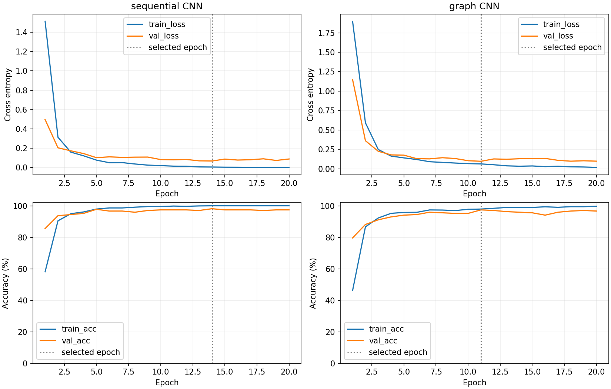

# HYSo 13.5.13 — Real dataset training and learning quality acceptance

Date: 2026-11-16 (Europe/Istanbul). **PASS within the measured CPU/dataset scope.** Two independently constructed CNNs learned real digits, exceeded the fixed validation/test thresholds, and completed the existing checkpoint, evaluation, comparison, reporting and ExperimentManager workflows. No runtime/Core/native source changed.

Evidence root: `C:\Users\hdgn5\AppData\Local\hyso-stage13-5-13-20261116` (`QA` below). Main successful run: `QA/learning`. [Measured evidence snapshot](stage13-5-13-learning-evidence.json), [executable example](../../examples/models/real_learning_acceptance.py), [short protocol tests](../../tests/test_real_learning_acceptance.py). Retained JSON is not a live native receipt.

Environment: Python 3.10.18 (`C:/Users/hdgn5/.conda/envs/torch_gpu/python.exe`), Torch 2.5.1+cu121, torchvision 0.20.1+cu121, sklearn 1.7.2, NumPy 2.2.2, Pillow 12.0.0. Execution is CPU despite the installed CUDA-capable Torch build. Reproduce explicitly with `python -B -m examples.models.real_learning_acceptance --output FRESH_EXTERNAL_QA_PATH`; it performs two bounded fits and one selected test inference per model, and refuses an existing output directory. Do not use a repeat for test-driven tuning.

## 1. Initial Git state and preservation

Branch `feature/hyso-models-next`; expected and observed initial HEAD `0ddf66fa2229e9eec4fe1901d34669fe462ba8e7`; index empty. There were two unrelated tracked modifications and 45 unrelated untracked files (47 actual files). No applicable repository/parent AGENTS.md was found. The prior 13.5.8 real-data, 13.5.11 receiver closure and 13.5.12 acceptance reports and relevant APIs/tests were inspected.

`QA/baseline.json` snapshots all 752 initial tracked/nonignored files and the historical protected groups before new files were written. QA is outside the repository; all new datasets, checkpoints, experiment SQLite databases, builds and install targets use QA. User databases were hashed as raw bytes; they were never connected to or migrated. Historic checkpoint files were only hashed, never loaded for training.

| Protected group | Before/after SHA-256 result |
| --- | --- |
| files | 752/752 unchanged |
| dirty | 47/47 unchanged |
| native | 71/71 unchanged |
| forensic | 47/47 unchanged |
| external6 | 6/6 unchanged |
| external11 | 11/11 unchanged |
| user_data197 | 197/197 unchanged |

Groups overlap. All pre-existing runtime modules, six explicit evidence/Core contracts, Graph v2 checkpoint/receiver mechanisms, historical reports and manifested P01–P35 evidence retain their initial bytes. This is coverage of the manifested files, not an exhaustive claim about every ignored/external path. No reset, clean, restore, rebase, amend, bulk add or push was performed.

## 2. Real source, local provenance and license

The installed `sklearn.datasets.load_digits()` collection contains 1797 processed human handwriting images, each 8×8 grayscale, with ten digit classes. It is the sklearn copy of the original UCI **test** collection; the new splits below are not the original UCI benchmark protocol. No dataset download was made.

Attribution: Alpaydin, E. & Kaynak, C. (1998), *Optical Recognition of Handwritten Digits*, UCI Machine Learning Repository, DOI [10.24432/C50P49](https://doi.org/10.24432/C50P49). The locally retained stage 13.5.8 `source-verification.json` records the inspected UCI source license as **CC BY 4.0** and its verification date as 2026-11-14. This stage verifies that local record and the identical bundled source bytes; it does not claim a fresh online license audit. See [historical verification and source links](stage13-5-8-real-dataset-p26-investigation.md). PNG copies are confined to QA and are not redistributed in the package.

Local verification record SHA-256: `c17bee42e3580d44067b10f7ef6e77a5264d1b95270baa61af7e5c6f1e77b1ab`. Bundled `digits.csv.gz`: `09f66e6debdee2cd2b5ae59e0d6abbb73fc2b0e0185d2e1957e9ebb51e23aa22`. Full uint8 source pixels + little-endian int64 labels: `65e5b4619795efb40c1082f4c350c049e4ad552200d369b6ae99e21eef5e72c5`. sklearn version: 1.7.2.

No NaN/Inf, no nonintegral pixel, and **zero exact original-pixel duplicate groups** were observed. Source range is 0–16; source shape is [1797,8,8]. Original source identities are collection + zero-based row, not invented writer IDs. The predetermined duplicate policy aborts before training if a changed source contains duplicates, requiring a reviewed group split rather than silently removing examples.

## 3. Fixed split, leakage checks and preprocessing

Stratified sklearn `train_test_split`, seed **13513**, first 70% train / 30% holdout, then equal validation/test split with seed **13514**. Rounding yields **1257 / 270 / 270**. Every source row appears once; source-ID sets are disjoint; original pixels, PNG bytes, decoded pixels and processed tensor hashes show no cross-split exact reuse. All 1797 source IDs and labels are retained in the measured snapshot; the full PNG/hash/tensor manifests are in QA.

Pipeline dataset ID: `883505a7c2f6669b83af474b220cb757d09af021394cc2e72630f25c7250585d`. Full file/tensor manifest SHA-256: `f3ece622344079ed98511577bf82eb2cf5ad560dc6cd02166abf33330bd62d86`. The snapshot retains the exact class mapping and preprocessing metadata alongside source IDs.

| Digit | Source | Train | Validation | Test |
| --- | --- | --- | --- | --- |
| 0 | 178 | 124 | 27 | 27 |
| 1 | 182 | 127 | 27 | 28 |
| 2 | 177 | 124 | 27 | 26 |
| 3 | 183 | 128 | 27 | 28 |
| 4 | 181 | 127 | 27 | 27 |
| 5 | 182 | 127 | 28 | 27 |
| 6 | 181 | 127 | 27 | 27 |
| 7 | 179 | 125 | 27 | 27 |
| 8 | 174 | 122 | 26 | 26 |
| 9 | 180 | 126 | 27 | 27 |

Deterministic conversion: `uint8((uint16(pixel)*255+8)//16)`, grayscale L PNG, compression 9, 8×8. This injectively preserves all 17 source levels with documented rounding; tensor error relative to source/16 is at most 0.5/255. Existing ImageFolder pipeline uses same-size bilinear resize, ToTensor CHW fp32 /255 and no additional normalization: range [0,1], one channel. Every actual loader tensor and label was independently compared against its source row. No random augmentation or statistics fitted on validation/test were used.

`load_image_splits(..., max_samples_per_split=1797)` uses an existing supported explicit budget. The default 128 limit rejects excess samples; it does not silently truncate. Actual integrity-scan counts and each epoch’s observed counts are measured, not inferred from requested budgets. No Dataset Core change or second framework was needed.

Integrity-only source scans inspect all splits before training. Test inference is locked separately: the pretraining plan is written before fits; both validation selections are hashed in `selection-seal.json` while test inference count is zero; only then is test inference executed **once per selected model**. No selection, tuning or further real-test inference followed these results. Packaging performs integrity scans and validation reads only.

## 4. Architectures and precommitted training plan

Model A uses schema2 ModelBuilder: Conv(1→16,3×3,pad1), ReLU, Conv(16→32,3×3,pad1), ReLU, terminal flatten (2048), classification head (2048→10, pooling none). Spatial information is retained for digit recognition. Model B uses GraphModelBuilder: Conv(1→8,3×3,pad1)+ReLU stem; independent 3×3 Conv(8→8)+ReLU and pointwise Conv(8→8)+ReLU branches; channel concat; flatten (1024); classification head (1024→10). GraphTensorOutput explicitly selects `logits`. No normalization or dropout is enabled.

| Model | Measured parameters | Seed | Initial validation accuracy | Initial checkpoint SHA-256 |
| --- | --- | --- | --- | --- |
| sequential | 25290 | 13513 | 4.0741% | 38cba18e55f0c629a18966a8da31e508c3317b296f1c21fb9d73228592f9acdd |
| graph | 10986 | 13514 | 10.0000% | 396dfd9e898e9250394700b0fbd0a8ec97f8c0fb92af107501247b43aa3b9127 |

CPU fp32, one Torch thread, deterministic algorithms enabled; batch 64, no drop-last, shuffled training with independent seeded loader generators, sequential validation/test; AdamW lr **0.003**, weight decay **0.0001**, CrossEntropyLoss, accumulation 1, no scheduler/EMA/early stopping. Exactly **two main fits, 20 epochs each**, through existing TrainingConfig/TrainingSession → Trainer.fit. There is no new training engine. Untrained forward/shape smoke uses real training inputs only. Initial checkpoints preserve actual starting weights.

Selection rule fixed before training: **minimum validation loss, earliest tie**. Fixed quality targets: validation accuracy ≥0.75, test accuracy ≥0.70, test macro-F1 ≥0.65; train loss must fall meaningfully (operationalized in the example as final <70% of first epoch), beat the majority baseline and avoid single-class collapse. Thresholds were not changed after outcomes.

Chance baseline is 10%. Per-split oracle majority proportions are train 128/1257 = 10.18298%, validation 28/270 = 10.37037%, test 28/270 = 10.37037%. A deployable majority rule uses training-majority digit 3: validation 27/270 = 10%, test 28/270 = 10.37037%. The pretraining plan records the per-split oracle proportions; both models exceed either baseline by a wide margin.

## 5. Actual epoch records and learning curves

Each epoch observes **1257 train examples / 20 batches / 20 real optimizer updates**, and **270 validation examples / 5 batches / 0 validation optimizer updates**. Native Trainer counts agree with a native optimizer post-step hook. Forward observations verify actual finite inputs/logits; Trainer validates labels/loss/gradients; state tensors are checked finite at each boundary. Each model records 400 updates total. These checks were active during the real fits, then hooks were removed before trusted checkpoint/evaluation capture.

Learning rate is 0.003 and early-stop=false for every row below. No NaN/Inf or sample/update mismatch occurred. Accuracy uses Trainer percent semantics and online training predictions; train/validation gaps are descriptive, not a post-fit train evaluation. Observer intervals include validation and observation/I/O overhead, and are not P19 timing or a native performance receipt.

### sequential CNN

| Epoch | Train loss | Train acc % | Val loss | Val acc % | Observed interval s |
| --- | --- | --- | --- | --- | --- |
| 1 | 1.51291476 | 58.15433572 | 0.49629069 | 85.55555556 | 11.35191810 |
| 2 | 0.31383512 | 90.45346062 | 0.20448043 | 93.70370370 | 11.71622500 |
| 3 | 0.15988722 | 94.98806683 | 0.17344981 | 94.44444444 | 10.96393420 |
| 4 | 0.12164411 | 96.10182975 | 0.14494025 | 95.18518519 | 9.72190980 |
| 5 | 0.07714866 | 97.93158313 | 0.10246468 | 97.77777778 | 8.72068000 |
| 6 | 0.05050609 | 98.64757359 | 0.11104834 | 96.66666667 | 8.21114690 |
| 7 | 0.05162710 | 98.64757359 | 0.10552356 | 96.66666667 | 10.27856810 |
| 8 | 0.03706887 | 99.12490056 | 0.10789861 | 95.92592593 | 14.42919550 |
| 9 | 0.02546989 | 99.52267303 | 0.10862193 | 97.03703704 | 19.59388780 |
| 10 | 0.02016542 | 99.52267303 | 0.08288372 | 97.40740741 | 11.20857280 |
| 11 | 0.01491932 | 99.84089101 | 0.08078559 | 97.40740741 | 10.42196290 |
| 12 | 0.01377593 | 99.68178202 | 0.08403973 | 97.40740741 | 11.04774380 |
| 13 | 0.00693130 | 99.92044551 | 0.06985069 | 97.03703704 | 15.74829390 |
| 14 | 0.00575099 | 100.00000000 | 0.06820976 | 98.14814815 | 15.27701240 |
| 15 | 0.00397201 | 100.00000000 | 0.08762094 | 97.40740741 | 15.86924950 |
| 16 | 0.00351243 | 100.00000000 | 0.07791827 | 97.40740741 | 15.14473200 |
| 17 | 0.00254032 | 100.00000000 | 0.08120200 | 97.40740741 | 13.41487960 |
| 18 | 0.00228554 | 100.00000000 | 0.09077428 | 97.03703704 | 13.66417210 |
| 19 | 0.00219454 | 100.00000000 | 0.07381547 | 97.40740741 | 10.26224180 |
| 20 | 0.00186279 | 100.00000000 | 0.08888118 | 97.40740741 | 11.73526110 |

### graph CNN

| Epoch | Train loss | Train acc % | Val loss | Val acc % | Observed interval s |
| --- | --- | --- | --- | --- | --- |
| 1 | 1.89802336 | 46.22116150 | 1.14730995 | 79.62962963 | 13.16659740 |
| 2 | 0.59251686 | 86.63484487 | 0.36196828 | 88.14814815 | 12.51713360 |
| 3 | 0.24869889 | 92.28321400 | 0.22597047 | 91.11111111 | 9.99814850 |
| 4 | 0.16407128 | 95.22673031 | 0.17961795 | 92.96296296 | 10.70215420 |
| 5 | 0.14113040 | 95.78361177 | 0.17597059 | 94.07407407 | 12.79688310 |
| 6 | 0.12015406 | 95.86316627 | 0.13098620 | 94.44444444 | 12.42208940 |
| 7 | 0.09188151 | 97.37470167 | 0.12839882 | 95.92592593 | 10.00112380 |
| 8 | 0.08292413 | 97.29514718 | 0.14343230 | 95.55555556 | 14.44956910 |
| 9 | 0.07459728 | 96.97692920 | 0.13270334 | 95.18518519 | 12.20748250 |
| 10 | 0.06741465 | 97.77247414 | 0.10474128 | 95.18518519 | 12.18495630 |
| 11 | 0.06345450 | 97.93158313 | 0.09722457 | 97.40740741 | 11.52636040 |
| 12 | 0.05290973 | 98.40891010 | 0.12759618 | 97.03703704 | 11.40814600 |
| 13 | 0.03873163 | 98.96579157 | 0.12335865 | 96.29629630 | 12.07623830 |
| 14 | 0.03391437 | 98.96579157 | 0.13019494 | 95.92592593 | 13.58461900 |
| 15 | 0.03725908 | 98.96579157 | 0.13357925 | 95.55555556 | 15.69324130 |
| 16 | 0.02875692 | 99.36356404 | 0.13441722 | 94.07407407 | 15.06338760 |
| 17 | 0.03340040 | 99.04534606 | 0.10965170 | 95.92592593 | 14.48344350 |
| 18 | 0.02612614 | 99.44311854 | 0.09861071 | 96.66666667 | 15.17955990 |
| 19 | 0.02371449 | 99.44311854 | 0.10416517 | 97.03703704 | 14.23025590 |
| 20 | 0.01862126 | 99.68178202 | 0.09874613 | 96.66666667 | 11.92247390 |

## 6. Validation selection, overfitting and underfitting

**sequential:** selected epoch 14/20, validation loss 0.06820976, accuracy 98.14814815%. Train loss fell 1.51291476 → 0.00186279; validation loss 0.49629069 → 0.08888118. Selected-epoch train/validation accuracy gap 1.85185185 percentage points. Last epoch validation 97.40740741% / loss 0.08888118; minimum-loss epoch differs from last by 6 epochs. Maximum validation accuracy 98.14814815% is reported separately from the fixed loss-based selection criterion.

**graph:** selected epoch 11/20, validation loss 0.09722457, accuracy 97.40740741%. Train loss fell 1.89802336 → 0.01862126; validation loss 1.14730995 → 0.09874613. Selected-epoch train/validation accuracy gap 0.52417573 percentage points. Last epoch validation 96.66666667% / loss 0.09874613; minimum-loss epoch differs from last by 9 epochs. Maximum validation accuracy 97.40740741% is reported separately from the fixed loss-based selection criterion.

Both models clearly escape chance-level underfitting; training and held-out validation improve substantially. Late train loss continues falling while validation loss fluctuates, with modest train/validation gaps: mild late overfitting is visible. Validation-only best-weight selection limits that effect. No early-stopping trigger is claimed because early stopping was explicitly disabled. This is a bounded pipeline learning acceptance, not a hyperparameter search or production-quality guarantee.

## 7. Strict checkpoint restoration and Graph trust scope

| Model | Selected checkpoint SHA-256 | Strict state / fixed val output | Legacy P26 checkpoint |
| --- | --- | --- | --- |
| sequential | cddc0ae202ddaaa7347a6d7879867e34487553cf4b858ef27c6947714526ebcc | exact / bit-equal | native |
| graph | e9972bd496b442d7e05ec9a4f19f5c098d77317f357c398dbdf82c29e6f4c5e4 | exact / bit-equal | missing |

Each selected state is saved using existing save_training_checkpoint, then loaded into a **fresh model instance** with expected file SHA-256, strict state matching and an exact metadata guard for architecture/settings/context/seed/selected epoch. State keys and every tensor match; outputs on a fixed 16-example validation input match bitwise; eval mode, CPU and fp32 are asserted. These selected-state checkpoints are not proof of optimizer/epoch resume; that was not tested for the real runs.

The concrete Graph falls inside the existing supported v2 CPU profile. graph_contract=True is used at save, capture_evidence=True at restore, and **capture_receiver_runtime=True** explicitly opts in to actual receiver observation. Live-process graph verification: `{"evaluation_capture": "native_in_process", "graph_v2": "verified", "inference_binding": "verified", "origin": "native_process_capture", "reason": "original_source_receipt_revalidated", "receiver_runtime": "verified"}`; source-to-receiver relation status `verified`. Graph legacy P26 checkpoint remains **missing**. Ordinary strict restore alone is never labeled trusted source evidence. Imported association JSON reports receiver authority unverified; artifact hashes do not recreate live receipts. The 13.5.11 security contract was unchanged.

## 8. Once-only locked test evaluation

| Model | Correct / total | Accuracy | Macro precision | Macro recall | Macro F1 | Weighted F1 |
| --- | --- | --- | --- | --- | --- | --- |
| sequential | 263/270 | 0.97407407 | 0.97430003 | 0.97391127 | 0.97397548 | 0.97420775 |
| graph | 263/270 | 0.97407407 | 0.97488825 | 0.97391127 | 0.97387362 | 0.97410966 |

The full precision fractions, supports, confusion matrices, ordered observed stream identity, model-state/checkpoint hashes and native producer envelope are retained in each QA evaluation JSON and the committed measured snapshot. Percentages are display values; exact correct counts /270 remain authoritative arithmetic inputs. Evaluation uses the existing isolated deepcopy eval/inference-mode path and complete sample accounting.

Same ordered 270-example stream for both models: paired SHA-256 `1be2da286c129a4c7b9691277184591717d40ca57e2b106cea284f217df692dc`, inputs `85e59e2eacabe5333d8d03f5c768f55d53f67b065eb797f4b40cd8d09d4fabc0`, targets `a1da31a3e9461a0672ea5c66b46ea07821fbbaac2c81ee6f8a6f29f702845a3e`. Test batches are [64,64,64,64,14]. Class vocabulary/order, preprocessing and metric zero-division semantics are identical.

### sequential: per-class metrics and confusion matrix

| Digit | Support | Precision | Recall | F1 | Predicted count |
| --- | --- | --- | --- | --- | --- |
| 0 | 27 | 1.00000000 | 1.00000000 | 1.00000000 | 27 |
| 1 | 28 | 0.93103448 | 0.96428571 | 0.94736842 | 29 |
| 2 | 26 | 0.92592593 | 0.96153846 | 0.94339623 | 27 |
| 3 | 28 | 1.00000000 | 0.96428571 | 0.98181818 | 27 |
| 4 | 27 | 1.00000000 | 1.00000000 | 1.00000000 | 27 |
| 5 | 27 | 0.96296296 | 0.96296296 | 0.96296296 | 27 |
| 6 | 27 | 1.00000000 | 1.00000000 | 1.00000000 | 27 |
| 7 | 27 | 1.00000000 | 1.00000000 | 1.00000000 | 27 |
| 8 | 26 | 0.92307692 | 0.92307692 | 0.92307692 | 26 |
| 9 | 27 | 1.00000000 | 0.96296296 | 0.98113208 | 26 |

| True \ predicted | 0 | 1 | 2 | 3 | 4 | 5 | 6 | 7 | 8 | 9 |
| --- | --- | --- | --- | --- | --- | --- | --- | --- | --- | --- |
| 0 | 27 | 0 | 0 | 0 | 0 | 0 | 0 | 0 | 0 | 0 |
| 1 | 0 | 27 | 1 | 0 | 0 | 0 | 0 | 0 | 0 | 0 |
| 2 | 0 | 1 | 25 | 0 | 0 | 0 | 0 | 0 | 0 | 0 |
| 3 | 0 | 0 | 0 | 27 | 0 | 0 | 0 | 0 | 1 | 0 |
| 4 | 0 | 0 | 0 | 0 | 27 | 0 | 0 | 0 | 0 | 0 |
| 5 | 0 | 0 | 1 | 0 | 0 | 26 | 0 | 0 | 0 | 0 |
| 6 | 0 | 0 | 0 | 0 | 0 | 0 | 27 | 0 | 0 | 0 |
| 7 | 0 | 0 | 0 | 0 | 0 | 0 | 0 | 27 | 0 | 0 |
| 8 | 0 | 1 | 0 | 0 | 0 | 1 | 0 | 0 | 24 | 0 |
| 9 | 0 | 0 | 0 | 0 | 0 | 0 | 0 | 0 | 1 | 26 |

Lowest recall is digit 8: 0.92307692; minimum class F1 0.92307692. All ten classes have nonzero recall and predictions. No completely failed class or single-class collapse is hidden.

### graph: per-class metrics and confusion matrix

| Digit | Support | Precision | Recall | F1 | Predicted count |
| --- | --- | --- | --- | --- | --- |
| 0 | 27 | 1.00000000 | 1.00000000 | 1.00000000 | 27 |
| 1 | 28 | 0.93103448 | 0.96428571 | 0.94736842 | 29 |
| 2 | 26 | 0.89655172 | 1.00000000 | 0.94545455 | 29 |
| 3 | 28 | 1.00000000 | 0.96428571 | 0.98181818 | 27 |
| 4 | 27 | 1.00000000 | 1.00000000 | 1.00000000 | 27 |
| 5 | 27 | 0.96296296 | 0.96296296 | 0.96296296 | 27 |
| 6 | 27 | 1.00000000 | 0.96296296 | 0.98113208 | 26 |
| 7 | 27 | 1.00000000 | 1.00000000 | 1.00000000 | 27 |
| 8 | 26 | 0.95833333 | 0.88461538 | 0.92000000 | 24 |
| 9 | 27 | 1.00000000 | 1.00000000 | 1.00000000 | 27 |

| True \ predicted | 0 | 1 | 2 | 3 | 4 | 5 | 6 | 7 | 8 | 9 |
| --- | --- | --- | --- | --- | --- | --- | --- | --- | --- | --- |
| 0 | 27 | 0 | 0 | 0 | 0 | 0 | 0 | 0 | 0 | 0 |
| 1 | 0 | 27 | 1 | 0 | 0 | 0 | 0 | 0 | 0 | 0 |
| 2 | 0 | 0 | 26 | 0 | 0 | 0 | 0 | 0 | 0 | 0 |
| 3 | 0 | 0 | 0 | 27 | 0 | 0 | 0 | 0 | 1 | 0 |
| 4 | 0 | 0 | 0 | 0 | 27 | 0 | 0 | 0 | 0 | 0 |
| 5 | 0 | 0 | 1 | 0 | 0 | 26 | 0 | 0 | 0 | 0 |
| 6 | 0 | 1 | 0 | 0 | 0 | 0 | 26 | 0 | 0 | 0 |
| 7 | 0 | 0 | 0 | 0 | 0 | 0 | 0 | 27 | 0 | 0 |
| 8 | 0 | 1 | 1 | 0 | 0 | 1 | 0 | 0 | 23 | 0 |
| 9 | 0 | 0 | 0 | 0 | 0 | 0 | 0 | 0 | 0 | 27 |

Lowest recall is digit 8: 0.88461538; minimum class F1 0.92000000. All ten classes have nonzero recall and predictions. No completely failed class or single-class collapse is hidden.

Historical 13.5.8 remains unchanged: 120/40/40 samples, two epochs, both models 10% test accuracy and collapsed predictions. Current full-source 1257/270/270 learning evidence is a different fixed protocol; its results do not rewrite or combine with those old metrics.

## 9. Existing P26 ModelComparison

Native EvaluationResult → EvidenceRecord → EvidenceIndex → ModelComparisonSource → compare_models(features="P26") is used. Both P26 quality metrics are COMPARABLE under the original exact-observed-stream policy. No new timing/parameter authority is injected into P26 quality evidence. The two architectures use the same test order and batch partition; metadata and local preprocessing are also independently controlled by the example.

Graph minus Sequential: accuracy difference 0.00000000 (0.00000000 percentage points); macro-F1 difference -0.00010186. Per-class descriptive differences follow; these are arithmetic projections, not statistical significance tests.

| Digit | Graph − Sequential precision | Recall difference | F1 difference |
| --- | --- | --- | --- |
| 0 | 0.00000000 | 0.00000000 | 0.00000000 |
| 1 | 0.00000000 | 0.00000000 | 0.00000000 |
| 2 | -0.02937420 | 0.03846154 | 0.00205832 |
| 3 | 0.00000000 | 0.00000000 | 0.00000000 |
| 4 | 0.00000000 | 0.00000000 | 0.00000000 |
| 5 | 0.00000000 | 0.00000000 | 0.00000000 |
| 6 | 0.00000000 | -0.03703704 | -0.01886792 |
| 7 | 0.00000000 | 0.00000000 | 0.00000000 |
| 8 | 0.03525641 | -0.03846154 | -0.00307692 |
| 9 | 0.00000000 | 0.03703704 | 0.01886792 |

| Model | Measured parameters | Observed epoch intervals total s | Mean s | Range s |
| --- | --- | --- | --- | --- |
| sequential | 25290 | 248.78158730 | 12.43907936 | 8.2111–19.5939 |
| graph | 10986 | 255.61386370 | 12.78069319 | 9.9981–15.6932 |

Parameter counts and durations are separate descriptive workload measurements affected by I/O, observation and machine state. There is no statistical-superiority evidence, no global_winner and no general architecture ranking; the existing comparison claims preserve that limitation.

## 10. Reporting and ExperimentManager

Existing create_report emits `QA/learning/report.json`, `report.md` and static `report.html` from both TrainingResults, retained analyses, the live Graph association and comparison. Existing ExperimentManager uses a **new QA-only store**, explicitly migrated through its public API: experiment `c30c7a45c19443ed8b8317b9caa75f05`. Two completed training runs record all 20-epoch histories and artifacts; a completed evaluation/report run records shared manifest/plan/comparison/report artifacts. **67 artifact SHA checks verified** in the successful main run. This verifies artifact bytes, not native authority. No reporting/experiment engine or frontend was added.

## 11. Negative tests and failure transparency

| Requested boundary | Executed coverage |
| --- | --- |
| Wrong class vocabulary | new invalid-evaluation vocabulary case; existing class-order/producer protocol tests |
| Wrong channels / output width | test_image_dataset model contract cases; trainer classification shape/label tests |
| Empty train/validation/test | new parameterized partition cases; existing empty loader/evaluation tests |
| Overlapping source IDs / exact leakage | new partition guards; existing decoded/processed file leakage negatives |
| Different preprocessing metadata | new actual file normalization + distinct manifest + incompatible native stream comparison |
| Checkpoint hash mismatch / wrong Graph architecture | test_graph_checkpoint_contract expected hash and runtime/config mismatch cases |
| Source state mutation / imported JSON authority loss | test_graph_receiver_runtime mutation, retained JSON and process tests |
| Different ordered test streams | receiver incompatible-stream case and producer stream identity regressions |
| NaN/Inf input/loss | new actual input failures + epoch metric guards; existing Trainer nonfinite checks |
| Train/eval separation | actual epoch no-validation-step checks; test_trainer_validation mode restoration/no-state-update matrix |
| Wrong label range / missing optimizer updates | new invalid label and independent update-counter negatives |
| Incomplete evaluation cannot pass | test_evaluation accounting failures and receiver failed/partial-inference tests |

Early development failures are retained, not counted as learning failures or final passes: the first attempt completed source preparation then rejected an explicit Sequential head in_features (the Builder infers it); a constructor probe and initial short tests rejected concat `dim` (the API uses `axis`). The example was corrected before either main fit. Initial short result: 13 passed, 6 failed, 1 deselected. The first full new-test run passed 17 cases but four negative fixtures omitted the required evaluation `split` argument and failed with TypeError before reaching their intended guards; the fixtures were corrected to explicit validation split and the full short suite rerun. Both failed logs/XML remain in QA (`new-short`, `new-negative-initial`). There was no failed/repeated real training fit, seed search, epoch extension or test-driven retry. No runtime bug fix was needed.

## 12. Targeted regression and packaging

| Final group | Passed | Failed / errors / skips |
| --- | --- | --- |
| new-final | 21 | 0 / 0 / 0 |
| regression | 534 | 0 / 0 / 0 |
| package | 2 | 0 / 0 / 0 |
| wheel-short | 20 | 0 / 0 / 0 |
| sdist-short | 20 | 0 / 0 / 0 |

**557 unique successful source/packaging cases**; installed short-test repetitions are reported separately and not added to that count. XML identities, exact selectors, logs and SHA-256 values are in `QA/test-proof.json` / `regression-selection.json`. Existing AMP GradScaler deprecation warnings remain visible. The previous 1768-case suite was not automatically rerun. No runtime change required a full broad rerun; the selected regression covers the directly used dataset, training, evaluation, v2 receiver, comparison, reporting and artifact contracts.

Fresh wheel/sdist are built from an isolated QA source snapshot through existing packaging tests. Canonical commercial configuration/content/metadata tests pass. Both archives contain exactly the same **164 runtime Python modules** and exact source bytes; all 10 development exclusions remain excluded. New tests/examples/docs are deliberately outside the commercial allowlist. No dataset, SQLite, checkpoint, bytecode, Studio/web assets or new dependency enters the package.

| Archive | SHA-256 | Installed target |
| --- | --- | --- |
| wheel | 93f94711abb4a4c1271f50773df0d443526dcfafafb5860a9ffe08310f31b51c | C:\Users\hdgn5\AppData\Local\hyso-stage13-5-13-20261116\installed-wheel |
| sdist | b7363d12d53183801bce1990c80d5d8b55cadfeea86f7fff3b0ac04d97a2b774 | C:\Users\hdgn5\AppData\Local\hyso-stage13-5-13-20261116\installed-sdist |

Each archive is independently installed offline with --no-index --no-deps --no-build-isolation --no-compile, then launched under isolated Python. The runner asserts hyso.__file__ is inside that install target, commercial Registry57, reproduces the complete real-file dataset manifest/counts, reads a validation batch, and executes the copied short acceptance tests (including both one-epoch TrainingSession/strict-restore smokes and actual evaluation failure cases). These tiny synthetic compatibility smokes make no real-learning claim. The 20-epoch real fits and once-only test inference are not repeated. Dependencies are the already installed environment; CUDA stays uninitialized. The first installed-wheel test launcher failed before tests because isolated Python hid the existing user-site pygments dependency. The QA launcher was corrected to append that existing user-site dependency path, as in the preceding stage. No dependency was downloaded or installed. The installed wheel bytes were verified before reuse; its failure log remains `QA/installed-wheel-initial.log`.

## 13. Git closure

Verified test/example commit: `061e88be60119e5d3b99332aca466f35e8da2d02`, parent `0ddf66fa2229e9eec4fe1901d34669fe462ba8e7`, message `test: validate real dataset CNN learning and generalization`. It contains exactly the new example and short tests. The following documentation commit contains only this report, its measured JSON snapshot and curve PNG; its full SHA/parent/path list is recorded in `QA/commits.json` / final handoff, because a commit cannot embed its own SHA without changing it.

Before each commit: protected raw hashes, exact staged file list, staged diff/content hash, whitespace and successful test/package evidence are checked. After each commit: SHA, parent, exact paths and empty staging are checked. Final status must equal the initial 47-file unrelated user state; prior ancestry remains intact. No push and no 13.5.14 work is performed.

## 14. Limitations and independent final gates

This demonstrates within-collection learning/generalization on a new fixed split of publicly known processed handwritten digits. It does **not** prove independent writers, a new external dataset/distribution, globally untouched historical data, production readiness, CUDA/native performance, statistical architecture superiority, full optimizer resume, cross-process native receipt continuity or bitwise training determinism on other machines. Strict restored fixed-input equality is demonstrated locally; local SHA values do not authenticate remote producer authorship. User/local historical data and earlier failures remain preserved.

| Gate | Decision | Measured scope |
| --- | --- | --- |
| A — Dataset Integrity | PASS | 1797 finite real-source images, complete profile and conversion checks |
| B — Train/Validation/Test Isolation | PASS | fixed stratified identities, no exact leakage; test locked until selections |
| C — Sequential CNN Real Learning | PASS | fixed validation/test/F1 targets and real loss/update evidence |
| D — Graph CNN Real Learning | PASS | same fixed targets; actual two-branch Graph training |
| E — Overfitting/Underfitting Analysis | PASS | 40 actual epoch records, selection and gaps |
| F — Checkpoint Restore | PASS | fresh strict state and fixed validation output equality; scoped v2 opt-in |
| G — Actual Test Evaluation | PASS | one complete 270-example test inference per selected model |
| H — Model Comparison | PASS | same native observed stream, existing P26 policy, no global winner |
| I — Reporting/ExperimentManager | PASS | existing JSON/MD/HTML reporting and verified QA artifacts |
| J — Regression/Packaging | PASS | targeted tests, fresh 164-module archives and real installed imports |
| K — Native/User Data Preservation | PASS | all manifested protected raw SHA-256 groups unchanged |
| L — Git Integrity | PASS | two scoped local commits; final SHA/index/status ledgers |

**Overall: PASS for stage 13.5.13 within these explicit CPU/dataset boundaries.** Stop here; no next-stage or push action.
