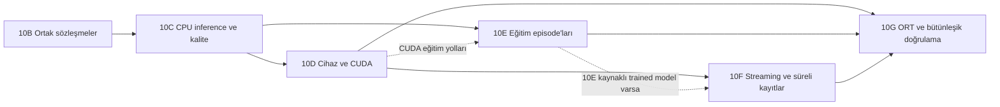

# Aşama 10A — P01–P35 ortak yürütücü entegrasyon envanteri

İnceleme tabanı `c51be9237ae3bbf545ab8ab1ffb2fe681af7e2fb`, branch
`feature/hyso-models-next`. Bu belge statik kaynak incelemesinin sonucudur.
10B–10G bölümleri uygulanacak işleri ve gelecekteki doğrulamaları tarif eder.
Bu incelemede native API çağrısı, preflight çalıştırması, model oluşturma,
ölçüm, eğitim, benchmark, GPU/sensör sorgusu veya test süiti yürütülmedi.

## 1. Mevcut yürütücü ve kanıt akışı

`catalog.EXECUTOR_FEATURES` iki yolu ilan ediyor.

| Yol | Bağlı özellikler | Mevcut sınır |
|---|---|---|
| `trusted_cpu` | P01, P02, P10, P11 | PyTorch classification, CPU. P01/P02 için contiguous fp32 NCHW, no-grad input ve fp32 model. In-process sert timeout/RAM kotası yok. |
| `isolated_cpu` | P02, P11 | Windows Job, SHA-pinned `TrustedFactoryBinding`, süreç ağacı sahipliği. Mevcut timeout 5–90 saniye, Job commit sınırı 1–4 GiB, worker sonuç sınırı 4 MiB. |

P01, `BenchmarkRunner(..., measure_cuda_memory=False).run()` ardından
`analyze_latency(..., quantiles=policy.quantiles)` kullanıyor. Benchmark
`auxiliary_evidence.benchmark` içinde tutuluyor. Varsayılan TailPolicy 1000
örnek ve kuyrukta 10 örnek istiyor. P02/P11 mevcut G2/G3 köprülerine gidiyor.
P10 yalnız `measure_memory()` ile tek OS snapshot alıyor. Callable-workload
RSS örneklemesi ve P11 artifact serialization mevcut ortak yola dahil değil.

Diğer **31 özelliğin ortak yürütücü adaptörü bulunmuyor**. Native API'leri
mevcut. CUDA seçimi mevcut ortak yolda `UNSUPPORTED` verir. CPU'da GPU gerektiren
özellikler de `UNSUPPORTED`, diğer bağlanmamış özellikler uygun değerlendirme
sırasına göre `NOT_IMPLEMENTED_IN_EXECUTOR` veya `MISSING_PREREQUISITE` alır.

Plan seçimi → metadata/OS preflight → açık özellik yetkisi → tekrar preflight →
tek kullanımlık execution → native constructor → EvidenceRecord → EvidenceIndex
→ UnifiedAnalysisReport akışı korunmalıdır. Önkoşul satırları `SKIPPED` kalır.
`authorized_features` açık seçimin benzersiz alt kümesidir. Bir veya iki model
kimliği, değişen binding metadata'sının reddi ve kullanılan dry-run'ın yeniden
çalıştırılamaması mevcut sözleşmelerdir.

Kaynaklar [catalog.py](../../hyso/analysis/catalog.py#L19),
[execution.py](../../hyso/analysis/execution.py#L28),
[native_bridge.py](../../hyso/analysis/native_bridge.py#L23),
[isolated_bridge.py](../../hyso/analysis/isolated_bridge.py#L86).

## 2. P01–P35 satır bazlı teknik envanter

Tabloda `perf` adı `hyso.performance`, `quality` adı `hyso.quality`, `eval` adı
`hyso.evaluation` modülünü gösterir. “CPU/CUDA” native API'nin kapsamıdır.
Ortak yürütücü desteği ayrı sütundadır. Kaydedilmiş CUDA kanıtını CPU'da okumak
ile yeni CUDA capture başlatmak ayrı işlemler olarak planlanmalıdır.

| ID ve mevcut ortak durum | Native giriş | Model/veri/kaynak | CPU, CUDA ve özel gereksinim | Çıktı ve evidence sözleşmesi | En küçük entegrasyon ve aşama |
|---|---|---|---|---|---|
| **P01 G2+ortak trusted CPU** | `BenchmarkRunner.run` → `perf.analyze_latency` | Model ve resident NCHW tensor veya kayıtlı BenchmarkResult | CPU fp32/fp64, native CUDA fp32/amp_fp16. Ortak yol fp32 CPU. | `LatencyAnalysis`, schema1, raw R×N örnekler, quantile/tail politikası ve kaynak run kimliği. | Mevcut yolu koru. Kayıtlı benchmark analizi 10B source ayrımıyla kullanılabilir. CUDA genişlemesi 10D'de ayrı açık binding. |
| **P02 G2/G3+ortak CPU** | `perf.measure_throughput`, `ThroughputProtocol` | Model, resident contiguous NCHW tensor, tek stream, bounded queue | CPU fp32/fp64, CUDA fp32/amp_fp16. Batch-count veya duration seçilir. | `ThroughputResult`, schema1, admitted/completed ledger, completed images / host wall seconds, terminal tail. | G2/G3 ve varsayılan sınırları koru. CUDA yolu 10D. Kamera FPS'ine dönüştürme. |
| **P03 eksik** | `perf.measure_pipeline`, `PipelineProtocol` | Model, `source()→PipelineSample`, açık preprocess/transfer/postprocess/deliver stage'leri | CPU veya native CUDA. CUDA için açık transfer stage gerekir. | `PipelineResult`, schema1, aynı sample ID, serial bounded block queue, host/device stage saatleri. | 10C'de typed stage/source binding ile tek pipeline capture. CUDA stage kapsamı 10D. |
| **P04 eksik** | `perf.analyze_stages`; yeni capture için `measure_stages` | Öncelikle kayıtlı PipelineResult. Yeni ölçümde P03 kaynak/stage kaynakları | Analiz CPU-only. Yeni pipeline CPU/CUDA kapsamına bağlı. | `StageTimingResult`, schema1, yeni sonuç ID'si ve `source_result_id`, raw sample/stage kanıtı. | 10C. P03+P04 seçiliyse aynı capture'dan türet. P04-only için retained source veya açıkça gösterilen pipeline capture maliyeti. |
| **P05 eksik** | `perf.measure_cold_start(ColdStartRecipe, protocol=ColdStartProtocol)` | Importable trusted CPU-construction factory, shape/seed, varsa checkpoint path+SHA | Her trial yeni interpreter. CPU veya native CUDA hazırlığı. OS page-cache soğukluğu bilinmiyor. | `ColdStartResult`, schema1, trial bazında phase/clock/PID/exit/timeout; weights_only yükleme. | 10C CPU, 10D CUDA. Factory/checkpoint kaynaklarını açık recipe ile taşı, mevcut fresh-process yolunu çağır. Checkpoint'siz native recipe constructor-only kapsamındadır. |
| **P06 eksik** | `perf.run_sweep(..., axis='batch')` | CPU FP32 master, `input_factory(shape,dtype,device)`, sonlu benzersiz batch noktaları | CPU veya CUDA owned copy; noktalar ayrı değerlendirilir. | `SweepResult`, schema1/P06, her noktada durum, PrecisionResult/raw refs, OOM sonrası not_run. | 10C CPU, 10D CUDA. Nokta listesi ve forward/queue bütçesini preflight'ta göster. |
| **P07 eksik** | `perf.run_sweep(..., axis='resolution')` | Aynı master, açık H×W listesi, görevle uyumlu input factory | CPU/CUDA. Shape geçerliliği görev semantiğinin doğrulanması yerine geçmez. | `SweepResult`, schema1/P07, shape/aspect-ratio ve nokta sonuçları korunur. | 10C/10D. Yeniden boyutlandırmayı veya model başını otomatik düzeltme. |
| **P08 eksik** | `perf.run_sweep(..., axis='precision')` | Aynı FP32 master, dtype-aware input factory, açık precision noktaları | Native fp32/fp64/amp_fp16/bf16/int8_dynamic noktaları, cihaz/operatör kabiliyetiyle sınırlı. | `SweepResult` ve nokta `PrecisionResult`, schema1/P08, unsupported noktalar ve gerçek execution proof. | 10C CPU, 10D CUDA. Unsupported precision için fallback veya otomatik conversion seçimi yapma. Kalite P28 ile ayrıca ilişkilendirilir. |
| **P09 eksik** | `BenchmarkRunner(..., measure_cuda_memory=True).run()` | Model, resident input, açık CUDA cihazı, owned allocator context | CUDA gerekir. Ayrı tek-forward probe process/device peak sayaçlarını sıfırlar. | `BenchmarkResult`, schema1 inference ailesi, `cuda_memory` baseline/previous peak/reset/current/peak alanları. Native payload'da `feature_ids` yok. | 10D. Native benchmark reader üzerinden P09 projeksiyonu. Reset için owned child tercih et. CPU P10'a fallback yapma. P01 ile capture paylaşımı yalnız aynı açık protokolde ve iki özellik de yetkiliyse. |
| **P10 ortak trusted CPU** | `perf.measure_memory(workload=None, protocol=MemoryProtocol)` | Geçerli mevcut süreç. Callable seçilirse workload sahipliği kullanıcıda | Windows/Linux OS RSS backend. CUDA gerektirmez. | `MemoryResult`, schema1, RSS/HWM, sampled peak, backend yoksa null/reason. | Mevcut tek snapshot yolu korunur. Gelecek callable modu 10C'de ayrı açık seçim olmalı. Child RSS ile controller RSS kimliği karıştırılmaz. |
| **P11 G2/G3+ortak CPU** | `perf.measure_footprint` | Dense CPU model; isteğe bağlı mevcut artifact veya açık serialize destination | Metadata CPU. Serialization ve roundtrip ayrı opt-in I/O. | `FootprintResult`, schema1, logical tensor bytes ve artifact bytes farklı alanlar. Mevcut artifact varsayılan olarak deserialize edilmez. | Mevcut logical-only yol korunur. 10C'de yalnız açık artifact binding varsa native seçenekleri geçir. Checkpoint formatını değiştirme. |
| **P12 eksik** | `perf.analyze_flops(OperatorProfileResult veya ColdStartRecipe)` | Kayıtlı P14 dispatch ledger veya explicit recipe capture | Retained analiz CPU. Recipe capture Windows owned profiler, CPU/CUDA. | `OperationCountResult`, schema1/P12, operation-model v3, counting convention ve unknown operator kapsamı. | 10C. Aynı P14 capture'ını kullan. Recipe argümanının capture çalıştırdığını planında göster. Unknown maliyetlerde native null total korunur. |
| **P13 eksik** | `perf.profile_layers`; isteğe bağlı `analyze_nsys_modules`; ayrı `measure_layer_overhead` | P14 capture/recipe, module inventory/invocations. Nsight için hash-pinned dosyalar | CPU/CUDA native kapsamları ayrıdır. CPU ownership, allocation lifetimes ve overhead ilave opt-in. | `LayerProfileResult`, schema1, versioned instrumentation, inclusive/exclusive CPU, selected-stream CUDA Event ve kernel attribution ayrı. Overhead ayrı `LayerOverheadResult`. | 10C CPU, 10D kayıtlı CUDA/Nsight. Capture paylaşılır. Overhead deneyi normal layer çağrısına eklenmez. |
| **P14 eksik** | `perf.profile_operators(ColdStartRecipe)`; `analyze_nsys_operators(sqlite_path,capture_path=...)` | Fresh trusted factory, trace bütçesi, varsa ilişkilendirilmiş Nsight SQLite/receipt | Capture Windows child CPU/CUDA. Offline Nsight okuma yeni GPU işi gerektirmez. | `OperatorProfileResult`, schema1, raw exported events/trace, self/total CPU ve doğrulanmış GPU activity bağlantıları. | 10C CPU capture ve retained okuma. 10D CUDA. P12/P13 için tek kaynak capture. Profiler elapsed süreyi normal inference latency sayma. |
| **P15 eksik** | `perf.measure_transfers(protocol=TransferProtocol)` | Model gerekmez. Explicit shape/dtype, H2D/D2H, pinned/non_blocking ve optional overlap/comparison | Windows owned child, native transfer profili `cuda:0`, dense buffers. | `TransferResult`, schema1, copy ledger/event/wall süreleri, worker receipt. Overlap probe, paired execution comparison ve dış nsys capture farklı opt-in. | 10D. Protocol-only binding kullan. Pinned/non_blocking alanlarından fiziksel overlap sonucu üretme. Başka cihazı sessizce cuda:0'a çevirme. |
| **P16 eksik** | `perf.measure_utilization(protocol=UtilizationProtocol())` | Mevcut sürecin CPU sayacı, optional fiziksel GPU selector, bounded süre/örnek | CPU native backend Windows. Optional installed nvidia-smi/NVML sensor; model çalıştırmaz. | `UtilizationResult`, schema1, current-process CPU, physical-board GPU, query overhead, workload label caller-declared. | 10D. Model binding zorunluluğunu yeni telemetry yoluna taşıma. Sampler'ın PID'sini kaydet. Başka child modelinin CPU kullanımını controller ölçümüyle temsil etme. |
| **P17 eksik** | `perf.find_max_batch_size(ColdStartRecipe, protocol=BatchSearchProtocol)` | Sonlu candidates, maximum_batch, input/private-commit limitleri, timeout, fresh factory | Windows, aday başına yeni worker, CPU veya açık CUDA. Native allocator fraction ayrı. | `CapacityResult`, schema1, feasible/OOM/resource_limit/crashed/timed_out/not_run, process termination receipts. | 10C CPU, 10D CUDA. Mevcut bounded candidate launcher'ını kullan. Unexpected failure maksimumu bastırır. Global maksimum veya monotonicity çıkarılmaz. |
| **P18 eksik** | `perf.analyze_roofline`; `read_ncu_counters` → `analyze_counter_roofline`; optional `measure_roofline` | Analytic P12/P13/P14 source veya target/session/CSV/receipt/counter unit ve NVTX bağları | Retained analiz CPU. Yeni target capture CUDA+Nsight Compute/hardware counter gerektirebilir. | `RooflineResult`, schema1. Estimated payload modeli ile measured FP32/DRAM empirical-session modeli ayrı protocol ID'leri kullanır. | 10D'de önce offline adapter. Target/reference session'larını ayrı tut. `measure_roofline` kullanımı yeni profile capture olduğundan ayrı açık yetki ister. |
| **P19 eksik** | `perf.measure_training(trainer, loaders, ...)` | Fresh standard Trainer, optimizer, loss, train/val loaders, epochs ve checkpoint seçenekleri | Gerçek CPU/CUDA fit. Model/optimizer/RNG normal ilerler. | `TrainingPerformanceResult`, `training_timing` schema1, segment/epoch/update ledger, host ve CUDA event kapsamları. | 10E. Bir training episode'unda bir fit. Native recorder/timing source ve callback/checkpoint dışlama sınırları korunur. |
| **P20 eksik** | `perf.measure_training_detailed` | P19 kaynakları ve TrainingStageProtocol | Tek gerçek CPU/CUDA fit, native execution hooks | `TrainingStageResult`, schema1, gömülü canonical P19+source SHA. `DetailedTrainingResult` timing/stages/throughput döndürür. | 10E. P19/P20/P22 üyelerini aynı dönüşten ayır. İç içe aşamaları toplayarak toplam veya yüzde üretme. |
| **P21 eksik** | `perf.measure_training_with_loader`; `analyze_worker_traces`; `analyze_worker_tasks` | Trainer+loaders. Optional TracedDataset/WorkerTaskDataLoader, execution/epoch/task/PID bağları | Gerçek CPU/CUDA fit. Worker task adapter PyTorch source/version ve map-style/spawn/automatic-batching sınırlarına sahip. | `DataLoaderAnalysisResult` schema1 partial; ayrı worker_trace v1/worker_tasks v2 companion'ları, P19/P20 source bağları. | 10E. Parent wait temelini ve optional companion'ları birlikte sakla. `stages` seçimini açık yetkiye göre geçir. Companion'ı loader v1'e gömüp schema'yı dönüştürme. |
| **P22 eksik** | `perf.analyze_training_throughput(P19)` | Tamamlanmış ve doğrulanmış P19 ledger | Retained analiz CPU. Kendi başına eğitim gerektirmez. | `TrainingThroughputResult`, schema1, ratio-of-sums, tamamlanan örnekler, training wall denominator; validation hariç. | 10E. Retained P19 veya aynı episode timing'i kullan. P22 talebi tek başına fit başlatmaz. |
| **P23 eksik** | `perf.measure_training_memory`; `measure_training_memory_isolated(TrainingMemoryRecipe)` | Fresh Trainer/loaders veya owned construction recipe, memory/timing protocol, RSS/allocator boundary sahipliği | CPU/CUDA Basic. Isolated Windows. CUDA saved-activation yolu production guard ile kapalı. | In-process `TrainingMemoryResult` schema1; ayrı `IsolatedTrainingMemoryResult` schema1 zarfı. `basic_metrics()` ve `diagnostics()` legacy export'tan ayrı kapsamı sunar. | 10E. İki formatı kendi constructor'larıyla doğrula. Basic varsayılanı `saved_activation_lifetime=False`. Reset yalnız açık izinli owned window. |
| **P24 eksik** | `quality.measure_time_to_quality(factory, cohort, seeds=..., target=...)` | Held-out EvaluationCohort, seed başına bağımsız fresh CPU Trainer ve bounded sequential TensorDataset | Gerçek eğitim. 2–8 seed, en çok 10 epoch/seed, train/eval en çok 256 örnek. Callback/EMA/early-stop kısıtları native. | `QualityExperimentResult`, schema1/P24, seed/P19 timing/evaluation checkpoints, hedefe ulaşmama sansürü ve cadence belirsizliği. | 10E, kalite bağları için 10C'ye bağlı. Mevcut session history/UX süresinden P24 üretme. Seed fit sayısını ve sahipliğini önceden göster. |
| **P25 eksik** | `perf.measure_gradient_diagnostics` | Fresh standard Trainer, native GradScaler, loaders, gradient/stage/timing protocol | Gerçek CPU/CUDA fit. Sparse/custom/unsupported norm kapsamları ayrı. | `GradientDiagnosticsResult`, schema1, embedded P19/P20, preclip/postclip, applied/skipped attempts ve source SHA'ları. | 10E. Norm algoritması ve native optimizer hooks korunur. Scale değişimini applied update kanıtı sayma. Hata sonrası otomatik fit tekrarı yapma. |
| **P26 eksik** | `eval.evaluate_classification`; retained prediction için `evaluate_predictions` | Model+sequential labeled loader veya mevcut targets/predictions, class order, split | CPU/CUDA inference. Producer/structure capture CPU-only kısıtlarını taşır. | `EvaluationResult`, `classification` schema1/2/3. v2 producer, v3 structure bağları. Schema1 prediction sonucu yeni producer kanıtı kazanmaz. | 10C CPU/retained, 10D uygun CUDA yolu. `capture_evidence`/`capture_structure` açık seçim. Görev metrikleri classification kapsamını korur. |
| **P27 eksik** | `quality.evaluate_robustness` | Explicit CPU EvaluationCohort, shape/dtype koruyan perturbation callback, corruption_id/severity/seed | CPU paired clean/corrupted evaluation, etiketli veri | `QualityExperimentResult`, schema1/P27, clean/perturbed cohort ID/hash, predictions ve corruption provenance. | 10C. Trusted perturbation binding ve cohort tek kaynaktan. Mevcut clean/corrupted sonuçları farklı veri akışlarıyla birleştirme. |
| **P28 eksik** | `quality.evaluate_precision_quality` | CPU master, matched labeled cohort, explicit candidate/device/batch_size | CPU fp32/fp64/bf16/dynamic Linear INT8; CUDA fp32/AMP fp16/bf16 opt-in | `QualityExperimentResult`, schema1/P28, baseline/candidate precision proof ve aynı ordered cohort. | 10C CPU, 10D CUDA. P08 hız sonucu otomatik çalıştırılmaz veya kalite yerine kullanılmaz. |
| **P29 eksik** | `quality.compare_performance_quality` | Baseline+candidate modeller, aynı cohort, kullanıcı quality/regression sınırları, precision/batch/memory policy | CPU fp32/fp64, native bounded quality+benchmark+memory işlemleri | `QualityExperimentResult`, schema1/P29, exact paired state witnesses, native evaluation/performance/memory bundles. Logical P11 default, RSS optional. | 10C. Pair binding ile bir shared operation. Kullanıcının seçtiği eşikler aynen taşınır. Native ölçümlerden gözlenen delta/Pareto, independent improvement veya global winner'a yükseltilmez. |
| **P30 eksik** | `perf.measure_streaming(StreamSource, WorkloadRecipe, directory, StreamProtocol)` | Gerçek video dosyası veya kamera, görev için uygun trained frame adapter, output run directory | Mevcut processor CPU-only. OpenCV/video codec veya fiziksel kamera/backend binding, Windows owned runtime | `RuntimeResult`, schema1 `feature_id=P30`, hash-chain journal, frame lifecycle, processed/dropped/pending conservation ve cleanup. | 10F. Dosya/kamera ve trained processor ayrı binding. Kamera yalnız açık kaynak seçimiyle açılır. Metadata FPS, read FPS ve processing FPS ayrı kalır. |
| **P31 eksik** | `perf.measure_stability`; retained için `reopen_stability` | Trusted WorkloadRecipe, directory, duration/idle/cadence/sample/journal ve process politikaları | Windows owned runtime, CPU veya açık fiziksel GPU UUID. Uzun kabul hedefi ayrı 7200 saniye. | `RuntimeResult`, schema1/P31, work start/end, closed terminal, ordered hash-chain, completion/health/PID/cleanup receipts. | 10F. Reopen salt okuma. Yeni run için süre ve kaynak yetkisi ayrı. Ayrı run'ların süreleri kesintisiz kanıt olarak birleştirilmez. |
| **P32 eksik** | `perf.analyze_memory_trend(P31, warmup_seconds=...)` | Doğrulanmış retained P31, gerçek RSS/allocator serisi; varsa weakref RetentionTracker evidence | CPU offline. Yeni eğitim/GPU/7200 run gerekmez. | `RuntimeResult`, schema1/P32, trend_version=2, source P31, gaps/warmup/slope/plateau ve retention sınırları. | 10F. P31 native snapshot'ını source olarak kullan. Native kısa-kayıt analizi geçerli olabilir, uzun süre kabul kapsamı ayrıca gösterilir. |
| **P33 eksik** | `perf.analyze_energy(P31)`; capture sensörü `observe_nvidia_power` | Aynı fiziksel GPU, clock ve active window'a bağlı instantaneous power, idle baseline ve completed work | Analiz CPU offline. Yeni sensör capture NVIDIA hardware/nvidia-smi ve açık GPU workload ister. | `RuntimeResult`, schema1/P33, energy_version=2, measured power integration, gaps/idle freshness, joule/completed image. | 10F, cihaz bağları 10D. Gerçek source P31'dir. P16 utilization veya TDP yerine power kanıtı konmaz. Board scope ve negatif net enerji korunur. |
| **P34 eksik** | `perf.compare_devices(WorkloadRecipe, devices, directory, DeviceProtocol)` | Aynı factory/model/input, 1–8 explicit target; karşılaştırma için en az iki gerçek farklı cihaz | Windows serial workers. CPU ve physical GPU UUID'leri. Native eager fp32/fp64. | `RuntimeResult`, schema1/P34, aynı host-completion timing protocol, actual device/precision identity, cleanup. Quality/energy null kalır. | 10D. Mevcut karşılaştırıcıyı çağır. CPU ve CUDA farklı timing motorlarından birleştirilmez. Bir GPU'nun iki logical index'i iki cihaz sayılmaz. |
| **P35 eksik** | `perf.profile_execution_providers(WorkloadRecipe, directory, ...)` | Factory→self-contained ONNX bytes+numpy feed; providers/options/expected/optimization/runtime path | Windows owned ORT worker. CPU EP veya açık CUDA/UUID. ONNX ve uygun ORT runtime kurulmuş olmalı. | `RuntimeResult`, schema1/P35, source/optimized graph, Node events, provider analysis v2 ve canonical diagnostics. | 10G. ONNX binding ve native ORT launcher. ModelBuilder için otomatik export yok. Fused/source mapping unknown, host Node time ve CUDA kernel time ayrıdır. |

API kaynakları [performance exports](../../hyso/performance/__init__.py),
[BenchmarkRunner](../../hyso/benchmark/runner.py#L310),
[quality](../../hyso/quality.py#L327), [evaluation](../../hyso/evaluation.py#L234).

## 3. Doğrudan entegrasyonu engelleyen sözleşme boşlukları

1. **G1 bildirimi ve runtime uygunluğu farklı katmanlar.** `feature_plan._missing`
   capability beyanı mevcut olsa bile `runtime_capability_requires_native_verification`
   üretiyor. P17 resource policy, P18 target counters, P29 matched evidence,
   P31 süre yetkisi, P32 retained süre doğrulaması ve P33 power bağları da bilinçli
   blocker. Yalnız EXECUTOR_FEATURES'e ID eklemek bunları çözmez. G1'in saf çıktısı
   korunmalı. Yeni operasyon preflight'ı her blocker için ilgili typed binding,
   retained native source veya execution-time admission gereğini ayrı göstermeli.
   Caller boolean'ı native attestation'a çevrilmemeli.
2. **Binding ve policy yalnız CPU profilini modelliyor.** `AnalysisPlan.policy`
   CPUAnalysisPolicy, preflight binding'i LiveCPUModel veya TrustedFactoryBinding
   bekliyor. Pipeline, retained kaynak, process telemetry, pair/cohort, training
   episode ve owned-runtime recipe için tiplendirilmiş ek kaynaklar gerekiyor.
   Eski çağrıların imzası/default davranışı ve schema1 snapshot'ı korunmalı.
   Yeni binding/policy özeti yalnız yeni operasyon seçildiğinde plana eklenmeli.
3. **Payload kimlik kapısı fazla dar.** `execute_analysis` şu anda
   `native.get('feature_ids') == [feature]` bekliyor. BenchmarkResult P09 için
   `feature_ids` taşımıyor. QualityExperimentResult ve RuntimeResult tekil
   `feature_id` kullanıyor. Native `validate_native` ailesi zaten bu farkları
   biliyor. Adaptörün beklediği kapalı sonuç tipi + constructor + feature üyeliği
   kontrolü kullanılmalı, native JSON alanları yeniden yazılmamalı.
4. **Eksik okuyucu aileleri.** `_native.validate_native` isolated P23,
   worker_trace v1 ve worker_tasks v2'yi kabul etmiyor. 10E'de yalnız bu sabit
   format/sürüm kombinasyonlarına constructor delegasyonu eklenmeli. Worker
   companion'ları P21'e ait ayrı hash-bağlı auxiliary artifact olarak saklanmalı.
   İlk tercih companion'ı yeni bir P21 temel sonucu gibi indekslememek, base
   loader record'a source SHA ile bağlamaktır. Isolated P23 için tam zarf yeni
   kapalı reader'da korunmalı, `measurement` içeriği in-process P23 gibi
   etiketlenmemeli. `probe_id`, embedded segment ID ve worker receipt ilişkileri
   yeni formata özgü açık projeksiyon ister. Eski schema1/v2 yüklemeleri aynı kalır.
5. **Execution outcome ve native coverage tek alan olamaz.** Süreç sıfır exit
   koduyla dönebilir, fakat sweep noktaları unsupported, isolated P23 outcome'u
   başarısız veya RuntimeResult aborted olabilir. Adapter bu sonucu mevcut
   FAILED/UNSUPPORTED/MISSING_PREREQUISITE/SKIPPED durumlarından uygun olana
   eşlemeli, raw sonucu ve nedeni saklamalı. Geçerli fakat partial native ölçümde
   execution tamamlanabilir, coverage partial olarak ayrı görünür. `STATUSES`
   enum'una ölçüm başarısı anlamı yüklenmemeli. Acceptance `NOT_EVALUATED` kalır.
6. **Tek capture'ın birden fazla kullanımı.** Mevcut `(model_id, feature_id)`
   döngüsü P03/P04, P12/P13/P14 veya P19/P20/P21/P22/P25 için gereksiz tekrar
   üretebilir. Bir operation receipt altında native source'u bir kez oluşturup
   yalnız açık seçilmiş/yetkili sonuçları projekte etmek gerekir. Alt üreticinin
   zorunlu işi dry-run'da gösterilir. Önkoşul özelliği scheduler tarafından
   kendiliğinden çalıştırılmaz. Tek P29 model çifti için aynı native operation
   tekrar çağrılmaz. İki modele satır projeksiyonu verilirse aynı shared operation
   ID/source hash açıkça taşınır, bağımsız iki capture olduğu ileri sürülmez.
7. **Model kapsamı olmayan kaynaklar.** P10 ve P16 süreç, P15 transfer, P18 bazı
   reference-session kanıtları ve P35 ONNX graph kaynakları taşır. Bunları dummy
   torch model ile geçerli göstermemek gerekir. `EvidenceScope(model_id=...)`
   ilişkilendirmesi caller-declared kalır. Eksik dataset/checkpoint/device bilgisi
   üretilmez. Model state SHA ve checkpoint file SHA birbirine çevrilmez.
8. **Boyut sınırları birbirinin yerine geçmez.** G3 4 MiB worker receipt,
   EvidenceRecord native payload 64 MiB, Manager/presentation 128 MiB sınırları
   vardır. Profiler CPU ownership büyük source taşıyabilir. Profiling/training
   worker'ını G3 zarfına zorla sığdırmak yerine kendi native sınırları kullanılmalı.
   Kaynak byte'ları kesilmemeli, taşan sonuç açık failure ve artifact durumu ile
   gösterilmeli. Opaque path, yüklenmiş doğrulanmış evidence yerine geçmez.

Kaynaklar [G1 blockers](../../hyso/analysis/feature_plan.py#L210),
[execution gate](../../hyso/analysis/execution.py#L374),
[native readers](../../hyso/analysis/_native.py#L16),
[EvidenceRecord](../../hyso/analysis/evidence.py#L140),
[Manager result reader](../../hyso/experiments/workflow.py#L113).

## 4. Gerçek bağımlılıklar ve kaynak sahipliği

| Kaynak ilişkisi | Teknik uygulama |
|---|---|
| P03 → P04 | Aynı PipelineResult'tan stage analizi. Yeni source yoksa P04'ün native measure_stages yolu bir pipeline capture içerir ve dry-run bu işi açıklar. |
| P14 → P12/P13, analytic P18 | Aynı OperatorProfileResult, source_result_id/SHA ve instrumentation sürümü. P12/P13 recipe overload'ı kaynak capture başlatabilir. Retained analiz bunu yapmaz. |
| P19 → P22 | Tamamlanmış native ledger, salt analiz. Validation süresi training throughput paydasına eklenmez. |
| Bir fit → P19/P20/P22 | measure_training_detailed zaten destekler. Ek fit yok. |
| Bir loader fit → P19/P21/(P20)/P22 | measure_training_with_loader zaten destekler. Worker companion ayrı kaynak ve clock domain'i taşır. |
| Bir gradient fit → P25 + embedded P19/P20, sonra P22 | P25'in native zarfı kullanılır. Standart GradScaler ve recorder cleanup korunur. |
| Bir memory fit → P23 + embedded P19, sonra P22 | In-process ve isolated formatları farklı. P23 memory wrapper'ı P20 üretmez. |
| P21 + P23 + P25 aynı fit | Mevcut public native API'lerde genel recorder composition yok. İlk entegrasyon bunu vaat etmemeli. Ayrı fresh episode binding'leri ve fit sayısı açıkça onaylanmışsa ayrı run'lar, aksi durumda MISSING_PREREQUISITE. Engine recorder'larını birleştirmek 10A planının minimal entegrasyon yaklaşımının dışında. |
| P24 → seed başına P19 + held-out P26 değerlendirmeleri | Mevcut bağımsız CPU factory deneyi. Bir önceki session'ın fit geçmişini yeniden ölçüm gibi kullanma. |
| P08/P26 → P28, matched pair → P29 | G1'de görünen önkoşullar veri/protokol bağlarını açıklar. Native quality API kendi paired kanıtını üretir, bağımsız P08/P26 satırları otomatik schedule edilmez. |
| P31 → P32 **ve P33** | P32/P33 gerçek native API'leri P31 RuntimeResult ister. G1'de P33→P16 listesi tek başına yeterli değildir. Mevcut P31 power/clock/completion kanıtı kullanılmalıdır. |
| P16 ve P33 | P16 utilization kaydı enerji kaydı değildir. InferenceWorkload'un ayrı observe_nvidia_power yolu matching idle/active power sağlayabilir. |
| P30 ve P31 | Ortak owned runtime/journal altyapısı, farklı feature/protocol/terminal semantics. P30 trained frame adapter'ı Model A/B MNIST checkpoint'iyle varsayılamaz. |

Kaynak sahipliği üç biçimde açık tutulmalıdır. Caller-owned live model/loader ve
callback'ler in-process kalır. Native owned recipe yalnız çocuğun kaynaklarını
kurar. Retained artifact binding salt okur. Kamera, file handle, iterator, live
Trainer veya CUDA stream süreçler arasında serialize edilmemelidir. Her run'ın
benzersiz output dizini, yazıcı sahibi, artifact kimliği ve cleanup sorumlusu
belirli olmalıdır. Kayıtlı dizini açmak yeni run, eğitim, sensör veya karşılaştırma
ölçümü başlatmamalıdır.

## 5. Timeout, izolasyon ve cleanup riskleri

| Alan | Mevcut sözleşme ve entegrasyon kuralı |
|---|---|
| Trusted in-process | P03/P06–P08/P26–P29 callback/forward'ları ve training wrapper'ları arbitrary trusted Python içerir. Thread/Future timeout'u hard kill sayma. Sert deadline istenen operasyon yalnız doğrulanmış owned backend'e yönlenebilir. |
| G3 | Windows suspended child→Job ataması→resume, deadline ve hard private-commit sınırı. Linux'ta sınırsız fallback yok. Bu profil P02/P11 CPU kapsamını korur. |
| P05/P13/P14/P15/P17 | Kendi native worker launcher/timeout/termination receipt'lerini kullan. Hepsinin aynı Job/RAM garantisine sahip olduğunu varsayma. Factory'nin alt süreç açması ve iç içe launcher sahipliği ayrıca doğrulanmalı. |
| Native worker sınırları | Profiling timeout default 60 s, transfer default 45 s, cold trial default 60 s. Bunlar mevcut default'lardır. Ortak sisteme yeni evrensel kota olarak dayatılmamalı. |
| P17 | Her aday yeni owned worker. Timeout/OOM/crash ayrımı ve process_terminated kanıtı zorunlu. Crash exit kodundan OOM tahmini yapılmaz. |
| P19–P25 | Fit hata vermeden önce model/optimizer/RNG ilerlemiş olabilir. Otomatik retry, rollback veya aynı Trainer'ı yeniden kullanma yok. Recorder/hook/RSS thread ve loader worker sahipliği cleanup sırasında korunur. |
| P09 ve isolated P23 | Peak reset process/device sayaçlarını değiştirir. P09 için child allocator sahipliği, P23 için mevcut explicit allow_peak_reset ve owned window sınırı esas alınır. Caller allocator'ı resetleyen controller hook'u eklenmez. |
| RAM/VRAM | OS available RAM/commit tahmini rezervasyon değildir. Job private commit RSS değildir. CUDA allocator fraction fiziksel VRAM kotası değildir. Native None/default opt-in kaynak ayarları korunur. |
| P16/P33 sensor | Sensor subprocess timeout'u ve örnek/gap sınırları native protocol'den gelir. UUID ile CUDA index/NVML physical enumeration ayrımı korunur. Eksik sensör null/unsupported döner. |
| P30/P31 runtime | Windows Job tree, startup/heartbeat/runtime deadline, journal/log byte sınırı ve sıfır aktif owned process cleanup receipt'i kullanılır. `_run_owned` yeni dizin ister. Reopen yalnız doğrulanmış committed prefix'i okur. |
| P31 uzun çalışma | Requested duration, gerçek closed work süresi ve controller wall time farklıdır. 7200 hedefinde cadence/max_samples/journal bütçesinin erken durdurma oluşturmayacağı preflight'ta incelenir. Native runtime deadline duration+idle+step timeout+5 s hesabını kullanır. |
| KeyboardInterrupt/SystemExit | Mevcut ortak executor propagasyon sözleşmesi korunur. Owned runtime'ın daha önce yayınladığı controller/committed-prefix kanıtı saklanır. Interrupted işi tamamlanmış başarıya çevirme veya yeniden başlatma yapılmaz. |
| Kanıt ve dosyalar | Output path collision, taşınmış/bozulmuş kaynak, açık reader handle, eksik terminal ve bounded result publication ayrı hata nedenleri olmalı. Yalnız owned geçici kaynaklar kapanır. Kullanıcı artifact'i, checkpoint'i veya forensic dosyası cleanup hedefi değildir. |

Kaynaklar [G3 Job](../../hyso/analysis/_windows_job.py#L104),
[P09 reset](../../hyso/benchmark/runner.py#L277),
[training worker](../../hyso/performance/_training_process.py#L96),
[runtime ownership](../../hyso/performance/stability.py#L119).

## 6. Kabul sınırları ve native otorite

Güncel üst kaynak 2026-11-12 tarihli scoped final acceptance raporudur. A ve B
için 35'er PASS, toplam 70/70 bildirir. Eski P30/P31/P33 belgelerindeki PARTIAL
kararları önceki kayıtların kapsamını anlatır. Bunları güncel bütünleşik karara
eşitlemek veya yeni executor desteğiyle yeniden sertifikalandırmak hatalı olur.
`analysis._native` içinde P31 için kalan genel PARTIAL açıklaması da bir legacy
sunum sınırıdır. Plan, bu metinden yeni acceptance kararı çıkarmamalıdır.
Kaynak [final scoped acceptance](../reports/p01-p35-final-acceptance-20261112.md).

- **P09** allocator allocated/reserved ve separate single-forward peak kapsamı.
  P10 RSS ve P11 logical bytes farklıdır. Peak reset sahipliği açık kaydedilir.
- **P12–P14** operation-model convention ve native instrumentation sürümleri
  korunur. Unknown operator maliyeti sıfır sayılmaz. Module inclusive CUDA Event
  süresi kernel attribution veya exclusive GPU zamanı değildir. Allocation,
  retained bytes, chronological high-water ve physical memory ayrıdır. P13
  overhead kalibrasyonu ayrı deneydir. Final rapordaki 5 pair, 2 priming window,
  25% CV ve 0.5 relative uncertainty sınırları kendi kayıtlarında korunur.
  Synthetic Shared kalibrasyonu model-specific CNN overhead kanıtına çevrilmez.
- **P15–P17** pinned/non_blocking fiziksel overlap kanıtı değildir. P16 physical
  board utilization model-exclusive değildir. P17 yalnız declared finite aday
  uzayını kapsar. Timeout/resource-limit/crash başarılı kapasiteye çevrilmez.
- **P18** analytic estimate, scoped empirical sessions ve qualified stable
  two-roof acceptance ayrı kalır. Tarihsel üç-örnek compute spread 10.518334%
  ile 10% screen'i geçmemiştir. Bu belirli deneyin FAIL/PARTIAL kararı korunur.
  10% bütün kütüphaneye yeni admission kuralı yapılamaz. Yeni/ayrı session eski
  başarısız session'ı onaramaz. Target kernel/model ilişkilendirmesi mevcut
  kanıtla sınırlıdır. Referans kernel kanıtı hedef model ölçümü diye sunulmaz.
- **P19–P22/P24/P25** P19 epoch/training, validation, P20 nested stages,
  DataLoader parent wait/worker service, P22 ratio-of-sums, P24 censored target
  ve P25 optimizer applied/skipped kanıtları ayrı korunur. TrainingSession UX
  observer interval'i P19 süresi değildir. P21 base loader v1 partial kalabilir,
  gereken worker kanıtı ayrı v1/v2 companion'dadır. Task adapter'ın PyTorch
  2.5.1 source check ve map-style/spawn/pin_memory=False sınırları ordinary
  DataLoader kullanımına evrensel zorunluluk yapılmaz.
- **P23** güncel kapsam Basic CPU/CUDA'dır. Logical parameter/buffer/gradient/
  optimizer, RSS/HWM ve owned allocator counter alanları kullanılır. Extended
  saved-activation kapsamı historical PARTIAL/experimental kalır. CUDA için
  `saved_activation_lifetime=True` mevcut production guard tarafından
  0xC0000409 nedeni ile reddedilir. Entegrasyon bu guard'ı açmamalı. Basic
  `basic_metrics()` görünümü legacy schema1 activation/partial alanlarını değiştirmez.
- **P30** ayrı, görev için uygun trained image/video adapter gerekir. Model A/B
  MNIST kamera tanıma kalitesi olarak sunulmaz. Application queue drop, sensor
  drop ve display sonucu aynı metrik değildir. Kamera kimliği için mevcut
  DSHOW binding kanıtı varsa taşınır.
- **P31/P32** final A/B 7200 saniyelik closed work pencereleri kendi kimliklerinde
  tutulur. Tarihsel yaklaşık 723 saniyelik stop ve tamamlanmamış prefix'ler
  süreye eklenmez. P32'nin native offline analizi kısa kayıtla da geçerlidir.
  7200 saniye bütün P32 analizlerine evrensel gereksinim değildir. Final
  0/60/300 saniye warmup analizleri descriptive kapsamı korur. RSS slope leak
  kanıtı veya leak absence garantisi olmaz.
- **P33** matched idle/active instantaneous power ve tamamlanan iş gerektirir.
  Board energy model-only değildir. Eksik power/cohort/clock, eski baseline ve
  sample gap'leri native kararlarını korur. Sensör precision/uncertainty alanları
  ortadan kaldırılmaz. Yeni power capture, retained analizin yan etkisi olamaz.
- **P34** bir gerçek CPU+bir gerçek GPU mevcut kabul kapsamıdır. Aynı GPU'nun
  iki index'i iki fiziksel hedef sayılmaz. Shared host-completion protokolü
  kullanılır. Quality/energy ve model-only memory üstünlüğü türetilmez.
- **P35** enabled-provider listesi yerine gerçek Node execution gerekir.
  `fallback_detected` schema1 expectation mismatch anlamını korur. Placement
  fallback ile runtime error/retry recovery ayrıdır. Fusion/renaming/source
  mapping unknown kalabilir. Host Node duration GPU kernel time değildir.
  Final CUDA kabulündeki **3 warmup + 10 measured** tam ledger kapısı korunur.
  ProviderProtocol'un 0/1 native default'u değiştirilmez, kısa default run'a
  tam CUDA acceptance denmez. Canonical evidence assessment kullanılır.

Ek kaynaklar [P12](../performance/p12-acceptance.md),
[P18](../performance/p18-acceptance.md), [P21](../performance/p21-acceptance.md),
[P23 Basic](../performance/p23-basic-acceptance.md),
[P32](../performance/p32-acceptance.md), [P34](../performance/p34-acceptance.md),
[P35](../performance/p35-acceptance.md).

## 7. 10B–10G kesin kapsam, giriş koşulları ve kabul kriterleri

Önerilen teslim sırası **10B → 10C → 10D → 10E → 10F → 10G**.
10E'nin CPU kapsamı 10C sonrasında 10D'den bağımsız ilerleyebilir; CUDA eğitim
yolları için önce 10D device/ownership kabulü gerekir. 10F'nin 10E bağı yalnız
10E'de üretilmiş trained model kullanılıyorsa geçerlidir; hazır trained adapter
ile 10E eğitimi gerekmez.
P35 native adapter'ı 10B/10D ownership/identity sözleşmelerine dayanır. 10G'nin
tüm aileleri kapsayan son kontrolü ise 10C–10F sonuçlarını gerektirir.

Her alt aşamanın kabulü, kapsamındaki her ID/varyant için native reader ile
yeniden açılabilen kaynak/evidence bağlantısı ve routing doğrulaması kaydı
gerektirir. Eksik kaynak, yetkisiz seçim, unsupported kapsam ve native failure
sonuçlarının beklenen durumları açıkça gösterilir; altyapı aşaması 10B bunları
mevcut dört adapter ve yeni sonuç zarfı sözleşmeleri üzerinde doğrular. Bu kayıtlar
ilgili alt aşama uygulanırken hazırlanır; 10A'da uygulama veya test yapılmaz.

### 10B — Kaynak, uygunluk ve native sonuç zarfı

**Kapsam.** Mevcut executor içine kapalı adapter dispatch, operation türü
capture/retained-derive ayrımı, typed binding/policy özeti, blocker resolution
receipts, tek source kullanımı ve sonuç ailesi kontrolü eklenmesi. Mevcut dört
adapter ve iki CPU mode aynı kalır. Bu grup tek başına kalan özellikleri
SUPPORTED ilan etmez. Backend-specific alanlar CPUAnalysisPolicy veya
TrainingConfig schema1'e zorla eklenmez.

**Giriş.** Bu envanter ve mevcut G1/G2/G3/Stage5 artifact fixture'ları.

**Kısa doğrulama tasarımı.** Kaynak factory import/forward/CUDA/subprocess
çağrılarına fail-sentinel koyarak plan ve metadata preflight testi. Fake native
sonuçlarla tekil feature_id, BenchmarkResult feature üyeliği, yanlış aile,
authorization dışı ID, duplicate model, stale binding, dry-run reuse ve
missing/unsupported/partial/failure ayrımı. Yeni capture başlatan overload'ın
retained-only işte çağrılmadığını test et.

**Kabul.** Eski plan/dry-run/execution JSON fixture'ları aynı anlam ve alanlarla
açılır. Eski dört yola routing değişmez. Yeni preflight beyanı native proof
saymaz. Sadece izinli seçili satırlar denenir. Native payload byte/ID/schema
alanları yeniden yazılmaz. G1 BLOCKED nedenleri görünür ve karşılandıkları
yetkili runtime aşaması açık olur.

### 10C — CPU inference, profil kaynakları ve etiketli kalite

**Kapsam.** Yeni **14 özellik** P03, P04, P05, P06, P07, P08, P12, P13,
P14, P17, P26, P27, P28, P29. CPU varyantları ve mevcut retained source
analizleri. P10/P11 seçenekleri yalnız açık ek seçimlerle genişletilebilir.
P13 overhead capture varsayılan entegrasyonun dışında ayrı opt-in kalır.

**Giriş.** 10B reader/routing ve operation ownership kabulü. Pipeline stage,
trusted recipe/input factory, retained profile ve labeled cohort binding'leri.
P17 için gerçek bounded resource policy. P29 için açık model çifti ve user bounds.

**Kısa doğrulama tasarımı.** Hazır pipeline/profile/sweep/quality JSON'larını
native constructor'larla tekrar açma. Mock üretici call count ile P03/P04 ve
P12/P13/P14 aynı source reuse kontrolü. P05 child timeout/crash ve P17 OOM/stop
receipts. P08 unsupported point, P12 unknown op, P26 v1/v2/v3, P27 corrupted
cohort association, P28 mismatched precision, P29 incompatible state/input/memory
ve shared pair operation sınamaları. İlk routing testleri forward çalıştırmadan
hazır sonuçlarla yapılır. Gerekli kısa native CPU smoke ayrıca açık kapsamlıdır.

**Kabul.** 14 özelliğin CPU adaptörleri gerçek native API'ye yönlenir ve sonuçları
kendi native constructor'larıyla yeniden açılır. Eksik kaynak
tek başına yeni capture talimatı olmaz. Aynı protokolde paylaşılabilir capture
bir kez çağrılır. Hata noktaları ve unsupported alanlar korunur. P29 source
witness ve comparability kuralları korunur. Başka task veya cihaz için destek
ilan edilmez.

### 10D — Cihaz kimliği, allocator, transfer, telemetry ve Roofline

**Kapsam.** Yeni **5 özellik** P09, P15, P16, P18, P34. Ayrıca mevcut native
API'lerin desteklediği açık CUDA varyantları P01/P02/P03/P04/P05/P06/P07/P08/
P12/P13/P14/P17/P26/P28 için dispatch. Analytic ve counter P18 ayrı operation
kapsamlarıdır. Yeni NCU/NSYS capture veya hardware calibration otomatik iş değildir.

**Giriş.** 10B kaynak/receipt ve 10C source-sharing/CPU referans sözleşmeleri.
Explicit cihaz, varsa fiziksel UUID, precision/stream, peak-reset sahipliği,
native worker ve sensor protocol'leri. Retained P18 için current GPU yerine
geçerli source/receipt/counter dosyaları yeterlidir.

**Kısa doğrulama tasarımı.** Saved CUDA BenchmarkResult/P09, layer/operator,
transfer, sensor ve device fixture'larını cihaz sorgusu yasaklı ortamda okuma.
Mock admission ile CPU fallback, yanlış UUID/index, parent peak reset, P16 yanlış
PID attribution, P18 eksik/birim uyumsuz reference, failed calibration'ın
atlanması ve P34 duplicated physical device reddi. Mevcut overhead CV/uncertainty
sınırlarının adapter tarafından gevşetilmediğini doğrula.

**Kabul.** GPU kaynakları yalnız explicit capture execution admission'ında
edinilir. Retained analiz yeni GPU işi çalıştırmaz. Reset/worker PID/cleanup
receipts korunur. P15 native cuda:0 sınırı açık görünür. P18 eksik roof veya
uyumsuz target olduğunda kazanç/bottleneck üretilmez. Saved-native doğrulama ve
mock routing, yeni gerçek donanım acceptance'ı olarak etiketlenmez.

### 10E — Eğitim episode'ları ve Basic memory

**Kapsam.** Yeni **7 özellik** P19–P25. Existing Trainer wrapper'larıyla tek-fit
üyelerini ayırma, retained P22, P21 companion bağları, isolated P23 reader ve
Basic metrics. P24 mevcut bağımsız bounded multi-seed CPU deneyini kullanır.
Native recorder'ların yeni genel birleşimi ve CUDA activation guard'ının açılması
kapsam dışıdır.

**Giriş.** 10B readers ve 10C cohort/provenance. Desteği istenen CUDA eğitim
yolları için 10D device/ownership sözleşmeleri. Fresh Trainer/session veya fresh
episode factory, train/val loader kimliği, epoch/update bütçesi ve belirli
checkpoint seçenekleri. Birlikte desteklenmeyen recorder talepleri için açık
ayrı episode'lar sağlanmış olmalı.

**Kısa doğrulama tasarımı.** P19/P20/P21/P22/P23/P25 saved fixture'ları,
source SHA/segment ilişkilendirmesi, worker_trace v1/worker_tasks v2 ve isolated
P23 success/failure envelope. Mock fit call count bir episode için bir olmalı.
Fail-after-update durumunda otomatik retry olmamalı. P22 retained analysis fit
çağırmamalı. Callback/checkpoint uyumsuzluğu, P24 seed/cohort/censored target,
P25 skipped/applied ve sparse norm durumları. CUDA saved_activation=True
pre-admission reddi ve Basic path hook sentinel'i. Sahte observer sürelerinden
P19 üretiminin reddi. Native kısa CPU fit gerekirse sonraki uygulama talebinin
açık test kapsamına dahil edilir.

**Kabul.** Session lifecycle ve native eğitim state'i tutarlı kalır. Bir hata
session'ı yeniden prepared yapmaz. Kaydedilmiş native source aynı kimlikte
kalır. Basic P23 alanları ve legacy schema1 CSV/JSON korunur. Incompatible
recorder kombinasyonu açık blokaj verir veya önceden gözden geçirilmiş farklı
episode'lara gider. Reopen veya export yeni fit başlatmaz.

### 10F — Streaming, süreli kayıt, trend ve enerji

**Kapsam.** Yeni **4 özellik** P30, P31, P32, P33. Mevcut native owned runtime,
journal recovery ve salt analiz yolları. Kamera açma, uzun run ve power sampling
ayrı kaynak/yetki seçimleridir. P32/P33 retained işler yeni run açmaz.

**Giriş.** 10B operation/artifact kimliği, 10D cihaz/power ownership ve varsa
10E üzerinden üretilmiş trained model association'ı. P30 processor'ı dışarıdan
hazır trained adapter da olabilir, 10E eğitimi zorunlu değildir. P31 için açık
süre/cadence/row-byte-budget manifest'i. P32/P33 için geçerli P31 kaydı.

**Kısa doğrulama tasarımı.** Saved journal hash-chain/terminal, eksik chunk,
truncated committed prefix, timeout/interruption/cleanup receipts. Mock camera
opener ve sensor fonksiyonu ile plan/reopen sırasında çağrı sayısı sıfır. P30
processed/drop/pending conservation, P31 kısa window'un 7200 kabulüne
yükseltilmemesi, P32 0/60/300 warmup, P33 missing/stale/gapped power ve negatif
net enerji. Gerçek kamera veya 7200 saniyelik test bu kısa gruba dahil edilmez.

**Kabul.** Reopen doğrulanmış kanıtı döndürür. Yeni execution veya resume üretmez.
Tamamlanmış uzun iş, interrupted prefix ve short smoke ayrı gösterilir. Kaynak
kanıtının durumu ve eksik sensörler korunur. Owned process tree temizlenmeden
başarılı receipt yayınlanmaz. P30 görev adaptörü ve FPS/drop kapsamı açık olur.

### 10G — ONNX Runtime ve tüm kullanıcı akışının birleştirilmesi

**Kapsam.** Son yeni özellik **P35**, existing ORT launcher/options/diagnostics
üzerinden. Ardından 10C–10F execution sonuçlarının ModelBuilder, TrainingSession,
Manager, raporlama, Advisor ve iki model karşılaştırmasıyla bağlantı kontrolü.
Yeni database/checkpoint formatı, automatic export veya Advisor hesap kuralı yok.

**Giriş.** 10B format/receipt, 10D owned device kimliği, explicit ONNX bytes/feed
factory ve kurulu seçilmiş ORT runtime. Bütünleşik kontrol için C/D/E/F sonuç
fixture'ları. ONNX export istenirse ayrı kaynak olarak hazır artifact sağlanır.

**Kısa doğrulama tasarımı.** Saved CPU ReLU, fused graph, CUDA ReLU ve mixed
provider kayıtları. Missing ORT/provider, mismatched options, source/optimized
graph mapping, lost provider ve incomplete warmup/measured ledger. Native GPU,
ORT install veya inference olmadan reopened diagnostics ve mock launcher routing.
Geçici schema1/schema2 Manager ile kayıt/açma, idempotency, eksik/bozuk/taşınmış
artifact ve recovery. JSON/Markdown/HTML'de feature status/limit/link kontrolü.
Advisor no-evidence ve incompatible comparison senaryoları.

**Kabul.** Gerçek Node event'leri authoritative kalır. Fusion ve fallback alanları
mevcut anlamlarında açılır. Tam CUDA kabul profili eksik 3+10 ledger ile geçmez.
Tüm 31 adapter ailesi için seçilmiş/yetkili/unsupported kaynak matrisi tamamdır.
Her kayıt yeniden açılabilir ve hiçbir reopen iş başlatmaz. Mevcut 70/70 kanıt
üzerinden yeni acceptance veya model üstünlüğü iddiası üretilmez.

Toplam yeni ID kapsamı **14 + 5 + 7 + 4 + 1 = 31**. 10B altyapıdır.
Bu bölümdeki testler öneridir, 10A'da çalıştırılmamıştır. Mock/fixture başarıları
ile geçmiş veya gelecekteki native hardware acceptance ayrı raporlanacaktır.

## 8. Diğer kullanıcı API'leriyle gereken bağlantılar

| Bileşen | Bağlantı ve en küçük gerekli değişiklik |
|---|---|
| ModelBuilder | `to_config()` architecture snapshot'ı ve model_id kaydedilir. Preflight `build()` çalıştırmaz. Yeni worker source'u explicit factory/config binding ile kurulmalıdır. Build fresh CPU weights ürettiğinden eğitimli checkpoint kimliği kendiliğinden oluşmaz. Arbitrary nn.Module hâlâ desteklenen live kaynaktır. |
| TrainingConfig/TrainingSession | Config schema1'e instrumentation anahtarları eklemek yerine ayrı analysis seçenekleri. `session.trainer/train_loader/val_loader/settings()` native wrapper'a kaynak sağlar. Ancak wrapper'ı doğrudan çağırmak session'ın prepared/running/completed/failed lifecycle'ını atlar. 10E'de session'ın mevcut tek-fit precondition/finalization yolunu paylaşan açık opt-in orchestration girişine ihtiyaç vardır. Session.fit ikinci kez çağrılmamalı. Checkpoint-free observer ve callback-free checkpoint profilleri aynen korunur. |
| TrainingResult | `log_to()` history/UX değerlerini mevcut anlamıyla taşır. Native P19–P25 artifact'leri source ID ile ayrıca ilişkilendirilir. Fit sonradan geçmişe dönük instrument edilemez. |
| ExperimentManager | Aynı Manager, `create_workflow_run`, dry_run.tracking_config, `record_result`, `open_result`, input_artifact_ids ve existing lifecycle kullanılır. Analysis workflow hâlen benchmark kind'ına, normal training workflow training kind'ına gider. Bu tarihsel tür eşlemesi şema migration'ı ile değiştirilmez. Eğitim analysis episode'ları ilgili training run/artifact ile açıkça bağlanır. |
| Manager schema1/schema2 | Yeni store schema1. Schema1 config/metrics, result artifact için açık schema2 migration gereği korunur. Otomatik migration yok. `_restore_result('analysis_execution')` yeni format ailelerini reader üzerinden doğrulayacak şekilde sınırlı genişler. Aux worker/trace kaynakları da türüne göre doğrulanmalıdır. Auth flags tracking config'e taşınmaz. |
| Journal ve artifact ownership | P30/P31 runtime dizini retained source olarak kalır. Mevcut snapshot, raw journal/trace/ONNX dış dosyalarının tümünün Manager'da varlığını kendiliğinden kanıtlamaz. Gerekli yan dosyalar ayrı register/link ile size/SHA/locator alır. Missing/mismatch/unreadable/unavailable durumları korunur. Current Manager 128 MiB snapshot sınırında kaynakları sessizce kesme. |
| Reporting | Existing AnalysisExecutionResult→EvidenceIndex/UnifiedAnalysisReport→create_report/report_experiment akışı. 35-feature catalog, native durumlar, birimler, scope ve source link'leri kullanılır. İzole P23/worker companion gibi ek kaynaklar kendi reader/diagnostics alanlarıyla sunulur. Bilinmeyen metric için grafik veya sıfır oluşturulmaz. |
| Advisor | Mevcut advise/recommend API'si ve eligibility kuralları. Scalar resolver P01/P02/P03/P08/P10/P11/P26 ile sınırlı. Yeni executor ID'si otomatik yeni optimizasyon kuralı yaratmaz. Diğer alanlarda coverage/review, native kanıt ve ölçüm sınırları gösterilir. |
| İki model karşılaştırması | Existing ModelComparisonSource.from_execution ve compare_models. Mevcut metrik karşılaştırması P01/P02/P10/P11/P26 için tanımlı. Diğer ID'ler mevcut NOT_SUPPORTED_IN_COMPARISON durumunu korur. P29 paired experiment ve P34 multi-device comparison kendi native sözleşmelerinde kalır. Global winner seçilmez. |

Kaynaklar [TrainingSession](../../hyso/training/session.py#L94),
[workflow](../../hyso/experiments/workflow.py#L25),
[migration](../../hyso/experiments/manager.py#L674),
[reporting](../../hyso/reporting/report.py#L216),
[comparison metrics](../../hyso/analysis/model_comparison.py#L19),
[Advisor](../../hyso/advisor/recommendations.py#L260).

## 9. 10A teslim ve inceleme sınırı

Tek teslim dosyası bu plandır. Üretim kodu, testler ve native motorlar için
uygulama değişikliği yapılmadı. Native/hardware kullanılabilirliği bu statik
incelemeyle yeniden doğrulanmış sayılmaz. 211 test, 67 alt test ve 14 HTML
kontrolü Aşama 9'un mevcut doğrulama kaydıdır, 10A test sayısı değildir.

Son kontrol sonucu: P01–P35'in 35 satırı da mevcuttur. Her satırda native giriş,
model/veri kaynağı, evidence tipi/sürümü, entegrasyon aşaması ve risk/sınır
bilgisi kontrol edildi; ortak sahiplik/timeout riskleri 5. bölümle birlikte
okunur. P16'nın keyword-only protocol imzası ve 10D listesindeki P17 CUDA
kapsamı düzeltildi. Koşullu 10D→10E ve 10E→10F bağları, 10G'nin bütünleşik
10E bağı ve alt aşamaların kabul kapısı netleştirildi. Envanter yeniden
hazırlanmadı.

Devam oturumunun başlangıcıyla karşılaştırıldığında 571 tracked dosyanın ve
plan dışındaki mevcut 47 forensic/debug/ilgisiz dosyanın SHA-256 değerleri
değişmemiştir. HEAD ve staged alanı da değişmemiştir; yalnız bu plan dosyası
düzenlenmiştir. Bu karşılaştırma önceki oturumun başlangıcına ilişkin yeni bir
iddia oluşturmaz.
10A tamamlanmıştır. 10B'ye geçilmez; uygulaması yeni aşama talebiyle başlar.
